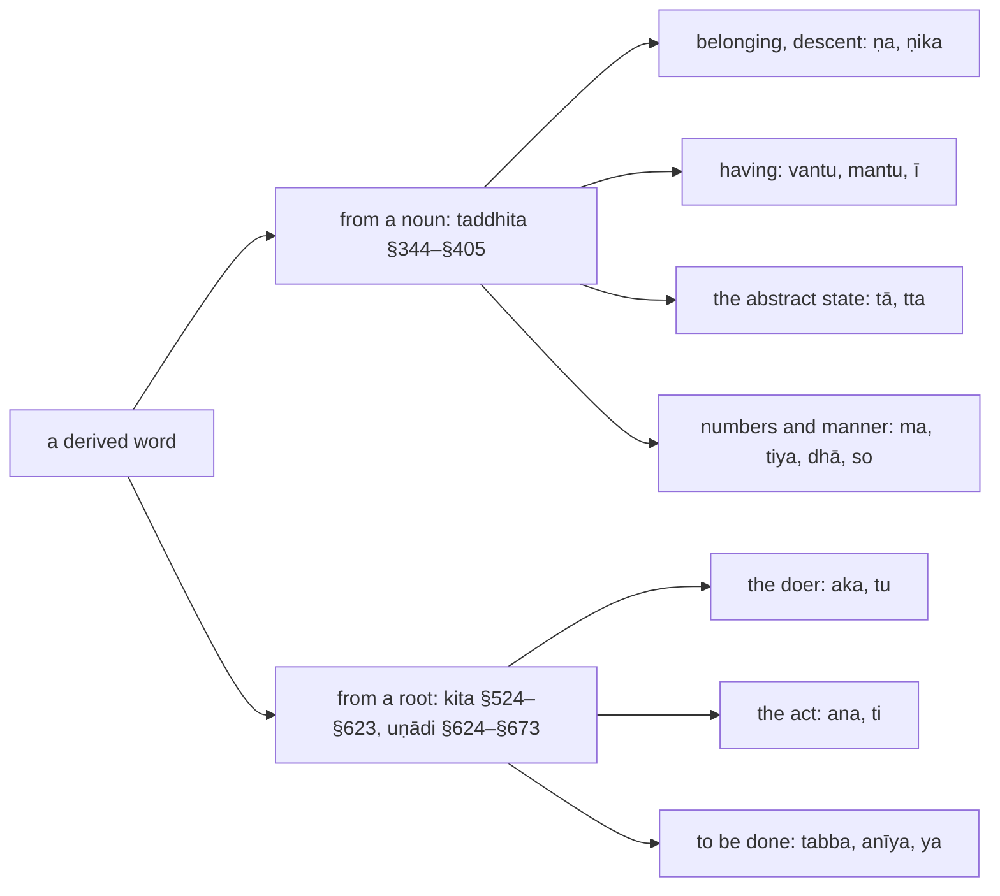

:::tip[Info]
Part of "A Beginner (Non-Linguist) Guide to Learning Pali"
:::

:::note[How this chapter fits]
Chapter 1 introduced the affixes in its sections on `taddhita`, `uṇādi` and `sādhana`; this chapter deepens them, with the senses from my translation of Kaccāyana's Taddhitakappa and Uṇādikappa. Its examples and exercises are words from the texts of chapters 3, 5, 7, 9 and 11. The text that follows it is chapter 11, the core teachings.
:::

Besides the compounds of chapter 6, Pāḷi makes new nouns by adding an affix
(`paccaya`) to a word that already exists. A `taddhita` affix is added to a
noun: `vāsiṭṭho` ("Vasiṭṭha's descendant") is `vasiṭṭha` with `ṇa` added and
its first vowel lengthened {344}. An `uṇādi` affix is added to a root:
`samatho` ("calm") is `√samu` with `tha` {628}. The `kita` affixes, which make
the participles, absolutives and infinitives marked 🔽 in the texts, are the
subject of [8.8](../8-8-verb-like-forms/) and are tabled in
[Appendix J](../j-kita/).

> vasiṭṭhassa apaccaṁ → **vāsiṭṭho**

🚹⨀⑥(vasiṭṭhassa) 🚻⨀①(apaccaṁ) → 🚹⨀①🔽(ṇa)(vāsiṭṭho)  
of Vasiṭṭha / descendant → Vasiṭṭha's descendant  
*The phrase becomes one word: the `vibhatti` ending of `vasiṭṭha` and the word `apacca` drop away, the affix takes their place, and the new word takes its own ending.*

The derived word is marked 🔽 in this book, with the affix as Kaccāyana names
it: 🚹⨀①🔽(ṇa)(vāsiṭṭho), 🚹⨀①🔽(tha)(samatho). Many affixes are written
with a `ṇ` that is not part of the affix: it is a signal that the first vowel of
the base is lengthened, `a` to `ā`, `i` to `e`, `u` to `o` {400}, and the `ṇ`
itself is dropped {396}. The affix `ṇa` therefore adds only `a`; `ṇika` adds
`ika`.

## The affixes you will meet most

Kaccāyana treats some sixty `taddhita` affixes and fifty `uṇādi` affixes. A
handful account for most of the derived words in the texts. The counts are of
the words the Digital Pāḷi Dictionary assigns to each affix and of their
occurrences in the early discourses:

| affix | sense | a word you will meet | words | occurrences | section |
| :-: | --- | --- | --: | --: | :-: |
| `vantu`, `mantu` | having | `bhagavā` ("the Blessed One"), `āyasmā` ("venerable") | 222 | 45,000 | [10.5](../10-5-tadassatthi/) |
| `ka` | a small or ordinary one of its kind, an adjective | `pāpako` ("bad") | 1,300 | 19,000 | [10.3](../10-3-samuha/) |
| `ṇa` | a descendant, belonging to | `vāsiṭṭho`, `māṇavo` ("a young brahmin") | 685 | 64,000 | [10.1](../10-1-apacca/) |
| `ṇika`, `ika` | connected with, living by | `nāviko` ("a sailor"), `santiko` ("near") | 513 | 7,600 | [10.2](../10-2-anekattha/) |
| `tā`, `tta` | the abstract state, "-ness" | `devatā` ("a deity"), `sahabyatā` ("companionship") | 1,108 | 10,200 | [10.4](../10-4-bhava/) |
| `tara`, `tama` | comparison, "more", "most" | `aññataro` ("a certain one"), `katamo` ("which?") | 183 | 17,600 | [10.4](../10-4-bhava/) |
| `tiya`, `ma` | the ordinals | `dutiyo` ("second"), `pañcamo` ("fifth") | 33 | 12,900 | [10.6](../10-6-sankhya/) |
| `dhā`, `so`, `thā`, `thaṁ` | division and manner | `sabbaso` ("in every way"), `yathā` ("as"), `kathaṁ` ("how?") | 82 | 21,200 | [10.6](../10-6-sankhya/) |
| `aka`, `tu` (`uṇādi`) | the doer | `kārako` ("a doer"), `satthā` ("the teacher") | 368 | 16,800 | [10.7](../10-7-sadhana/) |
| `ana`, `ti` (`uṇādi`) | the act | `ṭhānaṁ` ("a place"), `āpatti` ("an offence") | 1,697 | 87,000 | [10.7](../10-7-sadhana/) |

Kaccāyana orders the `taddhita` affixes by the sense they carry, from the
descendant {344} to the ordinals and the adverbs {373}–{399}, and ends with the
changes the affixes bring to the base {400}–{405}. The `uṇādi` rules first say
what the affixes denote, the agent, the action, the purpose, and then list the
affixes that form individual words. The chapter follows that order.
[Appendix H](../h-taddhita/) tables every `taddhita` rule and
[Appendix K](../k-unadi/) every `uṇādi` rule.

| section | sense | affixes | rules |
| :-: | --- | --- | --- |
| [10.1](../10-1-apacca/) | the descendant, and the shape of an affixed word | `ṇa`, `ṇāyana`, `ṇāna`, `ṇeyya`, `ṇi`, `ṇava`, `ṇera`; what the `ṇ` signals | {344}–{349}, {396}, {400}–{405} |
| [10.2](../10-2-anekattha/) | mixed with, crossing by, studying, made by, and the other senses | `ṇika`, `ṇa`, `ima`, `iya` | {350}–{353} |
| [10.3](../10-3-samuha/) | a collection, an occasion, a likeness, a dependence, an abundance | `kaṇ`, `ṇa`, `tā`, `iya`, `āyitatta`, `la`, `ālu` | {354}–{359} |
| [10.4](../10-4-bhava/) | the abstract state, and comparison | `ṇya`, `tta`, `tā`, `ttana`, `ṇa`, `kaṇ`; `tara`, `tama`, `isika`, `iya`, `iṭṭha` | {360}–{363} |
| [10.5](../10-5-tadassatthi/) | "having that", and "made of that" | `vī`, `sī`, `ika`, `ī`, `ra`, `vantu`, `mantu`, `ṇa`; `maya` | {364}–{372} |
| [10.6](../10-6-sankhya/) | the numerals: ordinals, the forms of the numbers, division and manner | `ma`, `tha`, `ṭha`, `tiya`, `ī`, `ka`; `dhā`, `so`, `thā`, `thaṁ` | {373}–{399} |
| [10.7](../10-7-sadhana/) | `uṇādi`: the agent, the action and the purpose | `kita`, `kicca`, `tta`, `yu`, `ṇvu`, `ṇī`, `tuṁ` and the rest | {624}–{626}, {635}–{637}, {639}–{642}, {650}–{655} |
| [10.8](../10-8-unadi-words/) | `uṇādi`: the affixes that form individual words | `tha`, `ma`, `la`, `ya`, `tti`, `īvara`, `ūra`, `ṭha` and the rest | {627}–{634}, {638}, {643}–{649}, {656}–{673} |

:::tip[Reading path]
On a first reading take [10.1](../10-1-apacca/) for the shape of an affixed word,
then [10.5](../10-5-tadassatthi/), [10.4](../10-4-bhava/) and
[10.7](../10-7-sadhana/), the affixes of the table above; the sections on the
rarer senses and on the individual `uṇādi` words are for looking things up,
and every rule number links to the full rule in the Kaccāyana translation.
:::
