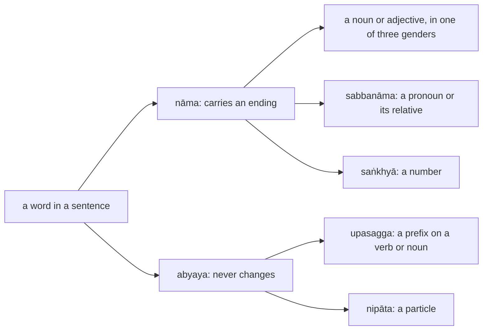
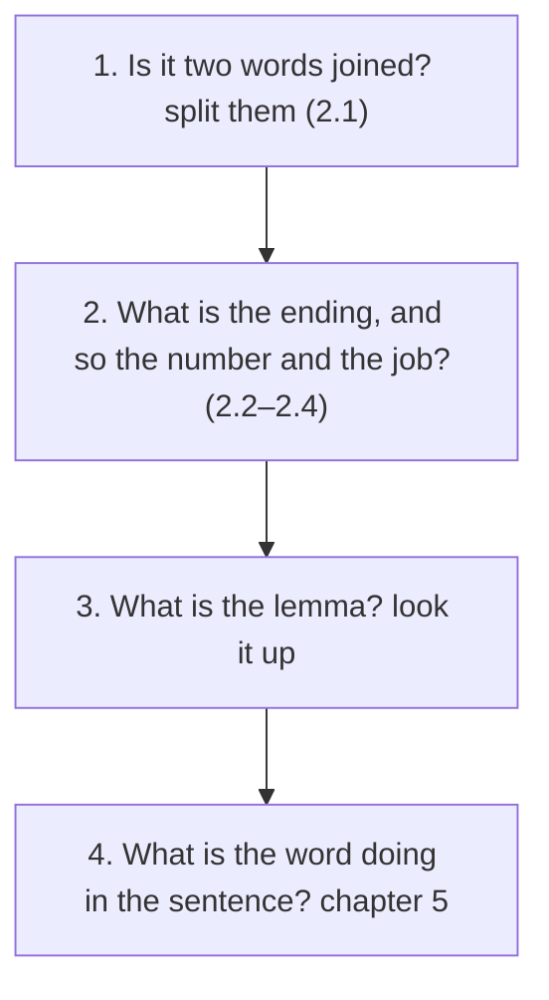

:::tip[Info]
Part of "A Beginner (Non-Linguist) Guide to Learning Pali"
:::

Chapter 1 set out the parts of a Pāḷi sentence. This chapter is about the words
that carry endings, the nouns (`nāma`), and the words that stand beside them
without changing: the pronouns and their relatives (`sabbanāma`), the numbers
(`saṅkhyā`), the prefixes (`upasagga`) and the particles (`nipāta`). It is not
about how Kaccāyana derives each form, which fills two hundred of his rules;
it is about recognising a form when it comes, which is what reading needs.

Reading a Pāḷi word is a fixed sequence of four questions, and the sections of
this chapter follow it:

| section | covers | Kaccāyana | appendix |
| :-: | --- | --- | :-: |
| [2.1](../2-1-sandhi/) | `sandhi`: the joins a reader meets on every line, and how to undo them | {1}–{51} | [E](../e-sandhi/) |
| [2.2](../2-2-nouns/) | gender, number and the eight endings; the inflection tables of `purisa`, `citta` and `kaññā`; adjectives agree | {52}–{125} | [G](../g-vibhatti/) |
| [2.3](../2-3-vowel-lemmas/) | lemmas in `i`, `ī`, `u`, `ū`: `aggi`, `bhikkhu`, `nadī`, `cakkhu` | {126}–{160} | [G](../g-vibhatti/) |
| [2.4](../2-4-irregular/) | the lemmas with their own shapes: `rāja`, `attā`, `satthā`, `bhagavā`, `kamma`, `mano` | {178}–{220} | [G](../g-vibhatti/) |
| [2.5](../2-5-pronouns/) | `sabbanāma`: `so`, `ayaṁ`, `yo`, `ko`, `sabba`, `ahaṁ`, `tvaṁ`, and the adverbs made from them | {161}–{177}, {248}–{270} | [L](../l-sabbanama/) |
| [2.6](../2-6-numbers/) | `saṅkhyā`: one to a hundred thousand, and the ordinals | {131}–{140}, {373}–{399} | [H](../h-taddhita/) |
| [2.7](../2-7-upasagga/) | `upasagga`: the twenty prefixes and what they do to a word | {221}–{222} | [F](../f-upasagga/) |
| [2.8](../2-8-nipata/) | `nipāta`: the particles that join, stress, negate, quote and ask | {221}–{222} | — |

Every section is built the same way: a short explanation, a table of the
shapes to recognise with the rule that makes each, a few worked examples from
the texts of chapters 3, 4 and 7, and one block of exercises on sentences from
those texts. Kaccāyana's own account of each form, the derivation, stays behind
the rule number, which links to it.

:::tip[Reading path]
On a first reading take [2.1](../2-1-sandhi/), [2.2](../2-2-nouns/),
[2.5](../2-5-pronouns/) and [2.8](../2-8-nipata/): splitting words, the common
endings, the pronouns and the particles are what every sentence of chapter 3
needs. The other sections are for looking up a shape when it comes.
:::
