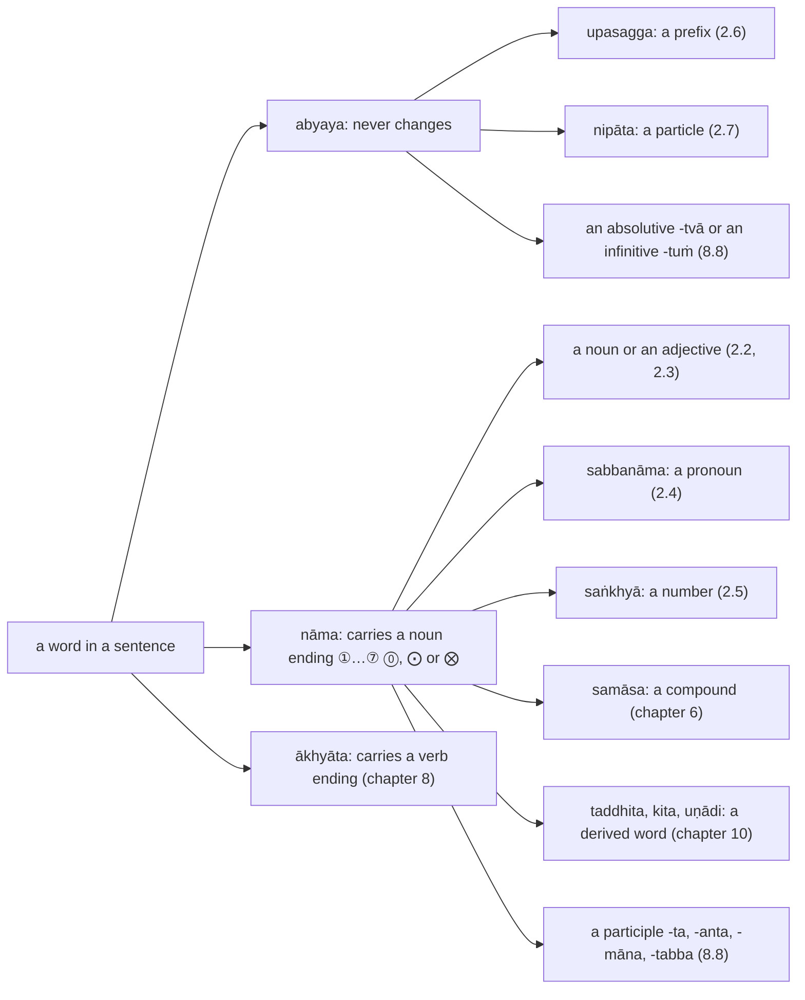
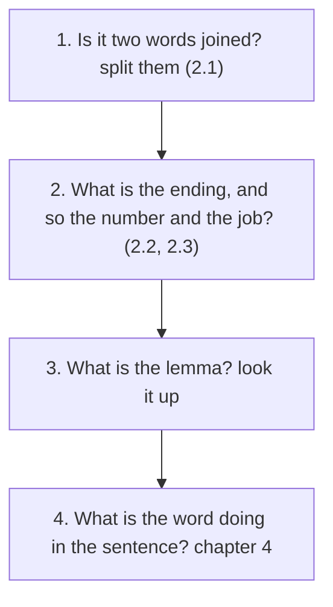

:::tip[Info]
Part of "A Beginner (Non-Linguist) Guide to Learning Pali"
:::

:::note[How this chapter fits]
Chapter 1 introduced nouns, pronouns, numbers, prefixes and particles in a few pages each; this chapter deepens them, with the forms from my translation of Kaccāyana's Nāmakappa and Sandhikappa. Its examples and exercises are sentences from the texts of chapters 3, 5, 7 and 9 and the bonus chapter. The text that follows it is chapter 3, the Buddha's account of his awakening.
:::

Chapter 1 set out the parts of a Pāḷi sentence and, at its end, the master
table of endings. This chapter is about the words that carry noun endings,
the nouns (`nāma`), and the words that stand beside them without changing:
the pronouns and their relatives (`sabbanāma`), the numbers (`saṅkhyā`), the
prefixes (`upasagga`) and the particles (`nipāta`). Verbs are chapter 8's,
compounds chapter 6's and derived words chapter 10's; the chart places them
all. It is not about how Kaccāyana derives each form, which fills two hundred
of his rules; it is about recognising a form when it comes, which is what
reading needs.

Reading a Pāḷi word is a fixed sequence of four questions, and the sections of
this chapter follow it:

| section | covers | Kaccāyana | appendix |
| :-: | --- | --- | :-: |
| [2.1](../2-1-sandhi/) | `sandhi`: the joins a reader meets on every line, and how to undo them | {12}–{51} | [E](../e-sandhi/) |
| [2.2](../2-2-nouns/) | gender, number and the eight endings; the major inflection tables in one view, `purisa`, `aggi`, `bhikkhu`, `kaññā`, `ratti`, `nadī`, `citta`, `aṭṭhi`, `cakkhu`; adjectives agree | {55}–{119}, {215}–{245} | [G](../g-vibhatti/) |
| [2.3](../2-3-irregular/) | the irregular inflections: `rājā`, `attā`, `satthā`, `bhagavā`, `kamma`, `mano` | {126}–{138}, {181}–{214}, {243} | [G](../g-vibhatti/) |
| [2.4](../2-4-pronouns/) | `sabbanāma`: `so`, `ayaṁ`, `yo`, `ko`, `sabba`, `ahaṁ`, `tvaṁ`, and the adverbs made from them | {139}–{151}, {161}–{177}, {247}–{260}, {398}–{399} | [L](../l-sabbanama/) |
| [2.5](../2-5-numbers/) | `saṅkhyā`: one to a hundred thousand, and the ordinals | {67}–{90}, {131}–{134}, {205}, {373}–{394} | [H](../h-taddhita/) |
| [2.6](../2-6-upasagga/) | `upasagga`: the twenty prefixes and what they do to a word | {221}, {12}–{51} | [F](../f-upasagga/) |
| [2.7](../2-7-nipata/) | `nipāta`: the particles that join, stress, negate, quote and ask | {221}, {248}–{259}, {398}–{399} | — |

Every section is built the same way: a short explanation, a table of the
shapes to recognise with the rule that makes each, a few worked examples from
the texts of chapters 3, 5, 7 and 9 and the bonus chapter, and one block of exercises on sentences from
those texts. Kaccāyana's own account of each form, the derivation, stays behind
the rule number, which links to it.

:::tip[Reading path]
On a first reading take [2.1](../2-1-sandhi/), [2.2](../2-2-nouns/),
[2.4](../2-4-pronouns/) and [2.7](../2-7-nipata/): splitting words, the common
endings, the pronouns and the particles are what every sentence of chapter 3
needs. The other sections are for looking up a shape when it comes.
:::
