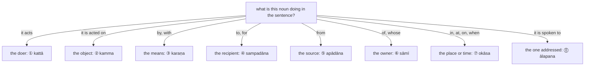

:::tip[Info]
Part of "A Beginner (Non-Linguist) Guide to Learning Pali"
:::

:::note[How this chapter fits]
Chapter 1 gave the typical meanings of the inflection forms; this chapter describes what each inflection form typically signify in terms of the role of the word within the sentence, based on Kaccāyana's Kārakakappa. Its examples and exercises are sentences from the texts of chapters 3, 5, 7 and 9 and the bonus chapter. The text that follows it is chapter 5, the first discourse.
:::

`kāraka` means the "cause" or "participants" of actions, and the relationship (the role of the word in the sentence).
The following are the `kāraka` categories and the inflection forms (`vibhatti`)
that words in each category typically take.

The question to ask of every noun in a sentence is what it is doing there, and the answer
can be derived from the inflection form:

Kaccāyana defines the `kāraka` {271}–{283}, in the order below, and then states which inflection form each takes and the other senses each form carries {284}–{315}. The chapter follows that order, one section for each `kāraka`, and ends with the two uses of the ① inflection form that name no `kāraka`. The tradition counts six `kāraka`: `apādāna`, `sampadāna`, `okāsa`, `karaṇa`, `kamma` and `kattā`, with the `hetu` of {282} a kind of `kattā`; `sāmī` {283} is defined in the same run but is not a `kāraka`, since the owner has no direct connection with the action (Buddhappiya's comment on [Rūpasiddhi 316](https://kaccayana.github.io/rupasiddhi/3-karakakanda#r316)), and the chapter gives it a section of its own all the same.

:::tip[Reading path]
On a first reading take the first use or two of each section, the ones the diagram names,
and their examples; the later uses of each inflection form are rarer, and every rule number links to
the full rule in the Kaccāyana translation. Come back for the rest once the texts of
chapters 3, 5, 7 and 9 and the bonus chapter have made the inflection forms familiar.
:::

| section | `kāraka` | meaning | usual inflection form | definition | uses of the inflection form |
| :-: | --- | --- | :-: | :-: | --- |
| [4.1](../4-1-apadana/) | `apādāna` | the source, "from" | ⑤ | {271}–{275} | {295}–{296} |
| [4.2](../4-2-sampadana/) | `sampadāna` | the recipient, "to", "for" | ④ | {276}–{277} | {293}–{294}, {311} |
| [4.3](../4-3-okasa/) | `okāsa` | the place or time, "in", "at", "on" | ⑦ | {278} | {302}, {310}–{315} |
| [4.4](../4-4-karana/) | `karaṇa` | the means, "by", "with" | ③ | {279} | {286}–{292} |
| [4.5](../4-5-kamma/) | `kamma` | the object | ② | {280} | {297}–{300}, {306}–{307} |
| [4.6](../4-6-katta/) | `kattā`, `hetu` | the agent and the causer | ① (③ in the passive) | {281}–{282} | {284}, {288} |
| [4.7](../4-7-sami/) | `sāmī` | the owner, "of" | ⑥ | {283} | {301}, {303}–{305}, {308}–{309} |
| [4.8](../4-8-lingattha/) | `liṅgattha`, `ālapana` | the bare noun and the calling form | ①, ⓪ | — | {284}–{285} |

