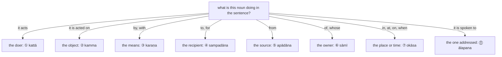

:::tip[Info]
Part of "A Beginner (Non-Linguist) Guide to Learning Pali"
:::

:::note[How this chapter fits]
Chapter 1 gave the typical meanings of the endings in one table; this chapter deepens that table, with the uses from my translation of Kaccāyana's Kārakakappa. Its examples and exercises are sentences from the texts of chapters 3, 5, 7 and 9 and the bonus chapter. The text that follows it is chapter 5, the first discourse.
:::

`kāraka` means the "cause" or "participants" of actions, and the relationship
between various words in a Pali sentence. The following are descriptions of
various `kāraka` categories, and the typical `vibhatti` endings that are
applied to words belonging to those categories.

The question to ask of every noun in a sentence is what it is doing there, and the answer
picks the ending:

Kaccāyana first defines the seven `kāraka` {271}–{283}, in the order below, and then states which `vibhatti` ending each takes and the other senses each ending carries {284}–{315}. The chapter follows that order, one section for each `kāraka`, and ends with the two uses of the ① ending that name no `kāraka`.

:::tip[Reading path]
On a first reading take the first use or two of each section, the ones the diagram names,
and their examples; the later uses of each ending are rarer, and every rule number links to
the full rule in the Kaccāyana translation. Come back for the rest once the texts of
chapters 3 and 5 and the bonus chapter have made the endings familiar.
:::

| section | `kāraka` | English name | usual ending | definition | uses of the ending |
| :-: | --- | --- | :-: | :-: | --- |
| [4.1](../4-1-ablative/) | `apādāna` | ablative, "from" | ⑤ | {271}–{275} | {295}–{296} |
| [4.2](../4-2-dative/) | `sampadāna` | dative, "to", "for" | ④ | {276}–{277} | {293}–{294}, {311} |
| [4.3](../4-3-locative/) | `okāsa` | locative, "in", "at", "on" | ⑦ | {278} | {302}, {310}, {312}–{315} |
| [4.4](../4-4-instrumental/) | `karaṇa` | instrumental, "by", "with" | ③ | {279} | {286}–{292} |
| [4.5](../4-5-accusative/) | `kamma` | accusative, the object | ② | {280} | {297}–{300}, {306}–{307} |
| [4.6](../4-6-agent/) | `kattā`, `hetu` | the agent and the causer | ① (③ in the passive) | {281}–{282} | {284}, {288} |
| [4.7](../4-7-genitive/) | `sāmī` | genitive, "of" | ⑥ | {283} | {301}, {303}–{305}, {308}–{309} |
| [4.8](../4-8-nominative/) | `liṅgattha`, `ālapana` | nominative and vocative | ①, ⓪ | — | {284}–{285} |

