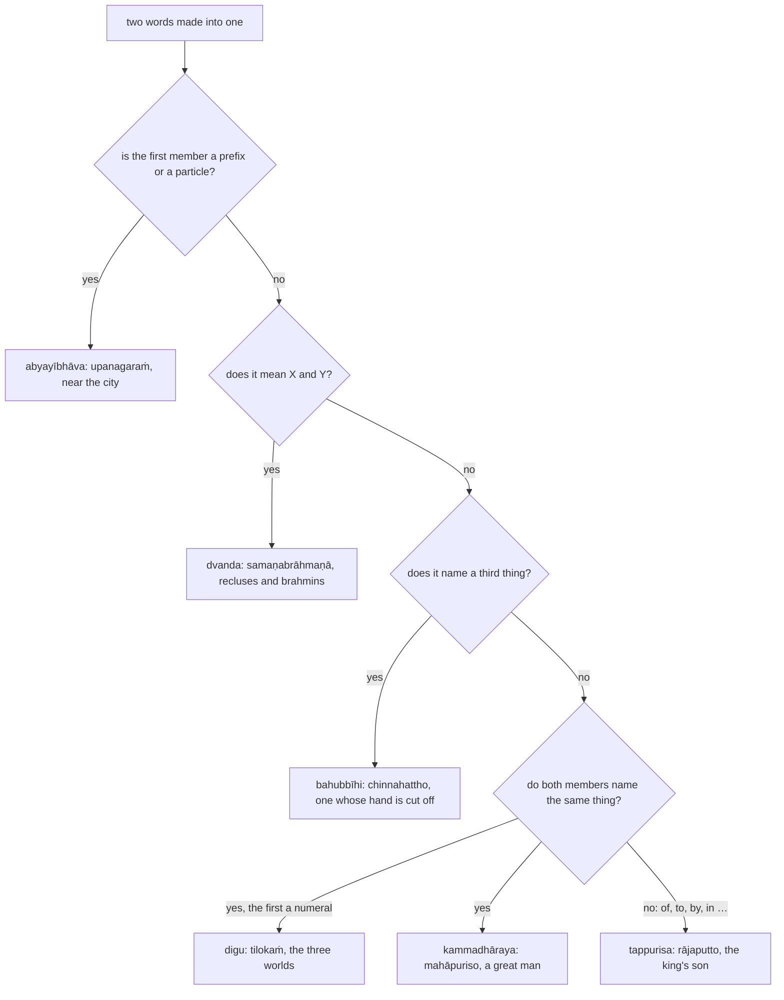

:::tip[Info]
Part of "A Beginner (Non-Linguist) Guide to Learning Pali"
:::

Like German, Pāḷi joins nouns into compound words: `rājaputto` ("the king's
son") is `rañño putto` made into one word. Kaccāyana calls the joining a
`samāsa` ("compound"): nouns whose meanings are connected {316}. When the nouns
are joined, the `vibhatti` endings of the members are elided {317}, a member
whose lemma ends in a vowel returns to its original form {318}, and the whole
compound then takes a `vibhatti` ending of its own like any other noun.

| | rañño + putto (rāja + sa ⑥⨀, putta + si ①⨀) | rule |
| --- | --- | :-: |
| → | rāja + ~~sa~~ + putta + ~~si~~ | {317} |
| → | rāja + putta | {318} |
| → | rājaputta + si (①⨀) | |
| → | rājaputta + ~~si~~(o) | {104} |
| → | **rājaputto** | |

The compound is marked 🆎 in this book, with its members in their lemma form:
🚹⨀①🆎(rāja+putta).

Kaccāyana names six kinds of compound by the relation between the members
{319}–{329}. To tell them apart, ask how the members relate:

Of these the `kammadhāraya` and the `tappurisa` are by far the commonest in the
texts, with the `bahubbīhi` and the `dvanda` next; the `digu` and the
`abyayībhāva` are rare. Kaccāyana then states the changes that some members
undergo at the beginning {330}–{336} and at the end {337}–{343} of a compound.
The chapter opens with the three rules that say what a compound is, follows
that order with one section for each kind, and ends with the changes at the end
of a compound.

:::tip[Reading path]
On a first reading take [7.3](../7-3-kammadharaya/), [7.5](../7-5-tappurisa/),
[7.6](../7-6-bahubbihi/) and [7.7](../7-7-dvanda/), the four kinds the texts are
full of, and the diagram above; the rules on the form of the members and the
rule table below are for looking things up, and every rule number links to the
full rule in the Kaccāyana translation.
:::

| section | compound | English name | members | rules |
| :-: | --- | --- | --- | --- |
| [7.1](../7-1-definition/) | `samāsa` | what a compound is | nouns whose meanings are connected | {316}–{318} |
| [7.2](../7-2-abyayibhava/) | `abyayībhāva` | adverbial | a prefix or particle first | {319}–{320}, {341}–{343} |
| [7.3](../7-3-kammadharaya/) | `kammadhāraya` | appositional | two words with the same referent | {324}, {330}–{336} |
| [7.4](../7-4-digu/) | `digu` | numeral | a numeral first | {325}, {321} |
| [7.5](../7-5-tappurisa/) | `tappurisa` | determinative | a word in the ② to ⑦ ending with the word that follows | {327}, {326} |
| [7.6](../7-6-bahubbihi/) | `bahubbīhi` | attributive | the compound names a third thing | {328} |
| [7.7](../7-7-dvanda/) | `dvanda` | copulative | nouns combined with "and" | {329}, {322}–{323} |
| [7.8](../7-8-samasanta/) | the end of a compound | — | — | {337}–{340} |

## The rules of the Samāsakappa

| rule | sutta | meaning |
| :-: | --- | --- |
| {316} | Nāmānaṁ samāso yuttattho | a `samāsa` is a joining of nouns whose meanings are connected |
| {317} | Tesaṁ vibhattiyo lopā ca | and the inflections of the members are elided |
| {318} | Pakati cassa sarantassa | and a member ending in a vowel returns to its original form |
| {319} | Upasagganipātapubbako abyayībhāvo | an `abyayībhāva` begins with a prefix or a particle |
| {320} | So napuṁsakaliṅgo | it is neuter |
| {321} | Digussekattaṁ | a `digu` is singular and neuter |
| {322} | Tathā dvande pāṇi tūriya yoggasenaṅgakhuddajantuka vividhaviruddha visabhāgatthādīnañca | likewise in a `dvanda` of limbs, instruments, parts of a team or an army, small creatures, opposites and things of different kinds |
| {323} | Vibhāsā rukkha tiṇa pasu dhana dhañña janapadā dīnañca | optionally for trees, grasses, animals, wealth, grain, countries and the like |
| {324} | Dvipade tulyādhikaraṇe kammadhārayo | two words with the same referent make a `kammadhāraya` |
| {325} | Saṅkhyāpubbo digu | a `digu` is a `kammadhāraya` beginning with a numeral |
| {326} | Ubhe tappurisā | both are `tappurisa` |
| {327} | Amādayo parapadebhi | a word in `aṁ` or a later inflection with the word that follows: `tappurisa` |
| {328} | Aññapadatthesu bahubbīhi | nouns compounded in the sense of another word: `bahubbīhi` |
| {329} | Nāmānaṁ samuccayo dvando | a combination of nouns is a `dvanda` |
| {330} | Mahataṁ mahā tulyādhikaraṇe pade | `mahā` for `mahanta` before a word with the same referent |
| {331} | Itthiyaṁ bhāsitapumitthī pumāva ce | a feminine word also spoken as masculine counts as masculine before a feminine word with the same referent |
| {332} | Kammadhārayasaññe ca | and in a compound named `kammadhāraya` |
| {333} | Attaṁ nassa tappurise | `a` for `na` in a `tappurisa` |
| {334} | Sare ana | `ana` before a vowel |
| {335} | Kada kussa | `kada` for `ku` before a vowel |
| {336} | Kā’ppatthesu ca | and `kā` in the sense of "little" |
| {337} | Kvaci samāsantagatānamakāranto | sometimes `a` for the final of a word at the end of a compound |
| {338} | Nadimhā ca | and `ka` after a `nadī` final (feminine `ī`, `ū`) |
| {339} | Jāyāya tudaṁ jāni patimhi | `tudaṁ`, `jāni` for `jāyā` before `pati` |
| {340} | Dhanumhā ca | and `ā` after `dhanu` |
| {341} | Aṁ vibhattīnamakārantā abyayībhāvā | `aṁ` for the inflections after an `abyayībhāva` in `a` |
| {342} | Saro rasso napuṁsake | the final vowel is shortened in the neuter |
| {343} | Aññasmā lopo ca | and elision of the inflections after any other `abyayībhāva` |
