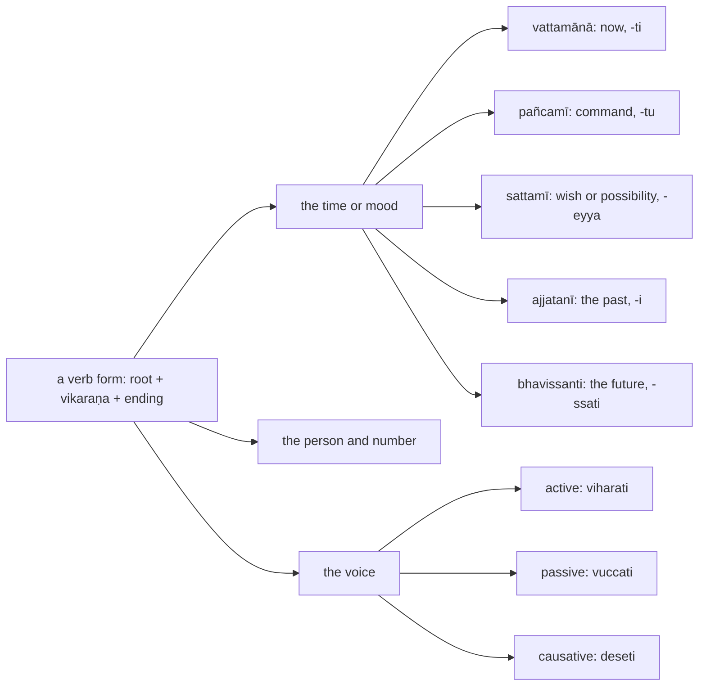
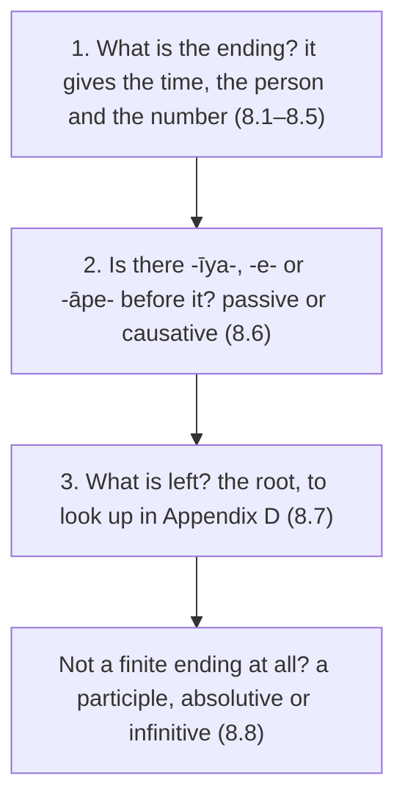

:::tip[Info]
Part of "A Beginner (Non-Linguist) Guide to Learning Pali"
:::

:::note[How this chapter fits]
Chapter 1 introduced the verbs and the verb-like forms in two sections; this chapter deepens them, with the endings and classes from my translation of Kaccāyana's Ākhyātakappa and Kibbidhānakappa. Its examples and exercises are sentences from the texts of chapters 3, 5, 7 and 9 and the bonus chapter. The text that follows it is chapter 9, the Fire Sermon.
:::

A verb (`ākhyāta`) is a root (`dhātu`) with an ending that says who acts, how
many, when, and whether the subject acts or is acted on. Kaccāyana spends a
hundred and twenty rules on how the endings are added; a reader needs only to
tell them apart, and this chapter is the table of what each ending looks like,
with the sentences of chapters 3 and 5 and the bonus chapter as its examples. Most of what does the
work of a verb in a Pāḷi sentence is not a finite verb at all but a verb-like
noun, a participle, an absolutive or an infinitive, so those end the chapter.

Reading a verb is three questions, asked of the end of the word first:

| section | covers | Kaccāyana | appendix |
| :-: | --- | --- | :-: |
| [8.1](../8-1-reading-a-verb/) | what a verb form tells you: the eight sets of endings and their times, person and number, the symbols the book uses | {406}–{431} | [I](../i-verbs/) |
| [8.2](../8-2-present/) | the present (`vattamānā`): `-ti`, `-nti`, `-si`, `-mi`, and the eight classes that put `a`, `ya`, `ṇā`, `o` or `e` before the ending | {414}, {423}, {445}–{453} | [I](../i-verbs/), [D](../d-roots/) |
| [8.3](../8-3-commands/) | commands and wishes: `pañcamī` (`ehi`, `caratha`, `desetu`) and `sattamī` (`labheyyaṁ`, `pabbajeyyaṁ`, `kareyya`) | {415}–{416}, {424}–{425} | [I](../i-verbs/) |
| [8.4](../8-4-past/) | the past: `ajjatanī` (`udapādi`, `nisīdi`, `āmantesi`, `ahosi`, `avoca`, `paccaññāsiṁ`), the `a-` put before the root, and the rarer `hiyyattanī` and `parokkhā` (`āha`) | {417}–{419}, {428}–{430}, {519} | [I](../i-verbs/) |
| [8.5](../8-5-future/) | the future (`bhavissanti`: `viharissatha`, `bhavissati`) and the conditional (`kālātipatti`: `abhavissa`) | {421}–{422}, {431} | [I](../i-verbs/) |
| [8.6](../8-6-voice/) | passive and causative: `-īya-`/`-iyya-` (`vuccati`, `paññāyati`), `-e-`/`-aya-`/`-āpe-` (`deseti`, `kāreti`, `pabbājeti`) | {438}–{444} | [I](../i-verbs/) |
| [8.7](../8-7-common-verbs/) | the verbs met on every page: `atthi` and `hoti` (to be), `karoti`, `gacchati`, `dadāti`, `jānāti`, `vadati`, `passati`, with their irregular forms | {454}–{523} selected | [D](../d-roots/) |
| [8.8](../8-8-verb-like-forms/) | the verb-like forms: participles (`gato`, `vutto`, `viharanto`, `bhaññamāno`, `kātabbo`), absolutives (`sutvā`, `viditvā`, `anupagamma`), infinitives (`kātuṁ`), and the "when X had happened" construction | {524}–{623} selected | [J](../j-kita/) |

Every section is built as the other chapters are: a short explanation, a table
of the endings or shapes to recognise with the rule that makes each, worked
examples from the texts, and one block of exercises on their sentences. The
derivation of a form, the root's own changes and the rules for each of the
seven classes, stays behind the linked rule number and in Appendix I.

:::tip[Reading path]
On a first reading take [8.1](../8-1-reading-a-verb/), [8.4](../8-4-past/)
and [8.8](../8-8-verb-like-forms/): the past tense and the participles are
what the texts are made of, and the present, the commands and the future
follow from 8.1's table. The classes in 8.2, the voices in 8.6 and the
irregular verbs in 8.7 are for looking up a form when it comes.
:::
