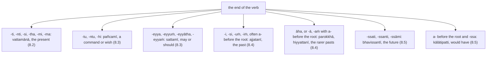

:::tip[Info]
Part of "A Beginner (Non-Linguist) Guide to Learning Pali"
:::

Every sentence of the texts turns on a verb (`ākhyāta`, "what is declared"),
the word that changes shape most: `viharati` ("dwells"), `udapādi` ("arose"),
`bhavissati` ("there will be"), `vadeyyātha` ("would you say"). Each is three
pieces in a row. `labhati` ("gets") is the root (`dhātu`) `labh`, which
carries the meaning {457}; the piece (`vikaraṇa`) `a` that its class puts
after the root {445}; and the ending (`vibhatti`) `-ti` {423}, always last
{455}. The root is what you look up ([Appendix D](../d-roots/) lists them,
[8.2](../8-2-present/) the pieces); the ending carries everything else.

The ending answers three questions at once: when, or in what mood; who; and
how many. Kaccāyana sorts the endings into eight sets of twelve, one for each
time or mood {414}–{422}, and names them; the dictionary and this book use
the names. So ask of every verb: what is its ending, and which set is it in?
This section is the table that answers; the sections after it take the sets
one at a time.

The book marks a verb with four symbols and the lemma to look up:
`🟢⨀🤟▶️(viharati)` is active, singular, third person, present, lemma
`viharati`; the bonus chapter's lines, made earlier, order them time, person,
number: `⏮👆⨀(paṭilabhi)`.

### The three persons

Kaccāyana's names for the persons are the reverse of the English ones: its
"first person" (`paṭhamapurisa`) is the English third, "he, she, it, they";
its "middle person" (`majjhimapurisa`) the second, "you"; its "highest
person" (`uttamapurisa`) the first, "I, we" {408}. This book keeps the
symbols and, from here on, the English names.

| person | Kaccāyana's name | symbol | the subject is | in the texts | rule |
| --- | --- | :-: | --- | --- | :-: |
| third | `paṭhamapurisa` | 🤟 | a noun, or nothing said | `bhagavā … viharati` | {410} |
| second | `majjhimapurisa` | 🤘 | `tvaṁ`, `tumhe` ("you"), said or not | `tumhe … vadeyyātha` | {411} |
| first | `uttamapurisa` | 👆 | `ahaṁ`, `mayaṁ` ("I", "we"), said or not | `ahaṁ … paccaññāsiṁ` | {412} |

Each person has a singular ⨀ and a plural ⨂ ending, so a set's twelve run in
pairs, singular then plural, third person first {408}. When subjects of
different persons share a verb, it follows the later person in this table,
"you" over "he", "I" over "you" {409}.

### The eight sets

The first six endings of every set are `parassapada` ("the word for
another", 🟢) {406}, used in the active {456}, and the texts use these
almost always; the last six are `attanopada` ("the word for oneself") {407},
met below.

| symbol | set | the ending says | rule | in the texts |
| :-: | --- | --- | :-: | --- |
| ▶️ | `vattamānā` ("going on") | the present (`paccuppanna`): what is happening now | {414} | `viharati` |
| ⏹ | `pañcamī` ("the fifth") | a command (`āṇatti`) or a wish (`āsīsa`), no time stated | {415} | `uppajjatu` |
| ⏯ | `sattamī` ("the seventh") | permission (`anumati`) or supposition (`parikappa`): may, should, would | {416} | `vadeyyātha` |
| 🔄 | `parokkhā` ("beyond the eye") | a past the speaker did not witness (`apaccakkha`): "they say" | {417} | `āha` (in `evamāha`) |
| ↩️ | `hiyyattanī` ("of yesterday") | the past from yesterday back, witnessed or not | {418} | `ajjhagamaṁ` |
| ⏮ | `ajjatanī` ("of today") | the near past (`samīpa`), from today back: the texts' usual past | {419} | `udapādi` |
| ⏭ | `bhavissantī` ("will be") | the future (`anāgata`) | {421} | `bhavissati` |
| 🔀 | `kālātipatti` ("the time has passed") | a past that did not happen (`kriyātipanna`): "would have" | {422} | `abhavissa` |

`pañcamī` and `sattamī` are labels, shared with the ⑤ and ⑦ noun endings;
the other names describe their time. The `hiyyattanī` occurs once in the
texts (`ajjhagamaṁ`, "I achieved", [Bonus: 46, 18.1](../11-pbt/#s46-u18-1)) and the
`parokkhā` once (`āha` inside `evamāha`, [Bonus: 1, 24.8](../11-pbt/#s1-u24-8)); the `ajjatanī` is on
every page. Three more rules shape what you see: `vattamānā`, `pañcamī`,
`sattamī` and `hiyyattanī` are grouped as `sabbadhātuka` {431}, and the other
four put an `i` before the ending, the `i` of `bhav-i-ssati` {516}; the three
past sets put an `a` before the root, the `a` of `ud-a-pādi` and
`a-bhavissa` {519}; and after `mā` ("do not") a past ending is a prohibition
in any time, not a past {420}.

### The endings: the master key

These are the `parassapada` endings of the eight sets as Kaccāyana lists
them; the other sections of the chapter refer back to this table.

| set | 🤟⨀ | 🤟⨂ | 🤘⨀ | 🤘⨂ | 👆⨀ | 👆⨂ | rule |
| --- | :-: | :-: | :-: | :-: | :-: | :-: | :-: |
| ▶️ `vattamānā` | `ti` | `anti` | `si` | `tha` | `mi` | `ma` | {423} |
| ⏹ `pañcamī` | `tu` | `antu` | `hi` | `tha` | `mi` | `ma` | {424} |
| ⏯ `sattamī` | `eyya` | `eyyuṁ` | `eyyāsi` | `eyyātha` | `eyyāmi` | `eyyāma` | {425} |
| 🔄 `parokkhā` | `a` | `u` | `e` | `ttha` | `aṁ` | `mha` | {426} |
| ↩️ `hiyyattanī` | `ā` | `ū` | `o` | `ttha` | `aṁ` | `mhā` | {427} |
| ⏮ `ajjatanī` | `ī` | `uṁ` | `o` | `ttha` | `iṁ` | `mhā` | {428} |
| ⏭ `bhavissantī` | `ssati` | `ssanti` | `ssasi` | `ssatha` | `ssāmi` | `ssāma` | {429} |
| 🔀 `kālātipatti` | `ssā` | `ssaṁsu` | `sse` | `ssatha` | `ssaṁ` | `ssāmhā` | {430} |

The texts differ from this in four small ways. `anti` and `antu` appear as
`-nti`, `-ntu` after the piece `a` (`pātubhavanti`); the `ī` of the
`ajjatanī` is usually short (`udapādi`, `nisīdi` {517}), and many verbs put
an `s` before it (`āmantesi`, `ahosi`); its plural `uṁ` (`abhinanduṁ`) is
also `-iṁsu` {504}; and the `a` before the root is not seen when the verb
begins with the prefix `ā` (`āmantesi`). [8.4](../8-4-past/) takes these
shapes one by one; chapter 1's
[verb terminations](../1-basics/#verb-terminations-423-430) show every
ending on one verb, `gacchati`, and [Appendix I](../i-verbs/) the rules
{406}–{523}.

### The `attanopada` endings

The six `attanopada` endings of each set {407} belong to the passive and the
impersonal {453}, sometimes to the active {454}; but the passive of the texts
mostly takes the `parassapada` endings instead {518}, as `nirujjhanti`
("cease", 🔴) in chapter [3](../3-awakening/) does, so these endings are rare. The texts show
three, all `sattamī`, marked 🔵: `-eyyaṁ` in `pabbajeyyaṁ` ("I would go
forth", 🔵⏯👆⨀) `-etha` in `paññāyetha` ("it would be evident", 🔵⏯🤟⨀) and in `labbhetha` ("could be obtained", [7: 2.2](../7-anatta/#u2-2)).

| set | the six `attanopada` endings: third, second, first person, each singular then plural | rule |
| --- | --- | :-: |
| ▶️ `vattamānā` | `te ante, se vhe, e mhe` | {423} |
| ⏹ `pañcamī` | `taṁ antaṁ, ssu vho, e āmase` | {424} |
| ⏯ `sattamī` | `etha eraṁ, etho eyyāvho, eyyaṁ eyyāmhe` | {425} |
| 🔄 `parokkhā` | `ttha re, ttho vho, iṁ mhe` | {426} |
| ↩️ `hiyyattanī` | `ttha tthuṁ, se vhaṁ, iṁ mhase` | {427} |
| ⏮ `ajjatanī` | `ā ū, se vhaṁ, aṁ mhe` | {428} |
| ⏭ `bhavissantī` | `ssate ssante, ssase ssavhe, ssaṁ ssāmhe` | {429} |
| 🔀 `kālātipatti` | `ssatha ssisu, ssase ssavhe, ssiṁ ssāmhase` | {430} |

:::note[How to tell the lookalike endings apart]
`-tha` is "you (plural)" in the present and in a command, `-ttha` in the past;
`-mi` and `-ma` are "I" and "we" in the present and in a wish alike
([Bonus: 18, 1.20](../11-pbt/#s18-u1-20) marks `jānāmi passāmi`, "may I know and see", ⏹); and `-ssa-` is the future
when the word ends `-ssati`, `-ssanti`, `-ssāmi`, but "would have" when an
`a` stands before the root and the word ends in `-ssa` (`bhavissati`,
`abhavissa`). Where the ending alone does not decide, the sentence does: a
wish is quoted with `ti`, a prohibition has `mā`.
:::

### Examples

> Ekaṁ samayaṁ bhagavā bārāṇasiyaṁ **viharati** isipatane migadāye.

*️⃣🤟🚹⨀②(eka) 🚹⨀②(samaya) 🚹⨀①(bhagavant) 🚺⨀⑦(bārāṇasī) 🟢⨀🤟▶️(viharati) 🚻⨀⑦(isipatana) 🚹⨀⑦(migadāya)  
one / time / the Bhagavā / at Bārāṇasī / dwells / at Isipatana / in the Deer Park  
*"At one time the Bhagavā was dwelling at Bārāṇasī, at Isipatana in the Deer Park." ([5: 1.1](../5-dhammacakka/#u1-1)) `viharati`: `-ti`, `vattamānā` ▶️, third person singular {423}; before it the `a` of the `bhū` class {445}, `vi-har-a-ti`; the texts' present often reads as an English past.*

> evaṁ me rūpaṁ **hotu**

⏏️(evaṁ) *️⃣👆⚧⨀⑥(ahaṁ) 🚻⨀①(rūpa) 🟢⨀🤟⏹(hoti)  
thus / my / form / let be  
*"May my `rūpa` be thus" ([7: 2.3](../7-anatta/#u2-3)) `hotu`: `-tu`, `pañcamī` ⏹, third person singular {424}; a wish {415}.*

> “Api nu tumhe, bhikkhave, evaṁ jānantā evaṁ passantā evaṁ **vadeyyātha**—

🔼(apinu) *️⃣🤘⚧⨂①(tvaṁ) 🚹⨂⓪(bhikkhu) 🔼(evaṁ) 🚹⨂①(jānanta) 🔼(evaṁ) 🚹⨂①(passanta) ⏯🤘⨂(vadati)  
are? / youse / bhikkhave / thus / knowing / thus / seeing / will say  
*"Thus knowing and thus seeing, bhikkhave, will you say -" ([Bonus: 1, 24.4](../11-pbt/#s1-u24-4)) `vadeyyātha`: `-eyyātha`, `sattamī` ⏯, second person plural {425}, the subject `tumhe` {411}; "would you say", a supposition {416}.*

> Atha kho bhagavā bodhirukkhamūle sattāhaṁ ekapallaṅkena **nisīdi** vimuttisukhapaṭisaṁvedī.

⏏️(atha) ⏏️(kho) 🚹⨀①(bhagavant) 🚻⨀⑦🆎(bodhirukkha+mūla) 🚻⨀②🆎(satta+aha) 🚹⨀③🆎(eka+pallaṅka) 🟢⨀🤟⏮(nisīdati) 🚹⨀①🆎(vimuttisukha+paṭisaṁvedī)  
then / indeed / the Bhagavā / at the root of the bodhi tree / for seven days / in one cross-legged posture / sat down / experiencing the bliss of liberation  
*"Then the Bhagavā sat at the root of the Bodhi tree for seven days in one cross-legged posture, experiencing the bliss of liberation (`vimuttisukhapaṭisaṁvedī`)." ([3: 2.2](../3-awakening/#u2-2)) `nisīdi`: `-i`, `ajjatanī` ⏮, third person singular {428}, the ending `ī` written short {517}; the subject `bhagavā`.*

> Āraddhaṁ kho pana me vīriyaṁ **bhavissati** asallīnaṁ,

🚻⨀①(āraddha) 🔼(kho pana) *️⃣👆⚧⨀③(ahaṁ) 🚻⨀①(vīriya) ⏭🤟⨀(bhavati) 🚻⨀①(asallīna)  
applied / and now / with me / determination / will become / active  
*"And now applied with me there will be active determination" ([Bonus: 45, 9.7](../11-pbt/#s45-u9-7)) `bhavissati`: `-ssati`, `bhavissantī` ⏭, third person singular {429}; the `i` before `ssa` is the insertion every future takes {516}, `bhav-i-ssati`.*

> Rūpañca hidaṁ, bhikkhave, attā **abhavissa**,

🚻⨀①(rūpa) ⏏️(ca) ⏏️(hi) *️⃣🤟🚻⨀①(ima) 🚹⨂⓪(bhikkhu) 🚹⨀①(atta) 🟢⨀🤟🔀(bhavati)  
form / and / indeed / this / bhikkhave / self / would be  
*"And indeed here, bhikkhave, if `rūpa` were `attā` (self)," ([7: 2.2](../7-anatta/#u2-2)) `abhavissa`: the `a` put before the root {519} and the ending `-ssā` {430}, here short {517}; `kālātipatti` 🔀, third person singular, "if it were".*

### Exercises

Each of the following is a verb from the texts of chapters [3](../3-awakening/),
[5](../5-dhammacakka/), [7](../7-anatta/), [9](../9-fire/) and the [bonus chapter](../11-pbt/), in
the form it has there. Name its set, its ending, its person and its number,
and say what the sentence means. Look the word up in a dictionary and check
the ending against the tables above.

:::tip[Hint]
You may find the [Digital Pali Dictionary](https://digitalpalidictionary.github.io/)
useful for looking up words, as well as doing the sandhi and compound word
deconstruction.
:::

1. pātubhavanti
2. vadāmi
3. āmantesi
4. abhinanduṁ
5. uddiseyyātha
6. hontu
7. hoti

### Answers

*Note: please do the exercises first before checking the answers.*

1. > Yadā have **pātubhavanti** dhammā,

⏏️(yadā) ⏏️(have) 🟢⨂🤟▶️(pātubhavati) 🚹⨂①(dhamma)  
when / indeed / appear / phenomena  
*"When indeed phenomena become manifest" ([3: 6.1](../3-awakening/#u6-1)) `pātubhavanti`: `-nti`, Kaccāyana's `anti`, `vattamānā` ▶️, third person plural {423}.*

2. > jātiyā jarāya maraṇena sokehi paridevehi dukkhehi domanassehi upāyāsehi ādittan’ti **vadāmi**.

🚺⨀③(jāti) 🚺⨀③(jarā) 🚻⨀③(maraṇa) 🚹⨂③(soka) 🚹⨂③(parideva) 🚻⨂③(dukkha) 🚻⨂③(domanassa) 🚹⨂③(upāyāsa) 🚻⨀①🔽(ta)(āditta) ⏏️(iti) 🟢⨀👆▶️(vadati)  
with birth / with aging / with death / with sorrows / with lamentations / with pains / with griefs / with despairs / burning / (end quote) / I say  
*"burning with birth, aging, death, with sorrows, lamentations, pains, griefs, and despairs, I say." ([9: 2.6](../9-fire/#u2-6)) `vadāmi`: `-mi`, `vattamānā` ▶️, first person singular {423}, the `a` before it lengthened {478}; the subject `ahaṁ` is not said {412}.*

3. > Tatra kho bhagavā pañcavaggiye bhikkhū **āmantesi**—

⏏️(tatra) ⏏️(kho) 🚹⨀①(bhagavant) 🚹⨂②🆎(pañca+vaggiya) 🚹⨂②(bhikkhu) 🟢⨀🤟⏮(āmanteti)  
there / indeed / the Bhagavā / of the group of five / bhikkhū / addressed  
*"There the Bhagavā addressed the group of five bhikkhū:" ([5: 1.2](../5-dhammacakka/#u1-2)) `āmantesi`: `-si`, the `s` + `-i` of the `ajjatanī` ⏮ on the verbs in `e` ([8.4](../8-4-past/)), third person singular {428}, the subject `bhagavā`; the `a` before the root is hidden by the prefix `ā`.*

4. > Attamanā te bhikkhū bhagavato bhāsitaṁ **abhinanduṁ**.

🚹⨂①🆎(atta+mana) *️⃣🤟🚹⨂①(ta) 🚹⨂①(bhikkhu) 🚹⨀⑥(bhagavant) 🚻⨀②🔽(ta)(bhāsita) 🟢⨂🤟⏮(abhinandati)  
delighted / those / bhikkhū / of the Bhagavā / what was spoken / rejoiced in  
*"Those bhikkhū, delighted, rejoiced in the Bhagavā’s words." ([9: 10.2](../9-fire/#u10-2)) `abhinanduṁ`: `-uṁ`, `ajjatanī` ⏮, third person plural {428}; the subject `bhikkhū`.*

5. > Api nu tumhe, bhikkhave, evaṁ jānantā evaṁ passantā aññaṁ satthāraṁ **uddiseyyāthā**”ti?

🔼(apinu) *️⃣🤘⚧⨂①(tvaṁ) 🚹⨂⓪(bhikkhu) 🔼(evaṁ) 🚹⨂①(jānanta) 🔼(evaṁ) 🚹⨂①(passanta) 🚹⨀②(añña) 🚹⨀②(satthar) ⏯🤘⨂(uddisati)  
are? / youse / bhikkhave / thus / knowing / thus / seeing / another / teacher / appoint  
*"Thus knowing and thus seeing, bhikkhave, will you appoint another teacher?" ([Bonus: 1, 24.10](../11-pbt/#s1-u24-10)) `uddiseyyātha`: `-eyyātha`, `sattamī` ⏯, second person plural {425}, "would you appoint"; the `-ā` before `”ti` is the join.*

6. > evaṁ me saṅkhārā **hontu**

⏏️(evaṁ) *️⃣👆⚧⨀⑥(ahaṁ) 🚹⨂①(saṅkhāra) 🟢⨂🤟⏹(hoti)  
thus / my / mental constructions / let be  
*"May my `saṅkhārā` be thus" ([7: 4.6](../7-anatta/#u4-6)) `hontu`: `-ntu`, Kaccāyana's `antu`, `pañcamī` ⏹, third person plural {424}; a wish {415}.*

7. > Evametassa kevalassa dukkhakkhandhassa samudayo **hoti**.

⏏️(evaṁ) *️⃣🤟🚹⨀⑥(eta) 🚹⨀⑥(kevala) 🚹⨀⑥🆎(dukkha+khandha) 🚹⨀①(samudaya) 🟢⨀🤟▶️(hoti)  
thus / of this / of the entire / of the mass of suffering / origin / is  
*"Thus is the origin of this whole mass of suffering." ([3: 3.12](../3-awakening/#u3-12)) `hoti`: `-ti`, `vattamānā` ▶️, third person singular {423}; the root `hū`, whose forms [8.7](../8-7-common-verbs/) tables.*
