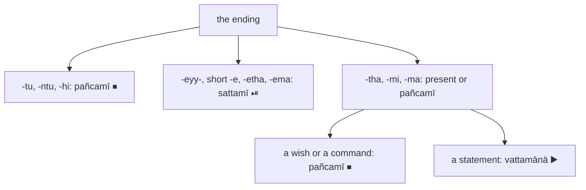

:::tip[Info]
Part of "A Beginner (Non-Linguist) Guide to Learning Pali"
:::

Two of the eight sets of endings in [8.1](../8-1-reading-a-verb/) state no
time; they state what the speaker wants. The `pañcamī` (the fifth set, ⏹) is
for a command (`āṇatti`) and a blessing (`āsīsa`) {415}: `karotu kusalaṁ`
("let him do good"), `sukhaṁ te hotu` ("may there be happiness for you"). The
`sattamī` (the seventh set, ⏯) is for permission (`anumati`) and supposition
(`parikappa`) {416}: `tvaṁ gaccheyyāsi` ("you may go"), `kimahaṁ kareyyāmi`
("what should I do?"); in the texts it is also a wish for oneself
(`pabbajeyyaṁ`, "I would go forth") and the verb of an "if" (`okanteyyuṁ`,
"if they were to cut off").

Ask 7.1's question, who and how many, and then: a command or blessing, or a
may, should or would? The ending answers: `-tu`, `-ntu`, `-hi` and `-eyy-`
are unmistakable, while `-tha`, `-mi` and `-ma` are the present's too, and
only the sense decides. Kaccāyana lists each set's twelve endings in {424} and
{425}, the active `parassapada` (🟢) six, then the `attanopada` (🔵) six.
`pañcamī` and `sattamī` are also the names of the ⑤ and ⑦ noun endings; the
symbols ⏹ and ⏯ keep the verb sets apart.

### The `pañcamī` ⏹: commands and blessings {415}

| what you see | person | number | example | rule |
| --- | --- | :-: | --- | :-: |
| `-tu` | third | ⨀ | `karotu`, `hotu`, `desetu` ("let him teach"), `uppajjatu` | {424} |
| `-ntu` | third | ⨂ | `kamantu` ("let them come") | {424} |
| `-hi`, the `a` before it long {478}; `hi` sometimes dropped {479} | second | ⨀ | `gacchāhi`, `gaccha` ("go!"), `ehi` ("come!") | {424} |
| `-tha` | second | ⨂ | `etha` ("come, all of you!") | {424} |
| `-mi`, the `a` before it long {478} | first | ⨀ | `vediyāmi` ("may I feel") | {424} |
| `-ma`, the `a` before it long {478} | first | ⨂ | `gacchāma` ("let us go") | {424} |
| `-taṁ`, `-antaṁ`, `-ssu`, `-vho`, `-e`, `-āmase` | the `attanopada` 🔵 set | | none in our texts | {424} |

### The `sattamī` ⏯: may, should, would {416}

| what you see | person | number | example | rule |
| --- | --- | :-: | --- | :-: |
| `-eyya` | third | ⨀ | `kareyya` ("he would do"), `padūseyya` | {425} |
| `-eyyuṁ` | third | ⨂ | `okanteyyuṁ` | {425} |
| `-eyyāsi` | second | ⨀ | `gaccheyyāsi` | {425} |
| `-eyyātha` | second | ⨂ | `vadeyyātha` ("would you say"), `uddiseyyātha` | {425} |
| `-eyyāmi` | first | ⨀ | `kareyyāmi` | {425} |
| `-eyyāma` | first | ⨂ | none in our texts; they have the short `vadema` below | {425} |
| `-eyyaṁ`, the 🔵 ending, common for a wish | first | ⨀ | `pabbajeyyaṁ`, `upapajjeyyaṁ` | {425} |
| `-etha`, the 🔵 ending | third | ⨀ | `paññāyetha` ("it would be evident") | {425} |
| `-eraṁ`, `-etho`, `-eyyāvho`, `-eyyāmhe` | the rest of the 🔵 set | | none in our texts | {425} |

The `sattamī` is often shortened; {517} allows the short shapes, which are the
ones a reader meets most:

| what you see | stands for | example | rule |
| --- | --- | --- | :-: |
| `-e` | `-eyya`, third person ⨀ | `kare` ("he would do"), `gacche` ("he would go") | {517} |
| `-etha` | `-eyyātha`, second person ⨂ | `vadetha` ("would you say") | {517} |
| `-ema` | `-eyyāma`, first person ⨂ | `vadema` ("would we say") | {517} |
| `siyā` | `-eyya` of `atthi` ("is"): "there would be" | `siyā` | {506}, {517} |
| `jaññā`, `jāniyā` | `-eyya` of `jānāti` ("knows"): "he would know" | `jaññā` | {508} |

:::note[How to tell a command from a wish, and both from the present]
`-tu`, `-ntu` and `-hi` are always ⏹; `-eyy-` is always ⏯. `-tha`, `-mi` and
`-ma` are the present's endings too: `‘sukhaṁ vediyāmī’ti` is a wish, "may I
feel happiness", so ⏹, while `sukhaṁ vediyati` in the next sentence is a
statement, ▶️. The short `-e` (`kare`) looks like a ⑦ noun ending; a root in
front of it, not a noun, tells. `-etha` is the 🔵 third person ⨀
(`paññāyetha`) or the short 🟢 second person ⨂ (`vadetha`); the subject
decides. A prohibition is `mā` with a past ending, `mā gamā` ("do not go")
{420}, in chapter 1's note on `mā` and in [8.4](../8-4-past/). `siyā` and
`assa` are both "would be", the `sattamī` of `atthi`
([8.7](../8-7-common-verbs/)).
:::

All twelve endings of each set are in [Appendix I](../i-verbs/) and chapter
1's [verb terminations](../1-basics/#verb-terminations-423-430).

### Examples

All from chapter [11](../11-pbt/); the numbers name its selection and sentence.

> ‘kāyo me **passambhatū**’ti.

🚹⨀①(kāya) *️⃣👆⚧⨀⑥(ahaṁ) ⏹🤟⨀(passambhati) 🔼(ti)  
physical body / of me / must calm down / quote  
*"May my body calm down." (18, 1.11) `passambhatu`: ⏹ `-tu`, third person ⨀ {424}; a wish {415}. The `-tū` before `’ti` is `-tu` lengthened at the join ([Appendix E](../e-sandhi/)).*

> ‘yathābhūtaṁ **jānāmi passāmī**’ti.

🚹⨀②(yathābhūta) ⏹👆⨀(jānāti) ⏹👆⨀(passati) 🔼(ti)  
reality as it is / must know / must see  
*"May I see and know reality as it is." (18, 1.20) `jānāmi`, `passāmi`: `-mi`, first person ⨀, the present's ending and the `pañcamī`'s alike {424}; a wish, so ⏹ {415}; `jānāti passati` in the next sentence is a statement, ▶️.*

> “Api nu tumhe, bhikkhave, evaṁ jānantā evaṁ passantā evaṁ **vadeyyātha**—

🔼(apinu) *️⃣🤘⚧⨂①(tvaṁ) 🚹⨂⓪(bhikkhu) 🔼(evaṁ) 🚹⨂①(jānanta) 🔼(evaṁ) 🚹⨂①(passanta) ⏯🤘⨂(vadati)  
are? / youse / bhikkhave / thus / knowing / thus / seeing / will say  
*"Thus knowing and thus seeing, bhikkhave, will you say -" (1, 24.4) `vadeyyātha`: ⏯ `-eyyātha`, second person ⨂ {425}; a supposition, "would you say" {416}.*

> khattiyamahāsālānaṁ sahabyataṁ **upapajjeyyan**’ti.

🚹⨂⑥(khattiyamahāsāla) 🚺⨀①(sahabyatā) 🔵⏯👆⨀(upapajjati) 🔼(ti)  
(for) wealthy man of the ruling caste / company of / should reborn  
*"I should be reborn in company of wealthy men of the ruling caste" (24, 3.3) `upapajjeyyaṁ`: ⏯ `-eyyaṁ`, the 🔵 first person ⨀ {425}, a wish for oneself; the `-n’ti` is `-ṁ` before `ti` ([Appendix E](../e-sandhi/)).*

### Exercises

Each of the following is a verb from chapter [11](../11-pbt/), in the form it
has there. Name the set, the ending, the person and the number, and say
whether it is a command, a wish or a supposition. Look each up in a
dictionary and check its ending against the tables.

:::tip[Hint]
You may find the [Digital Pali Dictionary](https://digitalpalidictionary.github.io/)
useful for looking up words, as well as doing the sandhi and compound word
deconstruction.
:::

1. uppajjatu
2. kamantu
3. vediyāmi
4. padūseyya
5. okanteyyuṁ
6. uddiseyyātha
7. pabbajeyyaṁ
8. paññāyetha

### Answers

*Note: please do the exercises first before checking the answers.*

1. > ‘avippaṭisāro me **uppajjatū**’ti.

🚹⨀①(avippaṭisāra) *️⃣👆⚧⨀⑥(ahaṁ) ⏹🤟⨀(uppajjati) 🔼(ti)  
non-regret / of me / must arise / quote  
*"May no regrets arise of me." (18, 1.2) `uppajjatu`: ⏹ `-tu`, third person ⨀ {424}; a wish {415}.*

2. > Kāmaṁ dāni imasmiṁ kāye pāṇisamphassāpi **kamantu**,

🚻⨀①(kāma) 🔼(dāni) 🚹⨀⑦(ima) 🚹⨀⑦(kāya) 🚹⨀②(pāṇisamphassa) 🔼(api) ⏹🤟⨂(kamati)  
certainly / now / in this / in body / slap / even / must occur  
*"And now certainly, even when hit by hands … in the body" (45, 9.8) `kamantu`: ⏹ `-ntu`, third person ⨂ {424}; "let them come", a command that concedes {415}.*

3. > ‘sukhaṁ **vediyāmī**’ti.

🚺⨀②(sukha) ⏹👆⨀(vediyati) 🔼(ti)  
happiness / must experience / quote  
*"May I experience happiness." (18, 1.14) `vediyāmi`: ⏹ `-mi`, first person ⨀ {424}; a wish {415}, though the ending is the present's too.*

4. > tatrāpi yo mano **padūseyya**

🔼(tatrāpi) 🚹⨀①(ya) 🚹⨀②(manas) ⏯🤟⨀(padūseti)  
even in that situation / whoever / mind / will corrupt  
*"even in that case whoever will corrupt his mind" (45, 9.6) `padūseyya`: ⏯ `-eyya`, third person ⨀ {425}; a supposition {416}. The `-e-` before the ending is the causative's piece ([8.6](../8-6-voice/)).*

5. > kakacena corā ocarakā aṅgamaṅgāni **okanteyyuṁ**,

🚹⨀③(kakaca) 🚹⨂①(cora) 🚹⨂①(ocaraka) 🚻⨂②(aṅgamaṅgāni) ⏯🤟⨂(okantati)  
with saw / robbers / lowlife / all the limbs / cut off  
*"even if lowlife robbers cut off all the limbs with a doubled handled saw" (45, 9.6) `okanteyyuṁ`: ⏯ `-eyyuṁ`, third person ⨂ {425}; an "if" is a supposition {416}.*

6. > aññaṁ satthāraṁ **uddiseyyāthā**”ti?

🚹⨀②(añña) 🚹⨀②(satthar) ⏯🤘⨂(uddisati)  
another / teacher / appoint  
*"will you appoint another teacher?" (1, 24.10) `uddiseyyātha`: ⏯ `-eyyātha`, second person ⨂ {425}; "would you", a supposition {416}; the `-ā` before `”ti` is the join.*

7. > agārasmā anagāriyaṁ **pabbajeyyan**”ti.

🚻⨀⑤(agāra) 🚻⨀②(anagāriya) 🔵⏯👆⨀(pabbajati) 🔼(ti)  
from household life / to homeless state / renounce / quote  
*"What if I were to renounce from household life to homeless state" (26, 12.8) `pabbajeyyaṁ`: ⏯ `-eyyaṁ`, the 🔵 first person ⨀ {425}; a wish for oneself, after `yannūnāhaṁ` ("what if I").*

8. > api nu kho kāmabhavo **paññāyethā**”ti?

🔼(apinu kho) 🚹⨀①(kāmabhava) 🔵⏯🤟⨀(paññāyati) 🔼(ti)  
what / indeed / desire for becoming / is evident / quote  
*"would desire for becoming be evident?" (15, 2.1) `paññāyetha`: ⏯ `-etha`, the 🔵 third person ⨀ {425}, on a passive, `-ya-` ([8.6](../8-6-voice/)); a supposition {416}.*
