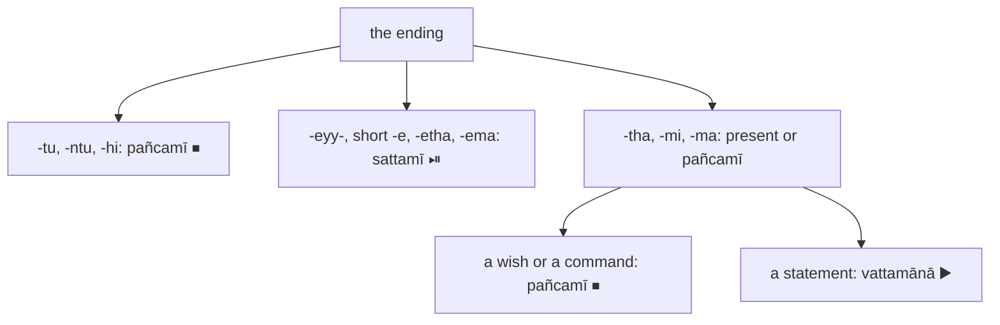

:::tip[Info]
Part of "A Beginner (Non-Linguist) Guide to Learning Pali"
:::

Two of the eight sets of endings in [8.1](../8-1-reading-a-verb/) state no
time; they state what the speaker wants. The `pañcamī` (the fifth set, ⏹) is
for a command (`āṇatti`) and a wish or blessing (`āsīsa`) {415}: `karotu kusalaṁ`
("let him do good"), `sukhaṁ te hotu` ("may there be happiness for you"). The
`sattamī` (the seventh set, ⏯) is for permission (`anumati`) and supposition
(`parikappa`) {416}: `tvaṁ gaccheyyāsi` ("you may go"), `kimahaṁ kareyyāmi`
("what should I do?"); in the texts it is also a wish for oneself
(`pabbajeyyaṁ`, "I would go forth") and the verb of an "if" (`okanteyyuṁ`,
"if they were to cut off").

Ask the question of [8.1](../8-1-reading-a-verb/), who and how many, and then: a command or blessing, or a
may, should or would? The ending answers: `-tu`, `-ntu`, `-hi` and `-eyy-`
are unmistakable, while `-tha`, `-mi` and `-ma` are the present's too, and
only the sense decides. Kaccāyana lists each set's twelve endings in {424} and
{425}, the active `parassapada` (🟢) six, then the `attanopada` (🔵) six.
`pañcamī` and `sattamī` are also the names of the ⑤ and ⑦ noun endings; the
symbols ⏹ and ⏯ keep the verb sets apart.

### The `pañcamī` ⏹: commands and blessings {415}

| what you see | person | number | example | rule |
| --- | --- | :-: | --- | :-: |
| `-tu` | third | ⨀ | `karotu`, `hotu` ([7: 2.3](../7-anatta/#u2-3)), `desetu` ("let him teach"), `uppajjatu` | {424} |
| `-ntu` | third | ⨂ | `hontu` ("may they be", [7: 4.6](../7-anatta/#u4-6)), `kamantu` ("let them come") | {424} |
| `-hi`, the `a` before it long {478}; `hi` sometimes dropped {479} | second | ⨀ | `gacchāhi`, `gaccha` ("go!"), `ehi` ("come!") | {424} |
| `-tha` | second | ⨂ | `etha` ("come, all of you!") | {424} |
| `-mi`, the `a` before it long {478} | first | ⨀ | `jānāmi` ("may I know", [Bonus: 18, 1.20](../11-pbt/#s18-u1-20)) | {424} |
| `-ma`, the `a` before it long {478} | first | ⨂ | `gacchāma` ("let us go") | {424} |
| `-taṁ`, `-antaṁ`, `-ssu`, `-vho`, `-e`, `-āmase` | the `attanopada` 🔵 set | | none in our texts | {424} |

### The `sattamī` ⏯: may, should, would {416}

| what you see | person | number | example | rule |
| --- | --- | :-: | --- | :-: |
| `-eyya` | third | ⨀ | `kareyya` ("he would do"), `saṁvatteyya` ([7: 2.2](../7-anatta/#u2-2)), `padūseyya` | {425} |
| `-eyyuṁ` | third | ⨂ | `saṁvatteyyuṁ` ([7: 4.5](../7-anatta/#u4-5)), `okanteyyuṁ` | {425} |
| `-eyyāsi` | second | ⨀ | `gaccheyyāsi` | {425} |
| `-eyyātha` | second | ⨂ | `vadeyyātha` ("would you say"), `uddiseyyātha` | {425} |
| `-eyyāmi` | first | ⨀ | `kareyyāmi` | {425} |
| `-eyyāma` | first | ⨂ | none in our texts; they have the short `vadema` below | {425} |
| `-eyyaṁ`, the 🔵 ending, common for a wish | first | ⨀ | `pabbajeyyaṁ`, `upapajjeyyaṁ` | {425} |
| `-etha`, the 🔵 ending | third | ⨀ | `paññāyetha` ("it would be evident", [Bonus: 15, 2.1](../11-pbt/#s15-u2-1)) | {425} |
| `-eraṁ`, `-etho`, `-eyyāvho`, `-eyyāmhe` | the rest of the 🔵 set | | none in our texts | {425} |

The `sattamī` is often shortened; {517} allows the short shapes, which are the
ones a reader meets most:

| what you see | stands for | example | rule |
| --- | --- | --- | :-: |
| `-e` | `-eyya`, third person ⨀ | `kare` ("he would do"), `gacche` ("he would go") | {517} |
| `-etha` | `-eyyātha`, second person ⨂ | `vadetha` ("would you say", [Bonus: 1, 24.14](../11-pbt/#s1-u24-14)) | {517} |
| `-ema` | `-eyyāma`, first person ⨂ | `vadema` ("would we say", [Bonus: 1, 24.5](../11-pbt/#s1-u24-5)) | {517} |
| `siyā` | `-eyya` of `atthi` ("is"): "there would be" | `siyā` | {506}, {517} |
| `jaññā`, `jāniyā` | `-eyya` of `jānāti` ("knows"): "he would know" | `jaññā` | {508} |

:::note[How to tell a command from a wish, and both from the present]
`-tu`, `-ntu` and `-hi` are always ⏹; `-eyy-` is always ⏯. `-tha`, `-mi` and
`-ma` are the present's endings too: `‘yathābhūtaṁ jānāmi passāmī’ti` is a
wish, "may I know and see", so ⏹, while `yathābhūtaṁ jānāti passati` in the
next sentence is a statement, ▶️. The short `-e` (`kare`) looks like a ⑦ noun
ending; a root in front of it, not a noun, tells. `-etha` is the 🔵 third
person ⨀ (`paññāyetha`) or the short 🟢 second person ⨂ (`vadetha`); the
subject decides. A prohibition is `mā` with a past ending, `mā gamā` ("do not go"),
`mā ahosi` ("may it not be", [7: 2.3](../7-anatta/#u2-3)) {420}, in chapter 1's note on `mā` and in [8.4](../8-4-past/). `siyā` and
`assa` are both "would be", the `sattamī` of `atthi`
([8.7](../8-7-common-verbs/)).
:::

All twelve endings of each set are in [Appendix I](../i-verbs/) and chapter
1's [verb terminations](../1-basics/#verb-terminations-423-430).

### Examples

From chapter [7](../7-anatta/) and the [bonus chapter](../11-pbt/); each citation links to the sentence.

> evaṁ me saṅkhārā **hontu**

⏏️(evaṁ) *️⃣👆⚧⨀⑥(ahaṁ) 🚹⨂①(saṅkhāra) 🟢⨂🤟⏹(hoti)  
thus / my / mental constructions / let be  
*"May my `saṅkhārā` be thus" ([7: 4.6](../7-anatta/#u4-6)) `hontu`: ⏹ `-ntu`, third person ⨂ {424}; a wish {415}.*

> ‘yathābhūtaṁ **jānāmi passāmī**’ti.

⏏️🆎(yathā+bhūta) 🟢⨀👆⏹(jānāti) 🟢⨀👆⏹(passati) ⏏️(iti)  
reality as it is / must know / must see / (end quote)  
*"May I know and see reality as it is." ([Bonus: 18, 1.20](../11-pbt/#s18-u1-20)) `jānāmi`, `passāmi`: `-mi`, first person ⨀ {424}, the present's ending too; the sentence is a wish, so ⏹ {415}.*

> “Api nu tumhe, bhikkhave, evaṁ jānantā evaṁ passantā evaṁ **vadeyyātha**—

⏏️(api) ⏏️(nu) *️⃣🤘⚧⨂①(tumhe) 🚹⨂⓪(bhikkhu) ⏏️(evaṁ) 🚹⨂①🔽(anta)(jānanta) ⏏️(evaṁ) 🚹⨂①🔽(anta)(passanta) ⏏️(evaṁ) 🟢⨂🤘⏯(vadati)  
perhaps? / surely? / youse / bhikkhave / thus / knowing / thus / seeing / thus / will say  
*"Thus knowing and thus seeing, bhikkhave, will you say -" ([Bonus: 1, 24.4](../11-pbt/#s1-u24-4)) `vadeyyātha`: ⏯ `-eyyātha`, second person ⨂ {425}; a supposition, "would you say" {416}.*

> nayidaṁ saṅkhārā ābādhāya **saṁvatteyyuṁ**,

⏏️(na) *️⃣🤟🚻⨀①(ima) 🚹⨂①(saṅkhāra) 🚹⨀④(ābādha) 🟢⨂🤟⏯(saṁvattati)  
not / this / mental constructions / to affliction / would lead  
*"these `saṅkhārā` would not lead to `ābādha` (affliction)," ([7: 4.5](../7-anatta/#u4-5)) `saṁvatteyyuṁ`: ⏯ `-eyyuṁ`, third person ⨂ {425}; the "would" that answers the "if" before it, a supposition {416}.*

### Exercises

Each of the following is a verb from chapter [7](../7-anatta/) or the [bonus chapter](../11-pbt/), in
the form it has there. Name the set, the ending, the person and the number, and say
whether it is a command, a wish or a supposition. Look each up in a
dictionary and check its ending against the tables.

:::tip[Hint]
You may find the [Digital Pali Dictionary](https://digitalpalidictionary.github.io/)
useful for looking up words, as well as doing the sandhi and compound word
deconstruction.
:::

1. hotu
2. padūseyya
3. saṁvatteyya
4. uddiseyyātha
5. pabbajeyyaṁ
6. paññāyetha

### Answers

*Note: please do the exercises first before checking the answers.*

1. > evaṁ me rūpaṁ **hotu**

⏏️(evaṁ) *️⃣👆⚧⨀⑥(ahaṁ) 🚻⨀①(rūpa) 🟢⨀🤟⏹(hoti)  
thus / my / form / let be  
*"May my `rūpa` be thus" ([7: 2.3](../7-anatta/#u2-3)) `hotu`: ⏹ `-tu`, third person ⨀ {424}; a wish {415}.*

2. > tatrāpi yo mano **padūseyya**

⏏️(tatra) ⏏️(api) *️⃣🤟🚹⨀①(ya) 🚹⨀②(mano) 🟠⨀🤟⏯(padūseti)  
in that situation / even / whoever / mind / will corrupt  
*"even in that case whoever will corrupt his mind" ([Bonus: 45, 9.6](../11-pbt/#s45-u9-6)) `padūseyya`: ⏯ `-eyya`, third person ⨀ {425}, the subject `yo`; a supposition {416}.*

3. > nayidaṁ rūpaṁ ābādhāya **saṁvatteyya**,

⏏️(na) *️⃣🤟🚻⨀①(ima) 🚻⨀①(rūpa) 🚹⨀④(ābādha) 🟢⨀🤟⏯(saṁvattati)  
not / this / form / to affliction / would lead  
*"this `rūpa` would not lead to `ābādha` (affliction)" ([7: 2.2](../7-anatta/#u2-2)) `saṁvatteyya`: ⏯ `-eyya`, third person ⨀ {425}; the "would" that answers the "if" before it, a supposition {416}.*

4. > aññaṁ satthāraṁ **uddiseyyāthā**”ti?

*️⃣🤟🚹⨀②(añña) 🚹⨀②(satthar) 🟢⨂🤘⏯(uddisati) ⏏️(iti)  
another / teacher / appoint / (end quote)  
*"will you appoint another teacher?" ([Bonus: 1, 24.10](../11-pbt/#s1-u24-10)) `uddiseyyātha`: ⏯ `-eyyātha`, second person ⨂ {425}; "would you", a supposition {416}; the `-ā` before `”ti` is the join.*

5. > agārasmā anagāriyaṁ **pabbajeyyan**”ti.

🚻⨀⑤(agāra) 🚻⨀②🆎(na+agāriya) 🔵⨀👆⏯(pabbajati) ⏏️(iti)  
from household life / to homeless state / renounce / (end quote)  
*"What if I were to renounce from household life to homeless state" ([Bonus: 26, 12.8](../11-pbt/#s26-u12-8)) `pabbajeyyaṁ`: ⏯ `-eyyaṁ`, the 🔵 first person ⨀ {425}; a wish for oneself, after `yannūnāhaṁ` ("what if I").*

6. > api nu kho kāmabhavo **paññāyethā**”ti?

⏏️(api) ⏏️(nu) ⏏️(kho) 🚹⨀①🆎(kāma+bhava) 🔵⨀🤟⏯(paññāyati) ⏏️(iti)  
perhaps? / surely? / indeed / existence in the realm of sensual desire / is evident / (end quote)  
*"would existence (of suffering) in the realm of sensual desire be evident?" ([Bonus: 15, 2.1](../11-pbt/#s15-u2-1)) `paññāyetha`: ⏯ `-etha`, the 🔵 third person ⨀ {425}, the subject `kāmabhavo`; a supposition {416}; the `-ā` before `”ti` is the join.*
