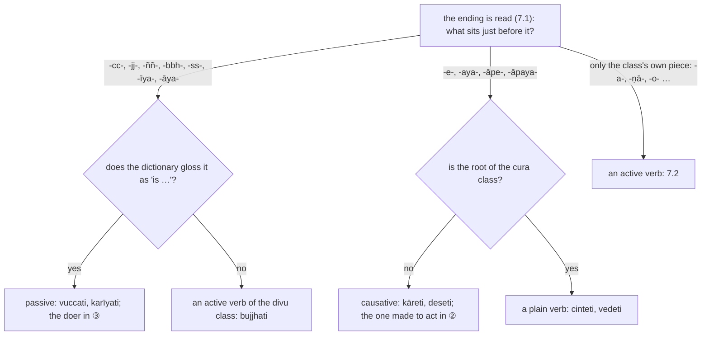

:::tip[Info]
Part of "A Beginner (Non-Linguist) Guide to Learning Pali"
:::

Section [8.1](../8-1-reading-a-verb/) read a verb from its ending: the time,
the person and the number. Two pieces that sit between the root and that
ending change who the subject of the sentence is. With `ya` the verb is
passive (`kamma`, 🔴): the subject is the thing acted on, `ayaṁ vuccati`
("this is said"), and the one who acts, if named at all, takes the ③ ending
{288}. With `e`, `aya`, `āpe` or `āpaya` it is causative (`kārita`, 🟠): the
subject makes someone else act, `kāreti` ("makes [him] do"), and the one made
to act takes the ② ending, or ③ {300}.

So once the ending is read, ask what sits just before it. Kaccāyana gives the
passive the `attanopada` endings (🔵, `-te`, `-ante`) {453}, `vuccate`, but the
texts nearly always swap them for the `parassapada` endings of 7.1 {518},
`vuccati`: a passive verb usually ends exactly like an active one, and only
the piece before the ending gives it away.

### The passive piece `ya` {440}

`ya` goes on every root alike {440}, after a root such as `vaca` has lost its
final `a` {521}, but it rarely stays visible: after a consonant it melts into
that consonant, after a vowel it stays, and an `ī` may be put in before it.

| what you see | example | root | rule |
| --- | --- | :-: | :-: |
| `-cc-`, `-jj-`, `-jjh-`, `-ññ-`, `-yy-`: `ya` and the root's last consonant have become one doubled letter of the `c` group, or `y` | `vuccati` ("is said"), `bhaññamāne` ("being spoken"), `haññati` ("is struck") | `vaca`, `bhaṇa`, `hana` | {441} |
| `-bbh-`, `-ss-` and the like: `ya` has taken the shape of the consonant before it | `upalabbhati` ("is found"), `dissati` ("is seen") | `labha`, `disa` | {443} |
| `-īya-`, also written `-iyya-`: an `ī` put in before `ya` | `karīyati` ("is done") | `kara` | {442} |
| `-āya-`, `-īya-` after a root that ends in a vowel | `paññāyati` ("is clearly known"), `dīyati` ("is given"), `khīyati` ("is exhausted") | `ñā`, `dā` (its `ā` to `ī`), `khī` | {440}, {502} |

### The causative piece {438}

Kaccāyana writes the four pieces `ṇe`, `ṇaya`, `ṇāpe`, `ṇāpaya` {438}. The `ṇ`
is not a sound of the word: it is dropped {523}, and it signals that the
root's vowel is strengthened {483}, `a` to `ā`, `i` to `e`, `u` to `o`:
`kara` gives `kār-`, and `pabbajati` ("goes forth", chapter 11's
`pabbajeyyaṁ`) gives `pabbājeti` ("makes go forth", ordains). Before a vowel
that `o` or `e` opens out into `āv` or `āy` {515}: `su` ("hear") gives
`sāveti` ("makes hear"). A root ending in two consonants keeps its vowel,
`cinteti` {483}.

| what you see | example | root | rule |
| --- | --- | :-: | :-: |
| `-e-` before the ending | `kāreti` ("has it done"), `deseti` ("teaches", literally "makes point out") | `kara`, `disa` | {438}, {523}, {483} |
| `-aya-` | `kārayati`, `namayanti` ("straighten"), `damayanti` ("tame") | `kara`, `nama`, `dama` | {438}, {523}, {483} |
| `-āpe-` | `kārāpeti`, `paṭivāpeti` ("pulls back") | `kara`, `vā` | {438}, {523}, {483} |
| `-āpaya-` | `kārāpayati` | `kara` | {438}, {523}, {483} |
| the same piece before a past ending, `-esi`, `-esuṁ`, or in a verb-like form, `-etabba`; in `-ita` only the strengthened root shows | `desesi` ("taught"), `saddamanussāvesuṁ` ("proclaimed"), `bhāvetabbaṁ` ("to be developed"), `bhāvitaṁ` ("developed") | `disa`, `su`, `bhū` | {438}, {515} |

:::note[How to tell a causative from a `cura`-class verb]
`e` and `aya` are also the piece of the `cura` class {452}: `cinteti`
("thinks"), `vedeti` ("knows, feels") and `manteti` ("consults") make nobody
do anything. The shape cannot tell them apart; the root can. The Digital
Pāḷi Dictionary gives every verb its root with the class and the class's
sign: `√cint (8, e, aya)` is the `cura` class, the eighth in its count, and
the `e` is the class's own; `√dis (1, a)` is the `bhū` class, whose piece is
`a`, so the `e` of `deseti` is the causative's, as the literal meaning
"causes to point out" says. [Appendix D](../d-roots/) lists the classes.
Likewise `ya` is the piece of the `divu` class {447} and doubles there too
{444}: `bujjhati` ("understands") and `maññati` ("thinks") are active; the
meaning, "is said", "is done", marks a passive.
:::

The three questions, in order:

### Examples

The passive with the ending of the active {518}:

> Ime **vuccanti**, bhikkhave, saṅkhārā.

🚹⨂①(ima) ▶️🤟⨂(vuccati) 🚹⨂⓪(bhikkhu) 🚹⨂①(saṅkhāra)  
these / are said to be / bhikkhave / mental constructions → Bhikkhave, these are said to be mental constructions.  
*`vuccanti` 🔴: `vaca` + `ya`, `c` and `ya` one `cc` {441}, `va` to `vu` {487}; the things said, `ime … saṅkhārā`, are the subject in ①, and the verb is plural with them.*

Kaccāyana's own example of the `ī` {442}, in chapter 11:

> **karīyati** hidaṁ buddhānaṁ sāsanan’ti

▶️🤟⨀(karīyati) 🔼(hidaṁ) 🚹⨂⑥(buddha) 🚻⨀①(sāsana) 🔼(ti)  
is practised / surely in this case / of Buddha / teaching / quote → surely in this case the teaching of the Buddha is practised  
*`karīyati` 🔴: `kara` + `ī` + `ya` {442}; the teaching, `sāsanaṁ`, is the subject in ①.*

The passive piece inside a participle of [8.8](../8-8-verb-like-forms/), with the ⑦ of "while":

> Imasmiñca pana veyyākaraṇasmiṁ **bhaññamāne**

*️⃣🤟🚻⨀⑦(ima) ⏏️(ca) ⏏️(pana) 🚻⨀⑦(veyyākaraṇa) 🚻⨀⑦🔽(māna)(bhaññamāna)  
in this / and / moreover / detailed exposition / being spoken → And while this detailed exposition was being spoken  
*`bhaññamāne`: `bhaṇa` + `ya`, `ṇ` and `ya` one `ññ` {441}, then `-māna` and the ⑦ ending; the exposition is what is spoken, not the speaker.*

The causative in the past, with its lengthening:

> bhummā devā **saddamanussāvesuṁ**

🚹⨂①(bhumma) 🚹⨂①(deva) 🟢⨂🤟⏮(saddamanussāveti)  
earth-dwelling / devas / raised a cry → `bhummā devā` (the earth-dwelling devas) raised a cry  
*`saddamanussāvesuṁ` 🟠: `saddaṁ anu-sāv-e-suṁ`, "made the sound heard": `su` strengthened to `sāv` {483}, {515}, the causative `e` {438}, then the past ending of 7.4.*

The `-aya-` causative:

> Attānaṁ **damayanti** paṇḍitā.

🚹⨀②(atta) ▶️🤟⨂(damayati) 🚹⨂①(paṇḍita)  
self / tames / the wise → The wise tames the self.  
*`damayanti` 🟠: `dama` ("be tame") + `aya` {438}, "make tame"; the one made tame, `attānaṁ`, is the object in ② {297}.*

### Exercises

Each of the following is from chapter [3](../3-awakening/),
[4](../5-dhammacakka/) or [9](../11-pbt/). Find the verb or verb-like form and
say which piece stands before its ending, whether it is passive, causative or
neither, and what its root is; a dictionary gives the root's class.

:::tip[Hint]
You may find the [Digital Pali Dictionary](https://digitalpalidictionary.github.io/)
useful for looking up words, as well as doing the sandhi and compound word
deconstruction.
:::

1. Ayaṁ vuccati, bhikkhave, sammāvāyāmo.
2. Tassa me tathāgato vā tathāgatasāvako vā dhammaṁ desesi.
3. nayidha sattupalabbhati.
4. Usukārā namayanti tejanaṁ;
5. dukkhanirodhagāminī paṭipadā ariyasaccaṁ bhāvetabban’ti
6. imaṁ udānaṁ udānesi
7. Yato khayaṁ paccayānaṁ avedī”ti.

### Answers

*Note: please do the exercises first before checking the answers.*

1. > Ayaṁ **vuccati**, bhikkhave, sammāvāyāmo.

🚹⨀①(ima) ▶️🤟⨀(vuccati) 🚹⨂⓪(bhikkhu) 🚹⨀①(sammāvāyāma)  
this / is said / bhikkhave / right effort → Bhikkhave, this is said to be "sammāvāyāma" (right effort).  
*Passive 🔴: `vaca` + `ya` as `-cc-` {441}, with the active ending {518}; `sammāvāyāmo`, the thing said, in ①.*

2. > Tassa me tathāgato vā tathāgatasāvako vā dhammaṁ **desesi**.

🚹⨀⑥(ta) *️⃣👆⚧⨀②(ahaṁ) 🚹⨀①(tathāgata) 🔼(vā) 🚹⨀①(tathāgatasāvaka) 🔼(vā) 🚹⨀②(dhamma) ⏮🤟⨀(desesi)  
of that / me / Tathāgata / or / disciple of the Buddha / or / Dhamma / taught → Because of that, the Tathāgata and his disciples taught the Dhamma to me.  
*Causative 🟠: `disa` ("point out", the `bhū` class) + `e` {438} before the past ending `-si`; what is taught, `dhammaṁ`, in ② {297}.*

3. > nayidha **sattupalabbhati**.

🔼(nayidha) 🚹⨀①(satta) ▶️🤟⨀(upalabbhati)  
not here / being / is found → No being is found in here.  
*Passive 🔴: `upa` + `labha` + `ya`, `ya` taking the shape of the `bh` {443}; `satto`, the thing found, in ①, joined to the verb by sandhi.*

4. > Usukārā **namayanti** tejanaṁ;

🚹⨂①(usukāra) ▶️🤟⨂(namayati) 🚻⨀②(tejana)  
arrow-maker / straighten / arrow → Arrow makers straighten arrow;  
*Causative 🟠: `nama` ("bend") + `aya` {438}, "make bend"; the arrow, `tejanaṁ`, in ② {297}.*

5. > dukkhanirodhagāminī paṭipadā ariyasaccaṁ **bhāvetabban**’ti

🚺⨀①🆎(dukkhanirodha+gāmī) 🚺⨀①(paṭipadā) 🚻⨀①🆎(ariya+sacca) 🚻⨀①🔽(tabba)(bhāvetabba) ⏏️(iti)  
leading to the cessation of suffering / path / realisation / to be developed / thus → ‘This `dukkhanirodhagāminī paṭipadā ariyasacca` should be `bhāvetabbaṁ` (developed)’: thus  
*Causative 🟠 inside a verb-like form (7.8): `bhū` ("be") + `e` {438}, `bhāveti` "makes be", develops, with `-tabba` ("to be …") on top; the next sentence of chapter 5 has its past participle `bhāvitaṁ`.*

6. > imaṁ udānaṁ **udānesi**

*️⃣🤟🚹⨀②(ima) 🚹⨀②(udāna) 🟢⨀🤟⏮(udāneti)  
this / inspired utterance / uttered → uttered this inspired utterance  
*Causative in form 🟠: the dictionary gives `ud` + `ana` ("breathe", the `bhū` class) + `e` {438}, "made breathe up", the `a` lengthened {483}; in sense simply "uttered", its object `udānaṁ` in ②.*

7. > Yato khayaṁ paccayānaṁ **avedī**”ti.

⏏️(yato) 🚹⨀②(khaya) 🚹⨂⑥(paccaya) 🟢⨀🤟⏮(vedeti) ⏏️(iti)  
since / the destruction / of conditions / knew / (end quote) → since he has understood the destruction of conditions.”  
*Neither: `vida` ("know") is of the `cura` class, `√vid (8, e, aya)`, so the `e` is the class's own {452}, not a causative; the `a-` before the root marks the past {519}.*
