:::tip[Info]
Part of "A Beginner (Non-Linguist) Guide to Learning Pali"
:::

This chapter presents a concise summary of the structure of Pali grammar
and the technical terms used in Kaccāyana. It is structured using EBNF notation and presented as Syntax Diagrams (also known as "Railroad" diagrams).

## The Pali Alphabet or Orthography (saññā)

### Phonemes {2}

Pali is an oral language consisting of sounds, but can be transcribed in written form using a combination of phonemes. Overall, there are 41 phonemes, which are grouped as consonants and vowels. These phonemes can be rendered in various scripts, or using Roman letters.

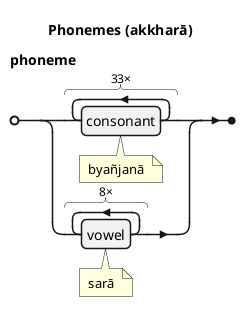

### Vowels {3}-{5}

The vowels can be short (1 mora in length) or long (2 morae). Some vowels can be short or long depending on circumstances.

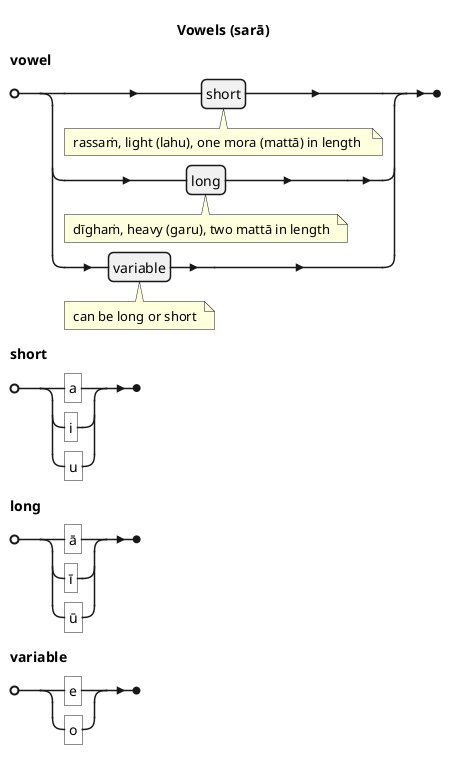

### Consonants {6}-{9}

Consonants can be grouped.

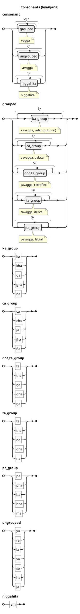

### Voicing

The grouped consonants can be either voiced or unvoiced.

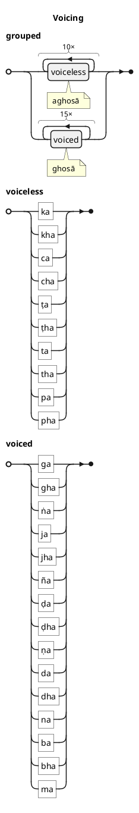

## Sentence structure

Pali text consists of sentences which contain one or more words. Words can be nouns, verbs, prefixes and particles. There is no strictly defined word order in sentences, but is proto-typically subject-object-verb.

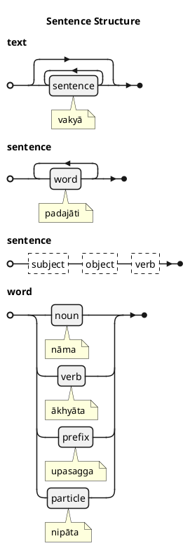

## Nouns

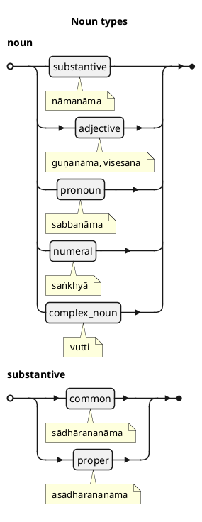

Nouns are constructed from a base, the lemma. Kaccāyana refers to the nominal base as the `liṅga`, but this word is also used to refer to the grammatical gender of nouns. `liṅga` technically means defining "characteristic" or "attribute" and hence the term is appropriate for both, as the defining characteristic of a noun is the base together with the gender. Other words that can be used to represent the base are `pāṭipadika` or `sadda`.

A fully formed noun-word is constructed by combining the base with optional prefixes, infixes, affixes and suffixes. The final suffix is the inflectional-ending and expresses the inflection form (the relationship of the noun to other parts of a sentence), number (singular or plural) and gender (masculine, feminine, or neuter).

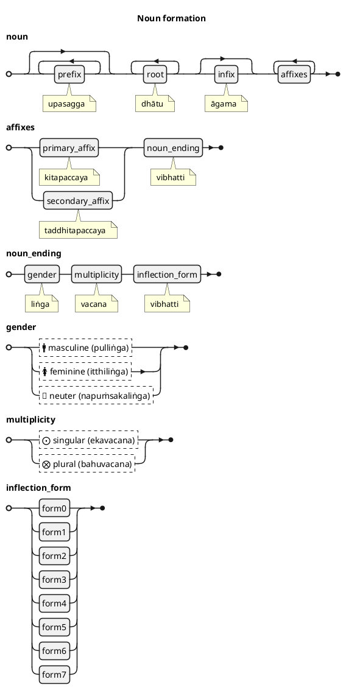

### `kāraka` (the roles)

The `kāraka` (roles) represent the relationship between words in a sentence (representing various participants) in the context of an action (verb). Kaccāyana defines seven `kāraka` {271}–{283}, and the calling form (`ālapana`) stands beside them.

There is a strong association between the roles and the inflection forms, but the association is not an equivalence, as a role can be represented by more than one inflection form, and an inflection form can represent more than one role.

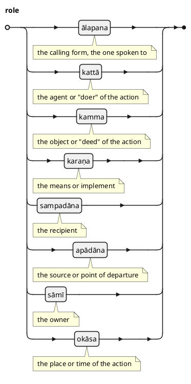

## Verbs

Technically, verbs in Pali are finite verbs, inflected by applying verb endings which represent the perspective and voice of the actor, multiplicity, and the mood/tense of the action.

Infinitives, participles (past, present, future), absolutives and other forms of words considered as verbs in other languages are technically nouns in Pali - they are created by combining a root with an affix (`kita` or `kicca`) and then inflected by adding a noun ending.

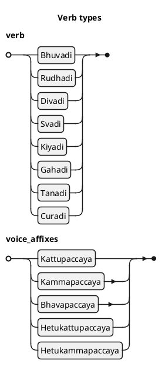

```plantuml
@startebnf
title Verb formation
verb =
  {prefix (* upasaggo *)},
  {root (* dhātu *)}-,
  [infix (* āgamo *)],
  voice_affixes (* paccaya *),
  verb_ending (* vibhatti *) ;
verb_ending =
  kāraka_relation (* kāraka *),
  person (* purisa *),
  multiplicity (* vacana *),
  (tense (* kāla *) | mood);
time =
  past |
  present |
  future ;
kāraka_relation =
  ?Kattukaraka : Active voice? |
  ?Kammakaraka : passive? ;
person =
  third_person (* paṭhamapurisa *) |
  second_person (* majjhimapurisa*) |
  first_person (* uttamapurisa *) ;
multiplicity =
  ?⨀ singular (ekavacanaṁ)? |
  ?⨂ plural (bahuvacanaṁ)? ;
voice =
  ?parassapada : active, action favours non-agent? |
  ?attanopada : reflective, action favours self/object?;
mood =
  ?pañcamī : a command or a wish? |
  ?sattamī : permission or supposition? |
  ?kālātipatti : Conditional, should have happened except for ...? ;
tense =
  ?vattamānā : Present tense (paccupannakāla)? |
  ?parokkhā : the unwitnessed past? |
  ?hiyyattanī : the past before today? |
  ?ajjatanī : the near past, from today back? |
  ?bhavissantī : Future tense? ;
@endebnf
```

### Complex nouns

Complex nouns include compounds, verbal derivatives (primary) and nominal derivatives (secondary).

Derivatives are nouns formed by combining either a root or a lemma with an affix, and then inflected by applying noun endings.

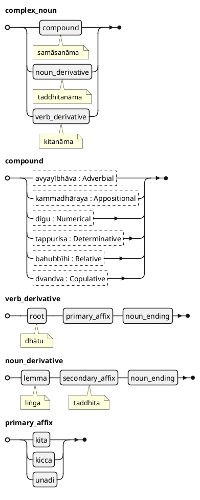

## Prefixes

Prefixes can be used as words in a sentence (in which case they are uninflected), or embedded in another word (in which case they act as prepositions and form part of the word).

## Particles

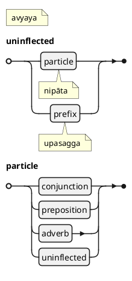

## References

This appendix draws upon information provided in the following sources

* *Kaccāyana Pāli Vyākaraṇaṁ (Kaccāyana Pāli Grammar)*, Vols I and II, A. Thitzana, Pariyatti Press (2018)
* *Technical Terms and Technique of the Pali and the Sanskrit Grammars*, Mahesh A Deokar, Central Institute of Higher Tibetan Studies (2008)
* *RŪPASIDDHI: A study of some aspects*, Phramaha Sriporn Rachiwong, Department Of Sanskrit And Prakrit Languages, University Of Pune (1995)
* *Pāli Grammar and Grammarians from Buddhaghosa to Vajirabuddhi: A Survey*, O.H. Pind, The Journal of the Pali Text Society, Vol. XXXI (2012), pp. 57–124
* *MĀGADHABHĀSĀ (PĀḶI): A Compendious Grammar on the Language of Pāḷi Buddhism*, A. Bhikkhu, Sāsanārakkha Buddhist Sanctuary (SBS), Revised 2nd Edition (2023)
