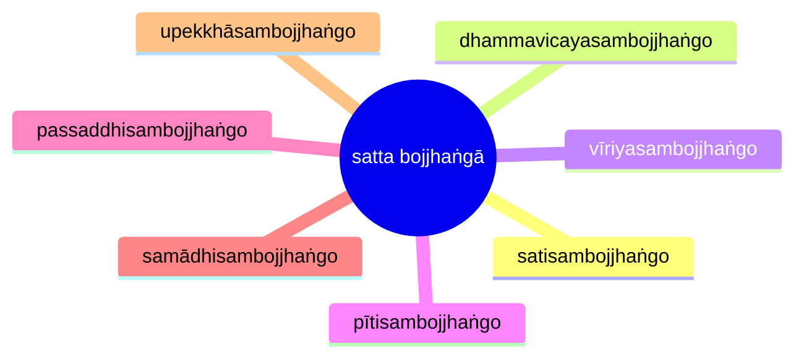

import { Tabs, TabItem } from '@astrojs/starlight/components';

[14S5/2.1.1 Himavantasutta](https://tipitaka2500.github.io/tipitaka/14S5/2/2.1/2.1.1.html)

<Tabs syncKey="paliquote">
<TabItem label="My Translation">
364\. [The Bhagavā] was dwelling at Sāvatthī.

> “Just as, Bhikkhave, relying on the Himālaya, the king of mountains,
> * elephants grow in body and gain strength;
> * having grown in body and gained strength there, they descend into small pools,
> * having descended into small pools, they descend into large pools,
> * having descended into large pools, they descend into small rivers,
> * having descended into small rivers, they descend into great rivers,
> * having descended into great rivers, they descend into the great ocean;
> * there they attain great bulk and vastness of body;
>
> in the same way, Bhikkhave, a bhikkhu, relying on virtue, established in virtue, cultivating the seven factors of awakening, practising the seven factors of awakening often, attains greatness and full development in the Dhamma.
>
> And how, Bhikkhave, does a bhikkhu, relying on virtue, established in virtue, cultivating the seven factors of awakening, practising the seven factors of awakening often, attain greatness and full development in the Dhamma? Here, Bhikkhave, a bhikkhu
>
> * cultivates the factor of awakening of `sati` (awareness), which is based on seclusion, dispassion, cessation, and culminates in relinquishment;
> * cultivates the factor of awakening of `dhammavicaya` (investigation of phenomena) ... ;
> * cultivates the factor of awakening of `vīriya` (energy) ... ;
> * cultivates the factor of awakening of `pīti` (joy) ... ;
> * cultivates the factor of awakening of `passaddhi` (tranquillity) ... ;
> * cultivates the factor of awakening of `samādhi` (focus) ... ;
> * cultivates the factor of awakening of `upekkhā` (equanimity), which is based on seclusion, dispassion, cessation, and culminates in relinquishment.
>
> Thus, Bhikkhave, a bhikkhu, relying on virtue, established in virtue, cultivating the seven factors of awakening, practising the seven factors of awakening often, attains greatness and full development in the Dhamma.”
</TabItem>

<TabItem label="Pāḷi (Roman IAST)">
364\. Sāvatthinidānaṃ. “Seyyathāpi, bhikkhave, himavantaṃ pabbatarājānaṃ nissāya nāgā kāyaṃ vaḍḍhenti, balaṃ gāhenti; te tattha kāyaṃ vaḍḍhetvā balaṃ gāhetvā kusobbhe otaranti, kusobbhe otaritvā mahāsobbhe otaranti, mahāsobbhe otaritvā kunnadiyo otaranti, kunnadiyo otaritvā mahānadiyo otaranti, mahānadiyo otaritvā mahāsamuddasāgaraṃ otaranti; te tattha mahantattaṃ vepullattaṃ āpajjanti kāyena; evameva kho, bhikkhave, bhikkhu sīlaṃ nissāya sīle patiṭṭhāya satta bojjhaṅge bhāvento satta bojjhaṅge bahulīkaronto mahantattaṃ vepullattaṃ pāpuṇāti dhammesu. Kathañca, bhikkhave, bhikkhu sīlaṃ nissāya sīle patiṭṭhāya satta bojjhaṅge bhāvento satta bojjhaṅge bahulīkaronto mahantattaṃ vepullattaṃ pāpuṇāti dhammesūti? Idha, bhikkhave, bhikkhu satisambojjhaṅgaṃ bhāveti vivekanissitaṃ virāganissitaṃ nirodhanissitaṃ vossaggapariṇāmiṃ; dhammavicayasambojjhaṅgaṃ bhāveti…pe…  vīriyasambojjhaṅgaṃ bhāveti…pe…  pītisambojjhaṅgaṃ bhāveti…pe…  passaddhisambojjhaṅgaṃ bhāveti…pe…  samādhisambojjhaṅgaṃ bhāveti…pe…  upekkhāsambojjhaṅgaṃ bhāveti vivekanissitaṃ virāganissitaṃ nirodhanissitaṃ vossaggapariṇāmiṃ. Evaṃ kho, bhikkhave, bhikkhu sīlaṃ nissāya sīle patiṭṭhāya satta bojjhaṅge bhāvento satta bojjhaṅge bahulīkaronto mahantattaṃ vepullattaṃ pāpuṇāti dhammesū”ti.
</TabItem>

<TabItem label="Pāḷi (Brahmi)">
364\. 𑀲𑀸𑀯𑀢𑁆𑀣𑀺𑀦𑀺𑀤𑀸𑀦𑀁. “𑀲𑁂𑀬𑁆𑀬𑀣𑀸𑀧𑀺, 𑀪𑀺𑀓𑁆𑀔𑀯𑁂, 𑀳𑀺𑀫𑀯𑀦𑁆𑀢𑀁 𑀧𑀩𑁆𑀩𑀢𑀭𑀸𑀚𑀸𑀦𑀁 𑀦𑀺𑀲𑁆𑀲𑀸𑀬 𑀦𑀸𑀕𑀸 𑀓𑀸𑀬𑀁 𑀯𑀟𑁆𑀠𑁂𑀦𑁆𑀢𑀺, 𑀩𑀮𑀁 𑀕𑀸𑀳𑁂𑀦𑁆𑀢𑀺; 𑀢𑁂 𑀢𑀢𑁆𑀣 𑀓𑀸𑀬𑀁 𑀯𑀟𑁆𑀠𑁂𑀢𑁆𑀯𑀸 𑀩𑀮𑀁 𑀕𑀸𑀳𑁂𑀢𑁆𑀯𑀸 𑀓𑀼𑀲𑁄𑀩𑁆𑀪𑁂 𑀑𑀢𑀭𑀦𑁆𑀢𑀺, 𑀓𑀼𑀲𑁄𑀩𑁆𑀪𑁂 𑀑𑀢𑀭𑀺𑀢𑁆𑀯𑀸 𑀫𑀳𑀸𑀲𑁄𑀩𑁆𑀪𑁂 𑀑𑀢𑀭𑀦𑁆𑀢𑀺, 𑀫𑀳𑀸𑀲𑁄𑀩𑁆𑀪𑁂 𑀑𑀢𑀭𑀺𑀢𑁆𑀯𑀸 𑀓𑀼𑀦𑁆𑀦𑀤𑀺𑀬𑁄 𑀑𑀢𑀭𑀦𑁆𑀢𑀺, 𑀓𑀼𑀦𑁆𑀦𑀤𑀺𑀬𑁄 𑀑𑀢𑀭𑀺𑀢𑁆𑀯𑀸 𑀫𑀳𑀸𑀦𑀤𑀺𑀬𑁄 𑀑𑀢𑀭𑀦𑁆𑀢𑀺, 𑀫𑀳𑀸𑀦𑀤𑀺𑀬𑁄 𑀑𑀢𑀭𑀺𑀢𑁆𑀯𑀸 𑀫𑀳𑀸𑀲𑀫𑀼𑀤𑁆𑀤𑀲𑀸𑀕𑀭𑀁 𑀑𑀢𑀭𑀦𑁆𑀢𑀺; 𑀢𑁂 𑀢𑀢𑁆𑀣 𑀫𑀳𑀦𑁆𑀢𑀢𑁆𑀢𑀁 𑀯𑁂𑀧𑀼𑀮𑁆𑀮𑀢𑁆𑀢𑀁 𑀆𑀧𑀚𑁆𑀚𑀦𑁆𑀢𑀺 𑀓𑀸𑀬𑁂𑀦; 𑀏𑀯𑀫𑁂𑀯 𑀔𑁄, 𑀪𑀺𑀓𑁆𑀔𑀯𑁂, 𑀪𑀺𑀓𑁆𑀔𑀼 𑀲𑀻𑀮𑀁 𑀦𑀺𑀲𑁆𑀲𑀸𑀬 𑀲𑀻𑀮𑁂 𑀧𑀢𑀺𑀝𑁆𑀞𑀸𑀬 𑀲𑀢𑁆𑀢 𑀩𑁄𑀚𑁆𑀛𑀗𑁆𑀕𑁂 𑀪𑀸𑀯𑁂𑀦𑁆𑀢𑁄 𑀲𑀢𑁆𑀢 𑀩𑁄𑀚𑁆𑀛𑀗𑁆𑀕𑁂 𑀩𑀳𑀼𑀮𑀻𑀓𑀭𑁄𑀦𑁆𑀢𑁄 𑀫𑀳𑀦𑁆𑀢𑀢𑁆𑀢𑀁 𑀯𑁂𑀧𑀼𑀮𑁆𑀮𑀢𑁆𑀢𑀁 𑀧𑀸𑀧𑀼𑀡𑀸𑀢𑀺 𑀥𑀫𑁆𑀫𑁂𑀲𑀼. 𑀓𑀣𑀜𑁆𑀘, 𑀪𑀺𑀓𑁆𑀔𑀯𑁂, 𑀪𑀺𑀓𑁆𑀔𑀼 𑀲𑀻𑀮𑀁 𑀦𑀺𑀲𑁆𑀲𑀸𑀬 𑀲𑀻𑀮𑁂 𑀧𑀢𑀺𑀝𑁆𑀞𑀸𑀬 𑀲𑀢𑁆𑀢 𑀩𑁄𑀚𑁆𑀛𑀗𑁆𑀕𑁂 𑀪𑀸𑀯𑁂𑀦𑁆𑀢𑁄 𑀲𑀢𑁆𑀢 𑀩𑁄𑀚𑁆𑀛𑀗𑁆𑀕𑁂 𑀩𑀳𑀼𑀮𑀻𑀓𑀭𑁄𑀦𑁆𑀢𑁄 𑀫𑀳𑀦𑁆𑀢𑀢𑁆𑀢𑀁 𑀯𑁂𑀧𑀼𑀮𑁆𑀮𑀢𑁆𑀢𑀁 𑀧𑀸𑀧𑀼𑀡𑀸𑀢𑀺 𑀥𑀫𑁆𑀫𑁂𑀲𑀽𑀢𑀺? 𑀇𑀥, 𑀪𑀺𑀓𑁆𑀔𑀯𑁂, 𑀪𑀺𑀓𑁆𑀔𑀼 𑀲𑀢𑀺𑀲𑀫𑁆𑀩𑁄𑀚𑁆𑀛𑀗𑁆𑀕𑀁 𑀪𑀸𑀯𑁂𑀢𑀺 𑀯𑀺𑀯𑁂𑀓𑀦𑀺𑀲𑁆𑀲𑀺𑀢𑀁 𑀯𑀺𑀭𑀸𑀕𑀦𑀺𑀲𑁆𑀲𑀺𑀢𑀁 𑀦𑀺𑀭𑁄𑀥𑀦𑀺𑀲𑁆𑀲𑀺𑀢𑀁 𑀯𑁄𑀲𑁆𑀲𑀕𑁆𑀕𑀧𑀭𑀺𑀡𑀸𑀫𑀺𑀁; 𑀥𑀫𑁆𑀫𑀯𑀺𑀘𑀬𑀲𑀫𑁆𑀩𑁄𑀚𑁆𑀛𑀗𑁆𑀕𑀁 𑀪𑀸𑀯𑁂𑀢𑀺…𑀧𑁂…  𑀯𑀻𑀭𑀺𑀬𑀲𑀫𑁆𑀩𑁄𑀚𑁆𑀛𑀗𑁆𑀕𑀁 𑀪𑀸𑀯𑁂𑀢𑀺…𑀧𑁂…  𑀧𑀻𑀢𑀺𑀲𑀫𑁆𑀩𑁄𑀚𑁆𑀛𑀗𑁆𑀕𑀁 𑀪𑀸𑀯𑁂𑀢𑀺…𑀧𑁂…  𑀧𑀲𑁆𑀲𑀤𑁆𑀥𑀺𑀲𑀫𑁆𑀩𑁄𑀚𑁆𑀛𑀗𑁆𑀕𑀁 𑀪𑀸𑀯𑁂𑀢𑀺…𑀧𑁂…  𑀲𑀫𑀸𑀥𑀺𑀲𑀫𑁆𑀩𑁄𑀚𑁆𑀛𑀗𑁆𑀕𑀁 𑀪𑀸𑀯𑁂𑀢𑀺…𑀧𑁂…  𑀉𑀧𑁂𑀓𑁆𑀔𑀸𑀲𑀫𑁆𑀩𑁄𑀚𑁆𑀛𑀗𑁆𑀕𑀁 𑀪𑀸𑀯𑁂𑀢𑀺 𑀯𑀺𑀯𑁂𑀓𑀦𑀺𑀲𑁆𑀲𑀺𑀢𑀁 𑀯𑀺𑀭𑀸𑀕𑀦𑀺𑀲𑁆𑀲𑀺𑀢𑀁 𑀦𑀺𑀭𑁄𑀥𑀦𑀺𑀲𑁆𑀲𑀺𑀢𑀁 𑀯𑁄𑀲𑁆𑀲𑀕𑁆𑀕𑀧𑀭𑀺𑀡𑀸𑀫𑀺𑀁. 𑀏𑀯𑀁 𑀔𑁄, 𑀪𑀺𑀓𑁆𑀔𑀯𑁂, 𑀪𑀺𑀓𑁆𑀔𑀼 𑀲𑀻𑀮𑀁 𑀦𑀺𑀲𑁆𑀲𑀸𑀬 𑀲𑀻𑀮𑁂 𑀧𑀢𑀺𑀝𑁆𑀞𑀸𑀬 𑀲𑀢𑁆𑀢 𑀩𑁄𑀚𑁆𑀛𑀗𑁆𑀕𑁂 𑀪𑀸𑀯𑁂𑀦𑁆𑀢𑁄 𑀲𑀢𑁆𑀢 𑀩𑁄𑀚𑁆𑀛𑀗𑁆𑀕𑁂 𑀩𑀳𑀼𑀮𑀻𑀓𑀭𑁄𑀦𑁆𑀢𑁄 𑀫𑀳𑀦𑁆𑀢𑀢𑁆𑀢𑀁 𑀯𑁂𑀧𑀼𑀮𑁆𑀮𑀢𑁆𑀢𑀁 𑀧𑀸𑀧𑀼𑀡𑀸𑀢𑀺 𑀥𑀫𑁆𑀫𑁂𑀲𑀽”𑀢𑀺.
</TabItem>
<TabItem label="Interlinear">
364.1 Sāvatthinidānaṃ.  
🚻⨀①🆎(sāvatthī+nidāna)  
set at Sāvatthī  
[The Bhagavā] was dwelling at Sāvatthī.

364.2 “Seyyathāpi, bhikkhave, himavantaṃ pabbatarājānaṃ nissāya nāgā kāyaṃ vaḍḍhenti, balaṃ gāhenti;  
⏏️(seyyathāpi) 🚹⨂⓪(bhikkhu) 🚹⨀②(himavant) 🚹⨀②🆎(pabbata+rāja) 🔽(ya)(nissayati) 🚹⨂①(nāga) 🚹⨀②(kāya) 🟠⨂🤟▶️(vaḍḍheti) 🚻⨀②(bala) 🟠⨂🤟▶️(gāheti)  
just as | Bhikkhave | the Himālaya | the king of mountains | relying on | elephants | body | grow | strength | gain  
“Just as, Bhikkhave, relying on the Himālaya, the king of mountains, elephants grow in body and gain strength;

364.3 te tattha kāyaṃ vaḍḍhetvā balaṃ gāhetvā kusobbhe otaranti, kusobbhe otaritvā mahāsobbhe otaranti, mahāsobbhe otaritvā kunnadiyo otaranti, kunnadiyo otaritvā mahānadiyo otaranti, mahānadiyo otaritvā mahāsamuddasāgaraṃ otaranti;  
*️⃣🤟🚹⨂①(ta) ⏏️(tattha) 🚹⨀②(kāya) 🔽(tvā)(vaḍḍheti) 🚻⨀②(bala) 🔽(tvā)(gāheti) 🚹⨂②🆎(ku+sobbha) 🟢⨂🤟▶️(otarati) 🚹⨂②🆎(ku+sobbha) 🔽(tvā)(otarati) 🚹⨂②🆎(mahā+sobbha) 🟢⨂🤟▶️(otarati) 🚹⨂②🆎(mahā+sobbha) 🔽(tvā)(otarati) 🚺⨂②🆎(ku+nadī) 🟢⨂🤟▶️(otarati) 🚺⨂②🆎(ku+nadī) 🔽(tvā)(otarati) 🚺⨂②🆎(mahā+nadī) 🟢⨂🤟▶️(otarati) 🚺⨂②🆎(mahā+nadī) 🔽(tvā)(otarati) 🚹⨀②🆎(mahā+samudda+sāgara) 🟢⨂🤟▶️(otarati)  
they | there | body | having grown | strength | having gained | into small pools | descend | into small pools | having descended | into large pools | descend | into large pools | having descended | into small rivers | descend | into small rivers | having descended | into great rivers | descend | into great rivers | having descended | into the great ocean | descend  
having grown in body and gained strength there, they descend into small pools, having descended into small pools, they descend into large pools, having descended into large pools, they descend into small rivers, having descended into small rivers, they descend into great rivers, having descended into great rivers, they descend into the great ocean;

364.4 te tattha mahantattaṃ vepullattaṃ āpajjanti kāyena;  
*️⃣🤟🚹⨂①(ta) ⏏️(tattha) 🚻⨀②(mahantatta) 🚻⨀②(vepullatta) 🟢⨂🤟▶️(āpajjati) 🚹⨀③(kāya)  
they | there | greatness | maturity | attain | in body  
there they attain great bulk and vastness of body;

364.5 evameva kho, bhikkhave, bhikkhu sīlaṃ nissāya sīle patiṭṭhāya satta bojjhaṅge bhāvento satta bojjhaṅge bahulīkaronto mahantattaṃ vepullattaṃ pāpuṇāti dhammesu.  
⏏️(evaṃ) ⏏️(eva) ⏏️(kho) 🚹⨂⓪(bhikkhu) 🚹⨀①(bhikkhu) 🚻⨀②(sīla) 🔽(ya)(nissayati) 🚻⨀⑦(sīla) 🔽(ya)(patiṭṭhāti) ⚧⨂②(satta) 🚹⨂②🆎(bodhi+aṅga) 🚹⨀①🔽(anta)(bhāventa) ⚧⨂②(satta) 🚹⨂②🆎(bodhi+aṅga) 🚹⨀①🆎(bahula+karonta) 🚻⨀②(mahantatta) 🚻⨀②(vepullatta) 🟢⨀🤟▶️(pāpuṇāti) 🚹⨂⑦(dhamma)  
in the same way | just | indeed | Bhikkhave | bhikkhu | virtue | relying on | in virtue | established | seven | factors of awakening | cultivating | seven | factors of awakening | practising often | greatness | maturity | attains | in the Dhamma  
in the same way, Bhikkhave, a bhikkhu, relying on virtue, established in virtue, cultivating the seven factors of awakening, practising the seven factors of awakening often, attains greatness and full development in the Dhamma.

364.6 Kathañca, bhikkhave, bhikkhu sīlaṃ nissāya sīle patiṭṭhāya satta bojjhaṅge bhāvento satta bojjhaṅge bahulīkaronto mahantattaṃ vepullattaṃ pāpuṇāti dhammesūti?  
⏏️(kathaṃ) ⏏️(ca) 🚹⨂⓪(bhikkhu) 🚹⨀①(bhikkhu) 🚻⨀②(sīla) 🔽(ya)(nissayati) 🚻⨀⑦(sīla) 🔽(ya)(patiṭṭhāti) ⚧⨂②(satta) 🚹⨂②🆎(bodhi+aṅga) 🚹⨀①🔽(anta)(bhāventa) ⚧⨂②(satta) 🚹⨂②🆎(bodhi+aṅga) 🚹⨀①🆎(bahula+karonta) 🚻⨀②(mahantatta) 🚻⨀②(vepullatta) 🟢⨀🤟▶️(pāpuṇāti) 🚹⨂⑦(dhamma) ⏏️(iti)  
how | and | Bhikkhave | bhikkhu | virtue | relying on | in virtue | established | seven | factors of awakening | cultivating | seven | factors of awakening | practising often | greatness | maturity | attains | in the Dhamma | thus  
And how, Bhikkhave, does a bhikkhu, relying on virtue, established in virtue, cultivating the seven factors of awakening, practising the seven factors of awakening often, attain greatness and full development in the Dhamma?

364.7 Idha, bhikkhave, bhikkhu satisambojjhaṅgaṃ bhāveti vivekanissitaṃ virāganissitaṃ nirodhanissitaṃ vossaggapariṇāmiṃ;  
⏏️(idha) 🚹⨂⓪(bhikkhu) 🚹⨀①(bhikkhu) 🚹⨀②🆎(sati+sambodhi+aṅga) 🟠⨀🤟▶️(bhāveti) 🚹⨀②🆎(viveka+nissita) 🚹⨀②🆎(virāga+nissita) 🚹⨀②🆎(nirodha+nissita) 🚹⨀②🆎(vossagga+pariṇāmī)  
here | Bhikkhave | bhikkhu | the factor of awakening of awareness | cultivates | based on seclusion | based on dispassion | based on cessation | culminating in relinquishment  
Here, Bhikkhave, a bhikkhu cultivates the factor of awakening of `sati` (awareness), which is based on seclusion, dispassion, cessation, and culminates in relinquishment;

364.8 dhammavicayasambojjhaṅgaṃ bhāveti…pe…  vīriyasambojjhaṅgaṃ bhāveti…pe…  pītisambojjhaṅgaṃ bhāveti…pe…  passaddhisambojjhaṅgaṃ bhāveti…pe…  samādhisambojjhaṅgaṃ bhāveti…pe…  upekkhāsambojjhaṅgaṃ bhāveti vivekanissitaṃ virāganissitaṃ nirodhanissitaṃ vossaggapariṇāmiṃ.  
🚹⨀②🆎(dhamma+vicaya+sambodhi+aṅga) 🟠⨀🤟▶️(bhāveti) ⏏️(peyyāla) 🚹⨀②🆎(vīriya+sambodhi+aṅga) 🟠⨀🤟▶️(bhāveti) ⏏️(peyyāla) 🚹⨀②🆎(pīti+sambodhi+aṅga) 🟠⨀🤟▶️(bhāveti) ⏏️(peyyāla) 🚹⨀②🆎(passaddhi+sambodhi+aṅga) 🟠⨀🤟▶️(bhāveti) ⏏️(peyyāla) 🚹⨀②🆎(samādhi+sambodhi+aṅga) 🟠⨀🤟▶️(bhāveti) ⏏️(peyyāla) 🚹⨀②🆎(upekkhā+sambodhi+aṅga) 🟠⨀🤟▶️(bhāveti) 🚹⨀②🆎(viveka+nissita) 🚹⨀②🆎(virāga+nissita) 🚹⨀②🆎(nirodha+nissita) 🚹⨀②🆎(vossagga+pariṇāmī)  
the factor of awakening of investigation of phenomena | cultivates | (and so on) | the factor of awakening of energy | cultivates | (and so on) | the factor of awakening of joy | cultivates | (and so on) | the factor of awakening of tranquillity | cultivates | (and so on) | the factor of awakening of focus | cultivates | (and so on) | the factor of awakening of equanimity | cultivates | based on seclusion | based on dispassion | based on cessation | culminating in relinquishment  
cultivates the factor of awakening of `dhammavicaya` (investigation of phenomena) ... ; cultivates the factor of awakening of `vīriya` (energy) ... ; cultivates the factor of awakening of `pīti` (joy) ... ; cultivates the factor of awakening of `passaddhi` (tranquillity) ... ; cultivates the factor of awakening of `samādhi` (focus) ... ; cultivates the factor of awakening of `upekkhā` (equanimity), which is based on seclusion, dispassion, cessation, and culminates in relinquishment.

364.9 Evaṃ kho, bhikkhave, bhikkhu sīlaṃ nissāya sīle patiṭṭhāya satta bojjhaṅge bhāvento satta bojjhaṅge bahulīkaronto mahantattaṃ vepullattaṃ pāpuṇāti dhammesū”ti.  
⏏️(evaṃ) ⏏️(kho) 🚹⨂⓪(bhikkhu) 🚹⨀①(bhikkhu) 🚻⨀②(sīla) 🔽(ya)(nissayati) 🚻⨀⑦(sīla) 🔽(ya)(patiṭṭhāti) ⚧⨂②(satta) 🚹⨂②🆎(bodhi+aṅga) 🚹⨀①🔽(anta)(bhāventa) ⚧⨂②(satta) 🚹⨂②🆎(bodhi+aṅga) 🚹⨀①🆎(bahula+karonta) 🚻⨀②(mahantatta) 🚻⨀②(vepullatta) 🟢⨀🤟▶️(pāpuṇāti) 🚹⨂⑦(dhamma) ⏏️(iti)  
thus | indeed | Bhikkhave | bhikkhu | virtue | relying on | in virtue | established | seven | factors of awakening | cultivating | seven | factors of awakening | practising often | greatness | maturity | attains | in the Dhamma | (end quote)  
Thus, Bhikkhave, a bhikkhu, relying on virtue, established in virtue, cultivating the seven factors of awakening, practising the seven factors of awakening often, attains greatness and full development in the Dhamma.”
</TabItem>
</Tabs>

