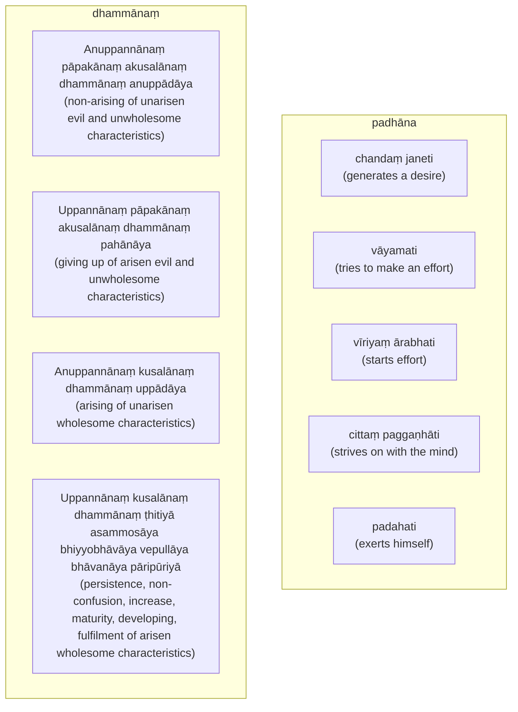

import { Tabs, TabItem } from '@astrojs/starlight/components';

[14S5/5.1.1--12 Pācīnādisutta](https://tipitaka2500.github.io/tipitaka/14S5/5/5.1/5.1.1--12.html)

<Tabs syncKey="paliquote">
<TabItem label="My Translation">
1284\. [The Bhagavā] was dwelling at Sāvatthī.

There the Bhagavā said this:

> “These, Bhikkhave, are the `cattāro sammappadhānā` (four right exertions). What four? Here, Bhikkhave,
> * A bhikkhu, for the non-arising of unarisen evil and unwholesome characteristics, generates a desire, tries to make an effort, starts effort, strives on with the mind, and exerts himself.
> * He generates a desire for the giving up of the arisen evil and unwholesome characteristics, tries to make an effort, starts effort, strives on with the mind, and exerts himself.
> * For the arising of unarisen wholesome characteristics, he generates a desire, tries to make an effort, starts effort, strives on with the mind, and exerts himself.
> * He generates a desire for the persistence of, non-confusion of, increase of, maturity of, developing of, fulfilment of arisen wholesome characteristics, tries to make an effort, starts effort, strives on with the mind, and exerts himself.
>
> These, Bhikkhave, are the four right exertions.”
</TabItem>

<TabItem label="Pāḷi (Roman IAST)">
1284\. Sāvatthinidānaṃ. Tatra kho bhagavā etadavoca—  “cattārome, bhikkhave, sammappadhānā. Katame cattāro? Idha, bhikkhave, bhikkhu anuppannānaṃ pāpakānaṃ akusalānaṃ dhammānaṃ anuppādāya chandaṃ janeti vāyamati vīriyaṃ ārabhati cittaṃ paggaṇhāti padahati. Uppannānaṃ pāpakānaṃ akusalānaṃ dhammānaṃ pahānāya chandaṃ janeti vāyamati vīriyaṃ ārabhati cittaṃ paggaṇhāti padahati. Anuppannānaṃ kusalānaṃ dhammānaṃ uppādāya chandaṃ janeti vāyamati vīriyaṃ ārabhati cittaṃ paggaṇhāti padahati. Uppannānaṃ kusalānaṃ dhammānaṃ ṭhitiyā asammosāya bhiyyobhāvāya vepullāya bhāvanāya pāripūriyā chandaṃ janeti vāyamati vīriyaṃ ārabhati cittaṃ paggaṇhāti padahati. Ime kho, bhikkhave, cattāro sammappadhānāti.
</TabItem>

<TabItem label="Pāḷi (Brahmi)">
1284\. 𑀲𑀸𑀯𑀢𑁆𑀣𑀺𑀦𑀺𑀤𑀸𑀦𑀁. 𑀢𑀢𑁆𑀭 𑀔𑁄 𑀪𑀕𑀯𑀸 𑀏𑀢𑀤𑀯𑁄𑀘—  “𑀘𑀢𑁆𑀢𑀸𑀭𑁄𑀫𑁂, 𑀪𑀺𑀓𑁆𑀔𑀯𑁂, 𑀲𑀫𑁆𑀫𑀧𑁆𑀧𑀥𑀸𑀦𑀸. 𑀓𑀢𑀫𑁂 𑀘𑀢𑁆𑀢𑀸𑀭𑁄? 𑀇𑀥, 𑀪𑀺𑀓𑁆𑀔𑀯𑁂, 𑀪𑀺𑀓𑁆𑀔𑀼 𑀅𑀦𑀼𑀧𑁆𑀧𑀦𑁆𑀦𑀸𑀦𑀁 𑀧𑀸𑀧𑀓𑀸𑀦𑀁 𑀅𑀓𑀼𑀲𑀮𑀸𑀦𑀁 𑀥𑀫𑁆𑀫𑀸𑀦𑀁 𑀅𑀦𑀼𑀧𑁆𑀧𑀸𑀤𑀸𑀬 𑀙𑀦𑁆𑀤𑀁 𑀚𑀦𑁂𑀢𑀺 𑀯𑀸𑀬𑀫𑀢𑀺 𑀯𑀻𑀭𑀺𑀬𑀁 𑀆𑀭𑀪𑀢𑀺 𑀘𑀺𑀢𑁆𑀢𑀁 𑀧𑀕𑁆𑀕𑀡𑁆𑀳𑀸𑀢𑀺 𑀧𑀤𑀳𑀢𑀺. 𑀉𑀧𑁆𑀧𑀦𑁆𑀦𑀸𑀦𑀁 𑀧𑀸𑀧𑀓𑀸𑀦𑀁 𑀅𑀓𑀼𑀲𑀮𑀸𑀦𑀁 𑀥𑀫𑁆𑀫𑀸𑀦𑀁 𑀧𑀳𑀸𑀦𑀸𑀬 𑀙𑀦𑁆𑀤𑀁 𑀚𑀦𑁂𑀢𑀺 𑀯𑀸𑀬𑀫𑀢𑀺 𑀯𑀻𑀭𑀺𑀬𑀁 𑀆𑀭𑀪𑀢𑀺 𑀘𑀺𑀢𑁆𑀢𑀁 𑀧𑀕𑁆𑀕𑀡𑁆𑀳𑀸𑀢𑀺 𑀧𑀤𑀳𑀢𑀺. 𑀅𑀦𑀼𑀧𑁆𑀧𑀦𑁆𑀦𑀸𑀦𑀁 𑀓𑀼𑀲𑀮𑀸𑀦𑀁 𑀥𑀫𑁆𑀫𑀸𑀦𑀁 𑀉𑀧𑁆𑀧𑀸𑀤𑀸𑀬 𑀙𑀦𑁆𑀤𑀁 𑀚𑀦𑁂𑀢𑀺 𑀯𑀸𑀬𑀫𑀢𑀺 𑀯𑀻𑀭𑀺𑀬𑀁 𑀆𑀭𑀪𑀢𑀺 𑀘𑀺𑀢𑁆𑀢𑀁 𑀧𑀕𑁆𑀕𑀡𑁆𑀳𑀸𑀢𑀺 𑀧𑀤𑀳𑀢𑀺. 𑀉𑀧𑁆𑀧𑀦𑁆𑀦𑀸𑀦𑀁 𑀓𑀼𑀲𑀮𑀸𑀦𑀁 𑀥𑀫𑁆𑀫𑀸𑀦𑀁 𑀞𑀺𑀢𑀺𑀬𑀸 𑀅𑀲𑀫𑁆𑀫𑁄𑀲𑀸𑀬 𑀪𑀺𑀬𑁆𑀬𑁄𑀪𑀸𑀯𑀸𑀬 𑀯𑁂𑀧𑀼𑀮𑁆𑀮𑀸𑀬 𑀪𑀸𑀯𑀦𑀸𑀬 𑀧𑀸𑀭𑀺𑀧𑀽𑀭𑀺𑀬𑀸 𑀙𑀦𑁆𑀤𑀁 𑀚𑀦𑁂𑀢𑀺 𑀯𑀸𑀬𑀫𑀢𑀺 𑀯𑀻𑀭𑀺𑀬𑀁 𑀆𑀭𑀪𑀢𑀺 𑀘𑀺𑀢𑁆𑀢𑀁 𑀧𑀕𑁆𑀕𑀡𑁆𑀳𑀸𑀢𑀺 𑀧𑀤𑀳𑀢𑀺. 𑀇𑀫𑁂 𑀔𑁄, 𑀪𑀺𑀓𑁆𑀔𑀯𑁂, 𑀘𑀢𑁆𑀢𑀸𑀭𑁄 𑀲𑀫𑁆𑀫𑀧𑁆𑀧𑀥𑀸𑀦𑀸𑀢𑀺.
</TabItem>
<TabItem label="Interlinear">
1284.1 Sāvatthinidānaṃ.  
🚻⨀①🆎(sāvatthī+nidāna)  
set at Sāvatthī  
[The Bhagavā] was dwelling at Sāvatthī.

1284.2 Tatra kho bhagavā etadavoca—  “cattārome, bhikkhave, sammappadhānā.  
⏏️(tatra) ⏏️(kho) 🚹⨀①(bhagavant) *️⃣🤟🚻⨀②(eta) 🟢⨀🤟⏮(vadati) 🚹⨂①(catu) *️⃣🤟🚹⨂①(ima) 🚹⨂⓪(bhikkhu) 🚹⨂①🆎(sammā+padhāna)  
there | indeed | the Bhagavā | this | said | four | these | Bhikkhave | right exertions  
There the Bhagavā said this: “These, Bhikkhave, are the `cattāro sammappadhānā` (four right exertions).

1284.3 Katame cattāro?  
*️⃣🤟🚹⨂①(katama) 🚹⨂①(catu)  
which | four  
What four?

1284.4 Idha, bhikkhave, bhikkhu anuppannānaṃ pāpakānaṃ akusalānaṃ dhammānaṃ anuppādāya chandaṃ janeti vāyamati vīriyaṃ ārabhati cittaṃ paggaṇhāti padahati.  
⏏️(idha) 🚹⨂⓪(bhikkhu) 🚹⨀①(bhikkhu) 🚹⨂⑥🔽(ta)🆎(na+uppanna) 🚹⨂⑥(pāpaka) 🚹⨂⑥🆎(na+kusala) 🚹⨂⑥(dhamma) 🚹⨀④🆎(na+uppāda) 🚹⨀②(chanda) 🟠⨀🤟▶️(janeti) 🟢⨀🤟▶️(vāyamati) 🚻⨀②(vīriya) 🟢⨀🤟▶️(ārabhati) 🚻⨀②(citta) 🟢⨀🤟▶️(paggaṇhāti) 🟢⨀🤟▶️(padahati)  
here | Bhikkhave | bhikkhu | of unarisen | of evil | of unwholesome | of characteristics | for non-arising | desire | generates | tries to make an effort to | effort | start | mind | strives on | exerts oneself  
Here, Bhikkhave, a bhikkhu, for the non-arising of unarisen evil and unwholesome characteristics, generates a desire, tries to make an effort, starts effort, strives on with the mind, and exerts himself.

1284.5 Uppannānaṃ pāpakānaṃ akusalānaṃ dhammānaṃ pahānāya chandaṃ janeti vāyamati vīriyaṃ ārabhati cittaṃ paggaṇhāti padahati.  
🚹⨂⑥🔽(ta)(uppanna) 🚹⨂⑥(pāpaka) 🚹⨂⑥🆎(na+kusala) 🚹⨂⑥(dhamma) 🚻⨀④(pahāna) 🚹⨀②(chanda) 🟠⨀🤟▶️(janeti) 🟢⨀🤟▶️(vāyamati) 🚻⨀②(vīriya) 🟢⨀🤟▶️(ārabhati) 🚻⨀②(citta) 🟢⨀🤟▶️(paggaṇhāti) 🟢⨀🤟▶️(padahati)  
of arisen | of evil | of unwholesome | of characteristics | for giving up of | desire | generates | tries to make an effort to | effort | start | mind | strives on | exerts oneself  
He generates a desire for the giving up of the arisen evil and unwholesome characteristics, tries to make an effort, starts effort, strives on with the mind, and exerts himself.

1284.6 Anuppannānaṃ kusalānaṃ dhammānaṃ uppādāya chandaṃ janeti vāyamati vīriyaṃ ārabhati cittaṃ paggaṇhāti padahati.  
🚹⨂⑥🔽(ta)🆎(na+uppanna) 🚹⨂⑥(kusala) 🚹⨂⑥(dhamma) 🚹⨀④(uppāda) 🚹⨀②(chanda) 🟠⨀🤟▶️(janeti) 🟢⨀🤟▶️(vāyamati) 🚻⨀②(vīriya) 🟢⨀🤟▶️(ārabhati) 🚻⨀②(citta) 🟢⨀🤟▶️(paggaṇhāti) 🟢⨀🤟▶️(padahati)  
of unarisen | of wholesome | of characteristics | for arising of | desire | generates | tries to make an effort to | effort | start | mind | strives on | exerts oneself  
For the arising of unarisen wholesome characteristics, he generates a desire, tries to make an effort, starts effort, strives on with the mind, and exerts himself.

1284.7 Uppannānaṃ kusalānaṃ dhammānaṃ ṭhitiyā asammosāya bhiyyobhāvāya vepullāya bhāvanāya pāripūriyā chandaṃ janeti vāyamati vīriyaṃ ārabhati cittaṃ paggaṇhāti padahati.  
🚹⨂⑥🔽(ta)(uppanna) 🚹⨂⑥(kusala) 🚹⨂⑥(dhamma) 🚺⨀④(ṭhiti) 🚹⨀④🆎(na+sammosa) 🚹⨀④🆎(bhiyyo+bhāva) 🚻⨀④(vepulla) 🚺⨀④(bhāvanā) 🚺⨀④(pāripūri) 🚹⨀②(chanda) 🟠⨀🤟▶️(janeti) 🟢⨀🤟▶️(vāyamati) 🚻⨀②(vīriya) 🟢⨀🤟▶️(ārabhati) 🚻⨀②(citta) 🟢⨀🤟▶️(paggaṇhāti) 🟢⨀🤟▶️(padahati)  
of arisen | of wholesome | of characteristics | for persistence of | for non-confusion | for increase of | for maturity | for developing | for fulfilment | desire | generates | tries to make an effort to | effort | start | mind | strives on | exerts oneself  
He generates a desire for the persistence of, non-confusion of, increase of, maturity of, developing of, fulfilment of arisen wholesome characteristics, tries to make an effort, starts effort, strives on with the mind, and exerts himself.

1284.8 Ime kho, bhikkhave, cattāro sammappadhānāti.  
*️⃣🤟🚹⨂①(ima) ⏏️(kho) 🚹⨂⓪(bhikkhu) 🚹⨂①(catu) 🚹⨂①🆎(sammā+padhāna) ⏏️(iti)  
these | indeed | Bhikkhave | four | right exertions | (end quote)  
These, Bhikkhave, are the four right exertions.”
</TabItem>
</Tabs>

