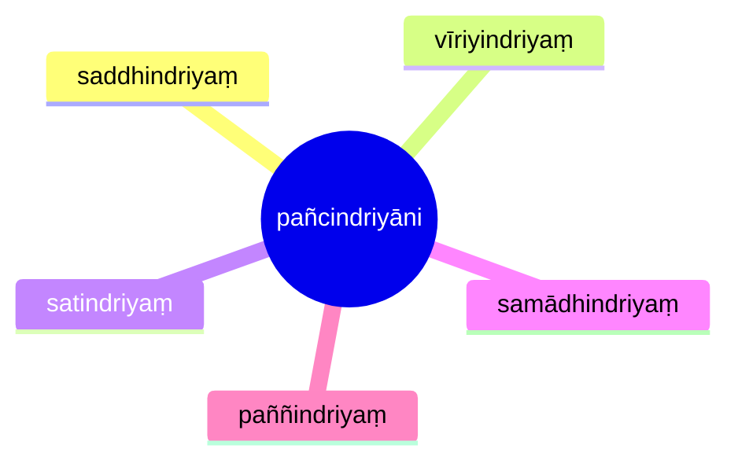

import { Tabs, TabItem } from '@astrojs/starlight/components';

[14S5/4.1.1 Suddhikasutta](https://tipitaka2500.github.io/tipitaka/14S5/4/4.1/4.1.1.html)

<Tabs syncKey="paliquote">
<TabItem label="My Translation">
1000\. [The Bhagavā] was dwelling at Sāvatthī.

There the Bhagavā said this:

> “Bhikkhave, these are the `pañcindriyāni` (five faculties). What five?
>
> * The faculty of `saddhā` (faith),
> * the faculty of `vīriya` (energy),
> * the faculty of `sati` (awareness),
> * the faculty of `samādhi` (focus),
> * the faculty of `paññā` (wisdom) —
>
> these, Bhikkhave, are the five faculties.”
</TabItem>

<TabItem label="Pāḷi (Roman IAST)">
1000\. Sāvatthinidānaṃ. Tatra kho bhagavā etadavoca. “Pañcimāni, bhikkhave, indriyāni. Katamāni pañca? Saddhindriyaṃ, vīriyindriyaṃ, satindriyaṃ, samādhindriyaṃ, paññindriyaṃ—  imāni kho, bhikkhave, pañcindriyānī”ti.
</TabItem>

<TabItem label="Pāḷi (Brahmi)">
1000\. 𑀲𑀸𑀯𑀢𑁆𑀣𑀺𑀦𑀺𑀤𑀸𑀦𑀁. 𑀢𑀢𑁆𑀭 𑀔𑁄 𑀪𑀕𑀯𑀸 𑀏𑀢𑀤𑀯𑁄𑀘. “𑀧𑀜𑁆𑀘𑀺𑀫𑀸𑀦𑀺, 𑀪𑀺𑀓𑁆𑀔𑀯𑁂, 𑀇𑀦𑁆𑀤𑁆𑀭𑀺𑀬𑀸𑀦𑀺. 𑀓𑀢𑀫𑀸𑀦𑀺 𑀧𑀜𑁆𑀘? 𑀲𑀤𑁆𑀥𑀺𑀦𑁆𑀤𑁆𑀭𑀺𑀬𑀁, 𑀯𑀻𑀭𑀺𑀬𑀺𑀦𑁆𑀤𑁆𑀭𑀺𑀬𑀁, 𑀲𑀢𑀺𑀦𑁆𑀤𑁆𑀭𑀺𑀬𑀁, 𑀲𑀫𑀸𑀥𑀺𑀦𑁆𑀤𑁆𑀭𑀺𑀬𑀁, 𑀧𑀜𑁆𑀜𑀺𑀦𑁆𑀤𑁆𑀭𑀺𑀬𑀁—  𑀇𑀫𑀸𑀦𑀺 𑀔𑁄, 𑀪𑀺𑀓𑁆𑀔𑀯𑁂, 𑀧𑀜𑁆𑀘𑀺𑀦𑁆𑀤𑁆𑀭𑀺𑀬𑀸𑀦𑀻”𑀢𑀺.
</TabItem>
<TabItem label="Interlinear">
1000.1 Sāvatthinidānaṃ.  
🚻⨀①🆎(sāvatthī+nidāna)  
set at Sāvatthī  
[The Bhagavā] was dwelling at Sāvatthī.

1000.2 Tatra kho bhagavā etadavoca.  
⏏️(tatra) ⏏️(kho) 🚹⨀①(bhagavant) *️⃣🤟🚻⨀②(eta) 🟢⨀🤟⏮(vadati)  
there | indeed | the Bhagavā | this | said  
There the Bhagavā said this:

1000.3 “Pañcimāni, bhikkhave, indriyāni.  
⚧⨂①(pañca) *️⃣🤟🚻⨂①(ima) 🚹⨂⓪(bhikkhu) 🚻⨂①(indriya)  
five | these | Bhikkhave | faculties  
“Bhikkhave, these are the `pañcindriyāni` (five faculties).

1000.4 Katamāni pañca?  
*️⃣🤟🚻⨂①(katama) ⚧⨂①(pañca)  
which | five  
What five?

1000.5 Saddhindriyaṃ, vīriyindriyaṃ, satindriyaṃ, samādhindriyaṃ, paññindriyaṃ—  imāni kho, bhikkhave, pañcindriyānī”ti.  
🚻⨀①🆎(saddhā+indriya) 🚻⨀①🆎(vīriya+indriya) 🚻⨀①🆎(sati+indriya) 🚻⨀①🆎(samādhi+indriya) 🚻⨀①🆎(paññā+indriya) *️⃣🤟🚻⨂①(ima) ⏏️(kho) 🚹⨂⓪(bhikkhu) 🚻⨂①🆎(pañca+indriya) ⏏️(iti)  
the faculty of faith | the faculty of energy | the faculty of awareness | the faculty of focus | the faculty of wisdom | these | indeed | Bhikkhave | the five faculties | (end quote)  
The faculty of `saddhā` (faith), the faculty of `vīriya` (energy), the faculty of `sati` (awareness), the faculty of `samādhi` (focus), the faculty of `paññā` (wisdom) — these, Bhikkhave, are the five faculties.”
</TabItem>
</Tabs>

