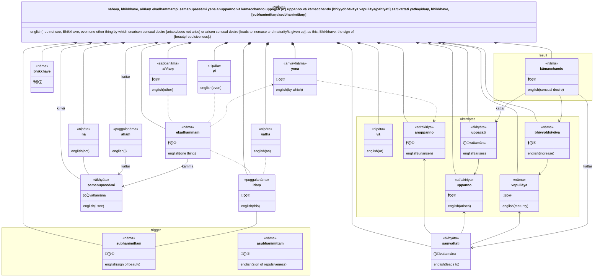
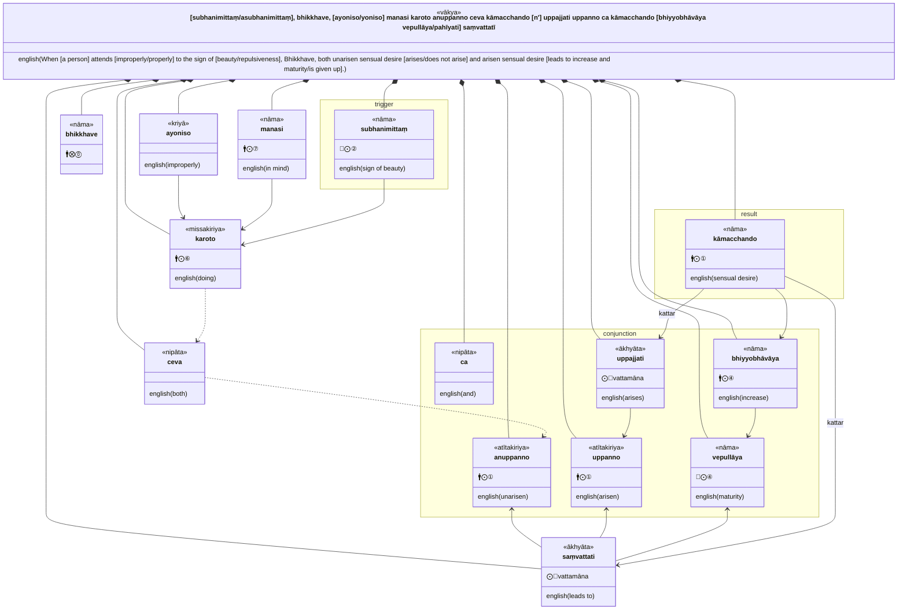
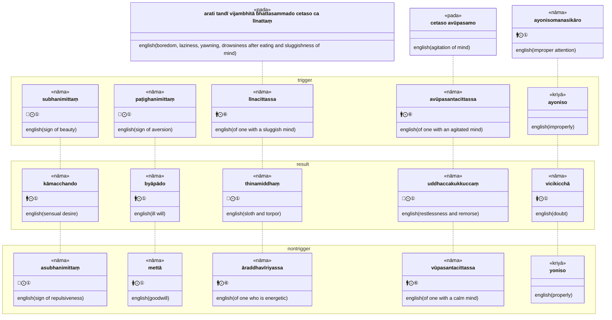

* [15A1/2 Nīvaraṇappahānavagga](https://tipitaka2500.github.io/tipitaka/15A1/2.html)

>11. "nāhaṃ, bhikkhave, aññaṃ ekadhammampi samanupassāmi yena anuppanno vā kāmacchando uppajjati uppanno vā kāmacchando bhiyyobhāvāya vepullāya saṃvattati yathayidaṃ, bhikkhave, subhanimittaṃ. subhanimittaṃ, bhikkhave, ayoniso manasi karoto anuppanno ceva kāmacchando uppajjati uppanno ca kāmacchando bhiyyobhāvāya vepullāya saṃvattatī"ti.  
>12. "nāhaṃ, bhikkhave, aññaṃ ekadhammampi samanupassāmi yena anuppanno vā byāpādo uppajjati uppanno vā byāpādo bhiyyobhāvāya vepullāya saṃvattati yathayidaṃ, bhikkhave, paṭighanimittaṃ. paṭighanimittaṃ, bhikkhave, ayoniso manasi karoto anuppanno ceva byāpādo uppajjati uppanno ca byāpādo bhiyyobhāvāya vepullāya saṃvattatī"ti.  
>13. "nāhaṃ, bhikkhave, aññaṃ ekadhammampi samanupassāmi yena anuppannaṃ vā thinamiddhaṃ uppajjati uppannaṃ vā thinamiddhaṃ bhiyyobhāvāya vepullāya saṃvattati yathayidaṃ, bhikkhave, arati tandī vijambhitā bhattasammado cetaso ca līnattaṃ. līnacittassa, bhikkhave, anuppannañceva thinamiddhaṃ uppajjati uppannañca thinamiddhaṃ bhiyyobhāvāya vepullāya saṃvattatī"ti.  
>14. "nāhaṃ, bhikkhave, aññaṃ ekadhammampi samanupassāmi yena anuppannaṃ vā uddhaccakukkuccaṃ uppajjati uppannaṃ vā uddhaccakukkuccaṃ bhiyyobhāvāya vepullāya saṃvattati yathayidaṃ, bhikkhave, cetaso avūpasamo. avūpasantacittassa, bhikkhave, anuppannañceva uddhaccakukkuccaṃ uppajjati uppannañca uddhaccakukkuccaṃ bhiyyobhāvāya vepullāya saṃvattatī"ti.  
>15. "nāhaṃ, bhikkhave, aññaṃ ekadhammampi samanupassāmi yena anuppannā vā vicikicchā uppajjati uppannā vā vicikicchā bhiyyobhāvāya vepullāya saṃvattati yathayidaṃ, bhikkhave, ayonisomanasikāro. ayoniso, bhikkhave, manasi karoto anuppannā ceva vicikicchā uppajjati uppannā ca vicikicchā bhiyyobhāvāya vepullāya saṃvattatī"ti.  
>16. "nāhaṃ, bhikkhave, aññaṃ ekadhammampi samanupassāmi yena anuppanno vā kāmacchando nuppajjati uppanno vā kāmacchando pahīyati yathayidaṃ, bhikkhave, asubhanimittaṃ. asubhanimittaṃ, bhikkhave, yoniso manasi karoto anuppanno ceva kāmacchando nuppajjati uppanno ca kāmacchando pahīyatī"ti.  
>17. "nāhaṃ, bhikkhave, aññaṃ ekadhammampi samanupassāmi yena anuppanno vā byāpādo nuppajjati uppanno vā byāpādo pahīyati yathayidaṃ, bhikkhave, mettā cetovimutti. mettaṃ, bhikkhave, cetovimuttiṃ yoniso manasi karoto anuppanno ceva byāpādo nuppajjati uppanno ca byāpādo pahīyatī"ti.  
>18. "nāhaṃ, bhikkhave, aññaṃ ekadhammampi samanupassāmi yena anuppannaṃ vā thinamiddhaṃ nuppajjati uppannaṃ vā thinamiddhaṃ pahīyati yathayidaṃ, bhikkhave, ārambhadhātu nikkamadhātu parakkamadhātu. āraddhavīriyassa, bhikkhave, anuppannañceva thinamiddhaṃ nuppajjati uppannañca thinamiddhaṃ pahīyatī"ti.  
>19. "nāhaṃ, bhikkhave, aññaṃ ekadhammampi samanupassāmi yena anuppannaṃ vā uddhaccakukkuccaṃ nuppajjati uppannaṃ vā uddhaccakukkuccaṃ pahīyati yathayidaṃ, bhikkhave, cetaso vūpasamo. vūpasantacittassa, bhikkhave, anuppannañceva uddhaccakukkuccaṃ nuppajjati uppannañca uddhaccakukkuccaṃ pahīyatī"ti.  
>20. "nāhaṃ, bhikkhave, aññaṃ ekadhammampi samanupassāmi yena anuppannā vā vicikicchā nuppajjati uppannā vā vicikicchā pahīyati yathayidaṃ, bhikkhave, yonisomanasikāro. yoniso, bhikkhave, manasi karoto anuppannā ceva vicikicchā nuppajjati uppannā ca vicikicchā pahīyatī"ti.

## Interlinear translation

11.1 "nāhaṃ, bhikkhave, aññaṃ ekadhammampi samanupassāmi yena anuppanno vā kāmacchando uppajjati uppanno vā kāmacchando bhiyyobhāvāya vepullāya saṃvattati yathayidaṃ, bhikkhave, subhanimittaṃ.  
⏏️(na) *️⃣👆⚧⨀①(ahaṃ) 🚹⨂⓪(bhikkhu) *️⃣🤟🚹⨀②(añña) 🚹⨀②🆎(eka+dhamma) ⏏️(api) 🟢⨀👆▶️(samanupassati) *️⃣🤟🚻⨀③(ya) 🚹⨀①🔽(ta)🆎(na+uppanna) ⏏️(vā) 🚹⨀①🆎(kāma+chanda) 🟢⨀🤟▶️(uppajjati) 🚹⨀①🔽(ta)(uppanna) ⏏️(vā) 🚹⨀①🆎(kāma+chanda) 🚹⨀④🆎(bhiyyo+bhāva) 🚻⨀④(vepulla) 🟢⨀🤟▶️(saṃvattati) ⏏️(yathā) *️⃣🤟🚻⨀①(ima) 🚹⨂⓪(bhikkhu) 🚻⨀①🆎(subha+nimitta)  
not | I | Bhikkhave | other | one thing | even | I see | by which | unarisen | or | sensual desire | arises | arisen | or | sensual desire | increase | maturity | leads to | as | this | Bhikkhave | sign of beauty  
“I do not see, Bhikkhave, even one other thing by which unarisen sensual desire arises or arisen sensual desire leads to increase and maturity, as this, Bhikkhave, the sign of beauty.

11.2 subhanimittaṃ, bhikkhave, ayoniso manasi karoto anuppanno ceva kāmacchando uppajjati uppanno ca kāmacchando bhiyyobhāvāya vepullāya saṃvattatī"ti.  
🚻⨀②🆎(subha+nimitta) 🚹⨂⓪(bhikkhu) ⏏️(ayoniso) 🚹⨀⑦(mano) 🚹⨀⑥🔽(anta)(karonta) 🚹⨀①🔽(ta)🆎(na+uppanna) ⏏️(ca) ⏏️(eva) 🚹⨀①🆎(kāma+chanda) 🟢⨀🤟▶️(uppajjati) 🚹⨀①🔽(ta)(uppanna) ⏏️(ca) 🚹⨀①🆎(kāma+chanda) 🚹⨀④🆎(bhiyyo+bhāva) 🚻⨀④(vepulla) 🟢⨀🤟▶️(saṃvattati) ⏏️(iti)  
sign of beauty | Bhikkhave | improperly | in mind | of one doing | unarisen | both | just | sensual desire | arises | arisen | and | sensual desire | increase | maturity | leads to | (end quote)  
When [a person] attends improperly to the sign of beauty, Bhikkhave, both unarisen sensual desire arises and arisen sensual desire leads to increase and maturity.”

12.1 "nāhaṃ, bhikkhave, aññaṃ ekadhammampi samanupassāmi yena anuppanno vā byāpādo uppajjati uppanno vā byāpādo bhiyyobhāvāya vepullāya saṃvattati yathayidaṃ, bhikkhave, paṭighanimittaṃ.  
⏏️(na) *️⃣👆⚧⨀①(ahaṃ) 🚹⨂⓪(bhikkhu) *️⃣🤟🚹⨀②(añña) 🚹⨀②🆎(eka+dhamma) ⏏️(api) 🟢⨀👆▶️(samanupassati) *️⃣🤟🚻⨀③(ya) 🚹⨀①🔽(ta)🆎(na+uppanna) ⏏️(vā) 🚹⨀①(byāpāda) 🟢⨀🤟▶️(uppajjati) 🚹⨀①🔽(ta)(uppanna) ⏏️(vā) 🚹⨀①(byāpāda) 🚹⨀④🆎(bhiyyo+bhāva) 🚻⨀④(vepulla) 🟢⨀🤟▶️(saṃvattati) ⏏️(yathā) *️⃣🤟🚻⨀①(ima) 🚹⨂⓪(bhikkhu) 🚻⨀①🆎(paṭigha+nimitta)  
not | I | Bhikkhave | other | one thing | even | I see | by which | unarisen | or | ill will | arises | arisen | or | ill will | increase | maturity | leads to | as | this | Bhikkhave | sign of aversion  
“I do not see, Bhikkhave, even one other thing by which unarisen ill will arises or arisen ill will leads to increase and maturity, as this, Bhikkhave, the sign of aversion.

12.2 paṭighanimittaṃ, bhikkhave, ayoniso manasi karoto anuppanno ceva byāpādo uppajjati uppanno ca byāpādo bhiyyobhāvāya vepullāya saṃvattatī"ti.  
🚻⨀②🆎(paṭigha+nimitta) 🚹⨂⓪(bhikkhu) ⏏️(ayoniso) 🚹⨀⑦(mano) 🚹⨀⑥🔽(anta)(karonta) 🚹⨀①🔽(ta)🆎(na+uppanna) ⏏️(ca) ⏏️(eva) 🚹⨀①(byāpāda) 🟢⨀🤟▶️(uppajjati) 🚹⨀①🔽(ta)(uppanna) ⏏️(ca) 🚹⨀①(byāpāda) 🚹⨀④🆎(bhiyyo+bhāva) 🚻⨀④(vepulla) 🟢⨀🤟▶️(saṃvattati) ⏏️(iti)  
sign of aversion | Bhikkhave | improperly | in mind | of one doing | unarisen | both | just | ill will | arises | arisen | and | ill will | increase | maturity | leads to | (end quote)  
When [a person] attends improperly to the sign of aversion, Bhikkhave, both unarisen ill will arises and arisen ill will leads to increase and maturity.”

13.1 "nāhaṃ, bhikkhave, aññaṃ ekadhammampi samanupassāmi yena anuppannaṃ vā thinamiddhaṃ uppajjati uppannaṃ vā thinamiddhaṃ bhiyyobhāvāya vepullāya saṃvattati yathayidaṃ, bhikkhave, arati tandī vijambhitā bhattasammado cetaso ca līnattaṃ.  
⏏️(na) *️⃣👆⚧⨀①(ahaṃ) 🚹⨂⓪(bhikkhu) *️⃣🤟🚹⨀②(añña) 🚹⨀②🆎(eka+dhamma) ⏏️(api) 🟢⨀👆▶️(samanupassati) *️⃣🤟🚻⨀③(ya) 🚻⨀①🔽(ta)🆎(na+uppanna) ⏏️(vā) 🚻⨀①🆎(thina+middha) 🟢⨀🤟▶️(uppajjati) 🚻⨀①🔽(ta)(uppanna) ⏏️(vā) 🚻⨀①🆎(thina+middha) 🚹⨀④🆎(bhiyyo+bhāva) 🚻⨀④(vepulla) 🟢⨀🤟▶️(saṃvattati) ⏏️(yathā) *️⃣🤟🚻⨀①(ima) 🚹⨂⓪(bhikkhu) 🚺⨀①🆎(na+rati) 🚺⨀①(tandī) 🚺⨀①(vijambhitā) 🚹⨀①🆎(bhatta+sammada) 🚹⨀⑥(cetas) ⏏️(ca) 🚻⨀①🔽(tta)(līnatta)  
not | I | Bhikkhave | other | one thing | even | I see | by which | unarisen | or | sloth and torpor | arises | arisen | or | sloth and torpor | increase | maturity | leads to | as | this | Bhikkhave | boredom | laziness | yawning | drowsiness after eating | of mind | and | sluggishness  
“I do not see, Bhikkhave, even one other thing by which unarisen sloth and torpor arises or arisen sloth and torpor leads to increase and maturity, as this, Bhikkhave, boredom, laziness, yawning, drowsiness after eating and sluggishness of mind.

13.2 līnacittassa, bhikkhave, anuppannañceva thinamiddhaṃ uppajjati uppannañca thinamiddhaṃ bhiyyobhāvāya vepullāya saṃvattatī"ti.  
🚹⨀⑥🆎(līna+citta) 🚹⨂⓪(bhikkhu) 🚻⨀①🔽(ta)🆎(na+uppanna) ⏏️(ca) ⏏️(eva) 🚻⨀①🆎(thina+middha) 🟢⨀🤟▶️(uppajjati) 🚻⨀①🔽(ta)(uppanna) ⏏️(ca) 🚻⨀①🆎(thina+middha) 🚹⨀④🆎(bhiyyo+bhāva) 🚻⨀④(vepulla) 🟢⨀🤟▶️(saṃvattati) ⏏️(iti)  
of one with a sluggish mind | Bhikkhave | unarisen | both | just | sloth and torpor | arises | arisen | and | sloth and torpor | increase | maturity | leads to | (end quote)  
For one with a sluggish mind, Bhikkhave, both unarisen sloth and torpor arises and arisen sloth and torpor leads to increase and maturity.”

14.1 "nāhaṃ, bhikkhave, aññaṃ ekadhammampi samanupassāmi yena anuppannaṃ vā uddhaccakukkuccaṃ uppajjati uppannaṃ vā uddhaccakukkuccaṃ bhiyyobhāvāya vepullāya saṃvattati yathayidaṃ, bhikkhave, cetaso avūpasamo.  
⏏️(na) *️⃣👆⚧⨀①(ahaṃ) 🚹⨂⓪(bhikkhu) *️⃣🤟🚹⨀②(añña) 🚹⨀②🆎(eka+dhamma) ⏏️(api) 🟢⨀👆▶️(samanupassati) *️⃣🤟🚻⨀③(ya) 🚻⨀①🔽(ta)🆎(na+uppanna) ⏏️(vā) 🚻⨀①🆎(uddhacca+kukkucca) 🟢⨀🤟▶️(uppajjati) 🚻⨀①🔽(ta)(uppanna) ⏏️(vā) 🚻⨀①🆎(uddhacca+kukkucca) 🚹⨀④🆎(bhiyyo+bhāva) 🚻⨀④(vepulla) 🟢⨀🤟▶️(saṃvattati) ⏏️(yathā) *️⃣🤟🚻⨀①(ima) 🚹⨂⓪(bhikkhu) 🚹⨀⑥(cetas) 🚹⨀①🆎(na+vūpasama)  
not | I | Bhikkhave | other | one thing | even | I see | by which | unarisen | or | restlessness and remorse | arises | arisen | or | restlessness and remorse | increase | maturity | leads to | as | this | Bhikkhave | of mind | agitation  
“I do not see, Bhikkhave, even one other thing by which unarisen restlessness and remorse arises or arisen restlessness and remorse leads to increase and maturity, as this, Bhikkhave, agitation of mind.

14.2 avūpasantacittassa, bhikkhave, anuppannañceva uddhaccakukkuccaṃ uppajjati uppannañca uddhaccakukkuccaṃ bhiyyobhāvāya vepullāya saṃvattatī"ti.  
🚹⨀⑥🆎(na+vūpasanta+citta) 🚹⨂⓪(bhikkhu) 🚻⨀①🔽(ta)🆎(na+uppanna) ⏏️(ca) ⏏️(eva) 🚻⨀①🆎(uddhacca+kukkucca) 🟢⨀🤟▶️(uppajjati) 🚻⨀①🔽(ta)(uppanna) ⏏️(ca) 🚻⨀①🆎(uddhacca+kukkucca) 🚹⨀④🆎(bhiyyo+bhāva) 🚻⨀④(vepulla) 🟢⨀🤟▶️(saṃvattati) ⏏️(iti)  
of one with an agitated mind | Bhikkhave | unarisen | both | just | restlessness and remorse | arises | arisen | and | restlessness and remorse | increase | maturity | leads to | (end quote)  
For one with an agitated mind, Bhikkhave, both unarisen restlessness and remorse arises and arisen restlessness and remorse leads to increase and maturity.”

15.1 "nāhaṃ, bhikkhave, aññaṃ ekadhammampi samanupassāmi yena anuppannā vā vicikicchā uppajjati uppannā vā vicikicchā bhiyyobhāvāya vepullāya saṃvattati yathayidaṃ, bhikkhave, ayonisomanasikāro.  
⏏️(na) *️⃣👆⚧⨀①(ahaṃ) 🚹⨂⓪(bhikkhu) *️⃣🤟🚹⨀②(añña) 🚹⨀②🆎(eka+dhamma) ⏏️(api) 🟢⨀👆▶️(samanupassati) *️⃣🤟🚻⨀③(ya) 🚺⨀①🔽(ta)🆎(na+uppanna) ⏏️(vā) 🚺⨀①(vicikicchā) 🟢⨀🤟▶️(uppajjati) 🚺⨀①🔽(ta)(uppanna) ⏏️(vā) 🚺⨀①(vicikicchā) 🚹⨀④🆎(bhiyyo+bhāva) 🚻⨀④(vepulla) 🟢⨀🤟▶️(saṃvattati) ⏏️(yathā) *️⃣🤟🚻⨀①(ima) 🚹⨂⓪(bhikkhu) 🚹⨀①🆎(na+yoniso+manasikāra)  
not | I | Bhikkhave | other | one thing | even | I see | by which | unarisen | or | doubt | arises | arisen | or | doubt | increase | maturity | leads to | as | this | Bhikkhave | improper attention  
“I do not see, Bhikkhave, even one other thing by which unarisen doubt arises or arisen doubt leads to increase and maturity, as this, Bhikkhave, improper attention.

15.2 ayoniso, bhikkhave, manasi karoto anuppannā ceva vicikicchā uppajjati uppannā ca vicikicchā bhiyyobhāvāya vepullāya saṃvattatī"ti.  
⏏️(ayoniso) 🚹⨂⓪(bhikkhu) 🚹⨀⑦(mano) 🚹⨀⑥🔽(anta)(karonta) 🚺⨀①🔽(ta)🆎(na+uppanna) ⏏️(ca) ⏏️(eva) 🚺⨀①(vicikicchā) 🟢⨀🤟▶️(uppajjati) 🚺⨀①🔽(ta)(uppanna) ⏏️(ca) 🚺⨀①(vicikicchā) 🚹⨀④🆎(bhiyyo+bhāva) 🚻⨀④(vepulla) 🟢⨀🤟▶️(saṃvattati) ⏏️(iti)  
improperly | Bhikkhave | in mind | of one doing | unarisen | both | just | doubt | arises | arisen | and | doubt | increase | maturity | leads to | (end quote)  
When [a person] attends improperly, Bhikkhave, both unarisen doubt arises and arisen doubt leads to increase and maturity.”

16.1 "nāhaṃ, bhikkhave, aññaṃ ekadhammampi samanupassāmi yena anuppanno vā kāmacchando nuppajjati uppanno vā kāmacchando pahīyati yathayidaṃ, bhikkhave, asubhanimittaṃ.  
⏏️(na) *️⃣👆⚧⨀①(ahaṃ) 🚹⨂⓪(bhikkhu) *️⃣🤟🚹⨀②(añña) 🚹⨀②🆎(eka+dhamma) ⏏️(api) 🟢⨀👆▶️(samanupassati) *️⃣🤟🚻⨀③(ya) 🚹⨀①🔽(ta)🆎(na+uppanna) ⏏️(vā) 🚹⨀①🆎(kāma+chanda) ⏏️(na) 🟢⨀🤟▶️(uppajjati) 🚹⨀①🔽(ta)(uppanna) ⏏️(vā) 🚹⨀①🆎(kāma+chanda) 🔴⨀🤟▶️(pahīyati) ⏏️(yathā) *️⃣🤟🚻⨀①(ima) 🚹⨂⓪(bhikkhu) 🚻⨀①🆎(na+subha+nimitta)  
not | I | Bhikkhave | other | one thing | even | I see | by which | unarisen | or | sensual desire | not | arises | arisen | or | sensual desire | is given up | as | this | Bhikkhave | sign of repulsiveness  
“I do not see, Bhikkhave, even one other thing by which unarisen sensual desire does not arise or arisen sensual desire is given up, as this, Bhikkhave, the sign of repulsiveness.

16.2 asubhanimittaṃ, bhikkhave, yoniso manasi karoto anuppanno ceva kāmacchando nuppajjati uppanno ca kāmacchando pahīyatī"ti.  
🚻⨀②🆎(na+subha+nimitta) 🚹⨂⓪(bhikkhu) ⏏️(yoniso) 🚹⨀⑦(mano) 🚹⨀⑥🔽(anta)(karonta) 🚹⨀①🔽(ta)🆎(na+uppanna) ⏏️(ca) ⏏️(eva) 🚹⨀①🆎(kāma+chanda) ⏏️(na) 🟢⨀🤟▶️(uppajjati) 🚹⨀①🔽(ta)(uppanna) ⏏️(ca) 🚹⨀①🆎(kāma+chanda) 🔴⨀🤟▶️(pahīyati) ⏏️(iti)  
sign of repulsiveness | Bhikkhave | properly | in mind | of one doing | unarisen | both | just | sensual desire | not | arises | arisen | and | sensual desire | is given up | (end quote)  
When [a person] attends properly to the sign of repulsiveness, Bhikkhave, both unarisen sensual desire does not arise and arisen sensual desire is given up.”

17.1 "nāhaṃ, bhikkhave, aññaṃ ekadhammampi samanupassāmi yena anuppanno vā byāpādo nuppajjati uppanno vā byāpādo pahīyati yathayidaṃ, bhikkhave, mettā cetovimutti.  
⏏️(na) *️⃣👆⚧⨀①(ahaṃ) 🚹⨂⓪(bhikkhu) *️⃣🤟🚹⨀②(añña) 🚹⨀②🆎(eka+dhamma) ⏏️(api) 🟢⨀👆▶️(samanupassati) *️⃣🤟🚻⨀③(ya) 🚹⨀①🔽(ta)🆎(na+uppanna) ⏏️(vā) 🚹⨀①(byāpāda) ⏏️(na) 🟢⨀🤟▶️(uppajjati) 🚹⨀①🔽(ta)(uppanna) ⏏️(vā) 🚹⨀①(byāpāda) 🔴⨀🤟▶️(pahīyati) ⏏️(yathā) *️⃣🤟🚻⨀①(ima) 🚹⨂⓪(bhikkhu) 🚺⨀①(mettā) 🚺⨀①🆎(cetas+vimutti)  
not | I | Bhikkhave | other | one thing | even | I see | by which | unarisen | or | ill will | not | arises | arisen | or | ill will | is given up | as | this | Bhikkhave | goodwill | mental liberation  
“I do not see, Bhikkhave, even one other thing by which unarisen ill will does not arise or arisen ill will is given up, as this, Bhikkhave, the mental liberation of goodwill.

17.2 mettaṃ, bhikkhave, cetovimuttiṃ yoniso manasi karoto anuppanno ceva byāpādo nuppajjati uppanno ca byāpādo pahīyatī"ti.  
🚺⨀②(mettā) 🚹⨂⓪(bhikkhu) 🚺⨀②🆎(cetas+vimutti) ⏏️(yoniso) 🚹⨀⑦(mano) 🚹⨀⑥🔽(anta)(karonta) 🚹⨀①🔽(ta)🆎(na+uppanna) ⏏️(ca) ⏏️(eva) 🚹⨀①(byāpāda) ⏏️(na) 🟢⨀🤟▶️(uppajjati) 🚹⨀①🔽(ta)(uppanna) ⏏️(ca) 🚹⨀①(byāpāda) 🔴⨀🤟▶️(pahīyati) ⏏️(iti)  
goodwill | Bhikkhave | mental liberation | properly | in mind | of one doing | unarisen | both | just | ill will | not | arises | arisen | and | ill will | is given up | (end quote)  
When [a person] attends properly to the mental liberation of goodwill, Bhikkhave, both unarisen ill will does not arise and arisen ill will is given up.”

18.1 "nāhaṃ, bhikkhave, aññaṃ ekadhammampi samanupassāmi yena anuppannaṃ vā thinamiddhaṃ nuppajjati uppannaṃ vā thinamiddhaṃ pahīyati yathayidaṃ, bhikkhave, ārambhadhātu nikkamadhātu parakkamadhātu.  
⏏️(na) *️⃣👆⚧⨀①(ahaṃ) 🚹⨂⓪(bhikkhu) *️⃣🤟🚹⨀②(añña) 🚹⨀②🆎(eka+dhamma) ⏏️(api) 🟢⨀👆▶️(samanupassati) *️⃣🤟🚻⨀③(ya) 🚻⨀①🔽(ta)🆎(na+uppanna) ⏏️(vā) 🚻⨀①🆎(thina+middha) ⏏️(na) 🟢⨀🤟▶️(uppajjati) 🚻⨀①🔽(ta)(uppanna) ⏏️(vā) 🚻⨀①🆎(thina+middha) 🔴⨀🤟▶️(pahīyati) ⏏️(yathā) *️⃣🤟🚻⨀①(ima) 🚹⨂⓪(bhikkhu) 🚺⨀①🆎(ārambha+dhātu) 🚺⨀①🆎(nikkama+dhātu) 🚺⨀①🆎(parakkama+dhātu)  
not | I | Bhikkhave | other | one thing | even | I see | by which | unarisen | or | sloth and torpor | not | arises | arisen | or | sloth and torpor | is given up | as | this | Bhikkhave | element of initiative | element of endurance | element of perseverance  
“I do not see, Bhikkhave, even one other thing by which unarisen sloth and torpor does not arise or arisen sloth and torpor is given up, as this, Bhikkhave, the element of initiative, the element of endurance and the element of perseverance.

18.2 āraddhavīriyassa, bhikkhave, anuppannañceva thinamiddhaṃ nuppajjati uppannañca thinamiddhaṃ pahīyatī"ti.  
🚹⨀⑥🆎(āraddha+vīriya) 🚹⨂⓪(bhikkhu) 🚻⨀①🔽(ta)🆎(na+uppanna) ⏏️(ca) ⏏️(eva) 🚻⨀①🆎(thina+middha) ⏏️(na) 🟢⨀🤟▶️(uppajjati) 🚻⨀①🔽(ta)(uppanna) ⏏️(ca) 🚻⨀①🆎(thina+middha) 🔴⨀🤟▶️(pahīyati) ⏏️(iti)  
of one who is energetic | Bhikkhave | unarisen | both | just | sloth and torpor | not | arises | arisen | and | sloth and torpor | is given up | (end quote)  
For one who is energetic, Bhikkhave, both unarisen sloth and torpor does not arise and arisen sloth and torpor is given up.”

19.1 "nāhaṃ, bhikkhave, aññaṃ ekadhammampi samanupassāmi yena anuppannaṃ vā uddhaccakukkuccaṃ nuppajjati uppannaṃ vā uddhaccakukkuccaṃ pahīyati yathayidaṃ, bhikkhave, cetaso vūpasamo.  
⏏️(na) *️⃣👆⚧⨀①(ahaṃ) 🚹⨂⓪(bhikkhu) *️⃣🤟🚹⨀②(añña) 🚹⨀②🆎(eka+dhamma) ⏏️(api) 🟢⨀👆▶️(samanupassati) *️⃣🤟🚻⨀③(ya) 🚻⨀①🔽(ta)🆎(na+uppanna) ⏏️(vā) 🚻⨀①🆎(uddhacca+kukkucca) ⏏️(na) 🟢⨀🤟▶️(uppajjati) 🚻⨀①🔽(ta)(uppanna) ⏏️(vā) 🚻⨀①🆎(uddhacca+kukkucca) 🔴⨀🤟▶️(pahīyati) ⏏️(yathā) *️⃣🤟🚻⨀①(ima) 🚹⨂⓪(bhikkhu) 🚹⨀⑥(cetas) 🚹⨀①(vūpasama)  
not | I | Bhikkhave | other | one thing | even | I see | by which | unarisen | or | restlessness and remorse | not | arises | arisen | or | restlessness and remorse | is given up | as | this | Bhikkhave | of mind | calming  
“I do not see, Bhikkhave, even one other thing by which unarisen restlessness and remorse does not arise or arisen restlessness and remorse is given up, as this, Bhikkhave, calming of mind.

19.2 vūpasantacittassa, bhikkhave, anuppannañceva uddhaccakukkuccaṃ nuppajjati uppannañca uddhaccakukkuccaṃ pahīyatī"ti.  
🚹⨀⑥🆎(vūpasanta+citta) 🚹⨂⓪(bhikkhu) 🚻⨀①🔽(ta)🆎(na+uppanna) ⏏️(ca) ⏏️(eva) 🚻⨀①🆎(uddhacca+kukkucca) ⏏️(na) 🟢⨀🤟▶️(uppajjati) 🚻⨀①🔽(ta)(uppanna) ⏏️(ca) 🚻⨀①🆎(uddhacca+kukkucca) 🔴⨀🤟▶️(pahīyati) ⏏️(iti)  
of one with a calm mind | Bhikkhave | unarisen | both | just | restlessness and remorse | not | arises | arisen | and | restlessness and remorse | is given up | (end quote)  
For one with a calm mind, Bhikkhave, both unarisen restlessness and remorse does not arise and arisen restlessness and remorse is given up.”

20.1 "nāhaṃ, bhikkhave, aññaṃ ekadhammampi samanupassāmi yena anuppannā vā vicikicchā nuppajjati uppannā vā vicikicchā pahīyati yathayidaṃ, bhikkhave, yonisomanasikāro.  
⏏️(na) *️⃣👆⚧⨀①(ahaṃ) 🚹⨂⓪(bhikkhu) *️⃣🤟🚹⨀②(añña) 🚹⨀②🆎(eka+dhamma) ⏏️(api) 🟢⨀👆▶️(samanupassati) *️⃣🤟🚻⨀③(ya) 🚺⨀①🔽(ta)🆎(na+uppanna) ⏏️(vā) 🚺⨀①(vicikicchā) ⏏️(na) 🟢⨀🤟▶️(uppajjati) 🚺⨀①🔽(ta)(uppanna) ⏏️(vā) 🚺⨀①(vicikicchā) 🔴⨀🤟▶️(pahīyati) ⏏️(yathā) *️⃣🤟🚻⨀①(ima) 🚹⨂⓪(bhikkhu) 🚹⨀①🆎(yoniso+manasikāra)  
not | I | Bhikkhave | other | one thing | even | I see | by which | unarisen | or | doubt | not | arises | arisen | or | doubt | is given up | as | this | Bhikkhave | proper attention  
“I do not see, Bhikkhave, even one other thing by which unarisen doubt does not arise or arisen doubt is given up, as this, Bhikkhave, proper attention.

20.2 yoniso, bhikkhave, manasi karoto anuppannā ceva vicikicchā nuppajjati uppannā ca vicikicchā pahīyatī"ti.  
⏏️(yoniso) 🚹⨂⓪(bhikkhu) 🚹⨀⑦(mano) 🚹⨀⑥🔽(anta)(karonta) 🚺⨀①🔽(ta)🆎(na+uppanna) ⏏️(ca) ⏏️(eva) 🚺⨀①(vicikicchā) ⏏️(na) 🟢⨀🤟▶️(uppajjati) 🚺⨀①🔽(ta)(uppanna) ⏏️(ca) 🚺⨀①(vicikicchā) 🔴⨀🤟▶️(pahīyati) ⏏️(iti)  
properly | Bhikkhave | in mind | of one doing | unarisen | both | just | doubt | not | arises | arisen | and | doubt | is given up | (end quote)  
When [a person] attends properly, Bhikkhave, both unarisen doubt does not arise and arisen doubt is given up.”
