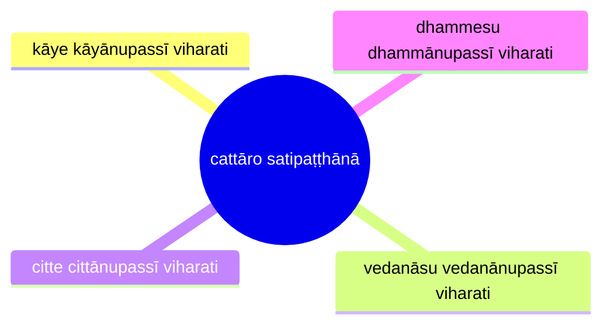

import { Tabs, TabItem } from '@astrojs/starlight/components';

* [14S5/3.1.1 Ambapālisutta](https://tipitaka2500.github.io/tipitaka/14S5/3/3.1/3.1.1.html)

<Tabs syncKey="paliquote">
<TabItem label="My Translation">
> 751\. “Bhikkhave, this is the direct path
>
> * for the purification of beings,
> * for the overcoming of sorrow and lamentation,
> * for the disappearance of pain and displeasure,
> * for the attainment of the right method,
> * for the realisation of `nibbāna` (extinguishment)
>
> — namely, `cattāro satipaṭṭhānā` (the four reflections). What four? Here, Bhikkhave:
>
> * a bhikkhu `kāye kāyānupassī viharati` (stays aware, observing the body [or, physical objects] in the body), ardent, clearly comprehending, with awareness, having removed covetousness and displeasure in the world;
> * he stays aware, observing `vedanā` (feelings) in feelings, ardent, clearly comprehending, with awareness, having removed covetousness and displeasure in the world;
> * he stays aware, observing `citta` (the mind) in the mind, ardent, clearly comprehending, with awareness, having removed covetousness and displeasure in the world;
> * he stays aware, observing `dhamma` (perceptual objects) in dhamma, ardent, clearly comprehending, with awareness, having removed covetousness and displeasure in the world.
>
> Bhikkhave, this is the direct path for the purification of beings, for the overcoming of sorrow and lamentation, for the disappearance of pain and displeasure, for the attainment of the right method, for the realisation of extinguishment — namely, the four reflections.”
</TabItem>

<TabItem label="Pāḷi (Roman IAST)">
751\. “Ekāyanvāyaṃ, bhikkhave, maggo sattānaṃ visuddhiyā sokaparidevānaṃ samatikkamāya dukkhadomanassānaṃ atthaṅgamāya ñāyassa adhigamāya nibbānassa sacchikiriyāya, yadidaṃ—  cattāro satipaṭṭhānā. Katame cattāro? Idha, bhikkhave, bhikkhu kāye kāyānupassī viharati ātāpī sampajāno satimā, vineyya loke abhijjhādomanassaṃ; vedanāsu vedanānupassī viharati ātāpī sampajāno satimā, vineyya loke abhijjhādomanassaṃ; citte cittānupassī viharati ātāpī sampajāno satimā, vineyya loke abhijjhādomanassaṃ; dhammesu dhammānupassī viharati ātāpī sampajāno satimā, vineyya loke abhijjhādomanassaṃ. Ekāyanvāyaṃ, bhikkhave, maggo sattānaṃ visuddhiyā sokaparidevānaṃ samatikkamāya dukkhadomanassānaṃ atthaṅgamāya ñāyassa adhigamāya nibbānassa sacchikiriyāya, yadidaṃ—  cattāro satipaṭṭhānā”ti.
</TabItem>

<TabItem label="Pāḷi (Brahmi)">
751\. “𑀏𑀓𑀸𑀬𑀦𑁆𑀯𑀸𑀬𑀁, 𑀪𑀺𑀓𑁆𑀔𑀯𑁂, 𑀫𑀕𑁆𑀕𑁄 𑀲𑀢𑁆𑀢𑀸𑀦𑀁 𑀯𑀺𑀲𑀼𑀤𑁆𑀥𑀺𑀬𑀸 𑀲𑁄𑀓𑀧𑀭𑀺𑀤𑁂𑀯𑀸𑀦𑀁 𑀲𑀫𑀢𑀺𑀓𑁆𑀓𑀫𑀸𑀬 𑀤𑀼𑀓𑁆𑀔𑀤𑁄𑀫𑀦𑀲𑁆𑀲𑀸𑀦𑀁 𑀅𑀢𑁆𑀣𑀗𑁆𑀕𑀫𑀸𑀬 𑀜𑀸𑀬𑀲𑁆𑀲 𑀅𑀥𑀺𑀕𑀫𑀸𑀬 𑀦𑀺𑀩𑁆𑀩𑀸𑀦𑀲𑁆𑀲 𑀲𑀘𑁆𑀙𑀺𑀓𑀺𑀭𑀺𑀬𑀸𑀬, 𑀬𑀤𑀺𑀤𑀁—  𑀘𑀢𑁆𑀢𑀸𑀭𑁄 𑀲𑀢𑀺𑀧𑀝𑁆𑀞𑀸𑀦𑀸. 𑀓𑀢𑀫𑁂 𑀘𑀢𑁆𑀢𑀸𑀭𑁄? 𑀇𑀥, 𑀪𑀺𑀓𑁆𑀔𑀯𑁂, 𑀪𑀺𑀓𑁆𑀔𑀼 𑀓𑀸𑀬𑁂 𑀓𑀸𑀬𑀸𑀦𑀼𑀧𑀲𑁆𑀲𑀻 𑀯𑀺𑀳𑀭𑀢𑀺 𑀆𑀢𑀸𑀧𑀻 𑀲𑀫𑁆𑀧𑀚𑀸𑀦𑁄 𑀲𑀢𑀺𑀫𑀸, 𑀯𑀺𑀦𑁂𑀬𑁆𑀬 𑀮𑁄𑀓𑁂 𑀅𑀪𑀺𑀚𑁆𑀛𑀸𑀤𑁄𑀫𑀦𑀲𑁆𑀲𑀁; 𑀯𑁂𑀤𑀦𑀸𑀲𑀼 𑀯𑁂𑀤𑀦𑀸𑀦𑀼𑀧𑀲𑁆𑀲𑀻 𑀯𑀺𑀳𑀭𑀢𑀺 𑀆𑀢𑀸𑀧𑀻 𑀲𑀫𑁆𑀧𑀚𑀸𑀦𑁄 𑀲𑀢𑀺𑀫𑀸, 𑀯𑀺𑀦𑁂𑀬𑁆𑀬 𑀮𑁄𑀓𑁂 𑀅𑀪𑀺𑀚𑁆𑀛𑀸𑀤𑁄𑀫𑀦𑀲𑁆𑀲𑀁; 𑀘𑀺𑀢𑁆𑀢𑁂 𑀘𑀺𑀢𑁆𑀢𑀸𑀦𑀼𑀧𑀲𑁆𑀲𑀻 𑀯𑀺𑀳𑀭𑀢𑀺 𑀆𑀢𑀸𑀧𑀻 𑀲𑀫𑁆𑀧𑀚𑀸𑀦𑁄 𑀲𑀢𑀺𑀫𑀸, 𑀯𑀺𑀦𑁂𑀬𑁆𑀬 𑀮𑁄𑀓𑁂 𑀅𑀪𑀺𑀚𑁆𑀛𑀸𑀤𑁄𑀫𑀦𑀲𑁆𑀲𑀁; 𑀥𑀫𑁆𑀫𑁂𑀲𑀼 𑀥𑀫𑁆𑀫𑀸𑀦𑀼𑀧𑀲𑁆𑀲𑀻 𑀯𑀺𑀳𑀭𑀢𑀺 𑀆𑀢𑀸𑀧𑀻 𑀲𑀫𑁆𑀧𑀚𑀸𑀦𑁄 𑀲𑀢𑀺𑀫𑀸, 𑀯𑀺𑀦𑁂𑀬𑁆𑀬 𑀮𑁄𑀓𑁂 𑀅𑀪𑀺𑀚𑁆𑀛𑀸𑀤𑁄𑀫𑀦𑀲𑁆𑀲𑀁. 𑀏𑀓𑀸𑀬𑀦𑁆𑀯𑀸𑀬𑀁, 𑀪𑀺𑀓𑁆𑀔𑀯𑁂, 𑀫𑀕𑁆𑀕𑁄 𑀲𑀢𑁆𑀢𑀸𑀦𑀁 𑀯𑀺𑀲𑀼𑀤𑁆𑀥𑀺𑀬𑀸 𑀲𑁄𑀓𑀧𑀭𑀺𑀤𑁂𑀯𑀸𑀦𑀁 𑀲𑀫𑀢𑀺𑀓𑁆𑀓𑀫𑀸𑀬 𑀤𑀼𑀓𑁆𑀔𑀤𑁄𑀫𑀦𑀲𑁆𑀲𑀸𑀦𑀁 𑀅𑀢𑁆𑀣𑀗𑁆𑀕𑀫𑀸𑀬 𑀜𑀸𑀬𑀲𑁆𑀲 𑀅𑀥𑀺𑀕𑀫𑀸𑀬 𑀦𑀺𑀩𑁆𑀩𑀸𑀦𑀲𑁆𑀲 𑀲𑀘𑁆𑀙𑀺𑀓𑀺𑀭𑀺𑀬𑀸𑀬, 𑀬𑀤𑀺𑀤𑀁—  𑀘𑀢𑁆𑀢𑀸𑀭𑁄 𑀲𑀢𑀺𑀧𑀝𑁆𑀞𑀸𑀦𑀸”𑀢𑀺.
</TabItem>
<TabItem label="Interlinear">
751.1 “Ekāyanvāyaṃ, bhikkhave, maggo sattānaṃ visuddhiyā sokaparidevānaṃ samatikkamāya dukkhadomanassānaṃ atthaṅgamāya ñāyassa adhigamāya nibbānassa sacchikiriyāya, yadidaṃ—  cattāro satipaṭṭhānā.  
🚹⨀①🆎(eka+ayana) *️⃣🤟🚹⨀①(ima) 🚹⨂⓪(bhikkhu) 🚹⨀①(magga) 🚹⨂⑥(satta) 🚺⨀④(visuddhi) 🚹⨂⑥🆎(soka+parideva) 🚹⨀④(samatikkama) 🚻⨂⑥🆎(dukkha+domanassa) 🚹⨀④🆎(attha+gama) 🚹⨀⑥(ñāya) 🚹⨀④(adhigama) 🚻⨀⑥(nibbāna) 🚺⨀④🆎(sacchi+kiriyā) *️⃣🤟🚻⨀①(ya) *️⃣🤟🚻⨀①(ima) 🚹⨂①(catu) 🚹⨂①🆎(sati+upaṭṭhāna)  
direct | this | Bhikkhave | path | of beings | for the purification | of sorrow and lamentation | for the overcoming | of pain and displeasure | for the disappearance | of the right method | for the attainment | of extinguishment | for the realisation | which | this | four | reflections  
“Bhikkhave, this is the direct path for the purification of beings, for the overcoming of sorrow and lamentation, for the disappearance of pain and displeasure, for the attainment of the right method, for the realisation of `nibbāna` (extinguishment) — namely, `cattāro satipaṭṭhānā` (the four reflections).

751.2 Katame cattāro?  
*️⃣🤟🚹⨂①(katama) 🚹⨂①(catu)  
which | four  
What four?

751.3 Idha, bhikkhave, bhikkhu kāye kāyānupassī viharati ātāpī sampajāno satimā, vineyya loke abhijjhādomanassaṃ;  
⏏️(idha) 🚹⨂⓪(bhikkhu) 🚹⨀①(bhikkhu) 🚹⨀⑦(kāya) 🚹⨀①🆎(kāya+anupassī) 🟢⨀🤟▶️(viharati) 🚹⨀①(ātāpī) 🚹⨀①(sampajāna) 🚹⨀①🔽(mantu)(satimant) 🔽(ya)(vineti) 🚹⨀⑦(loka) 🚹⨀②🆎(abhijjhā+domanassa)  
here | Bhikkhave | a bhikkhu | in the body | observing the body | stays aware | ardent | clearly comprehending | with awareness | having removed | in the world | covetousness and displeasure  
Here, Bhikkhave: a bhikkhu `kāye kāyānupassī viharati` (stays aware, observing the body [or, physical objects] in the body), ardent, clearly comprehending, with awareness, having removed covetousness and displeasure in the world;

751.4 vedanāsu vedanānupassī viharati ātāpī sampajāno satimā, vineyya loke abhijjhādomanassaṃ;  
🚺⨂⑦(vedanā) 🚹⨀①🆎(vedanā+anupassī) 🟢⨀🤟▶️(viharati) 🚹⨀①(ātāpī) 🚹⨀①(sampajāna) 🚹⨀①🔽(mantu)(satimant) 🔽(ya)(vineti) 🚹⨀⑦(loka) 🚹⨀②🆎(abhijjhā+domanassa)  
in feelings | observing feelings | stays aware | ardent | clearly comprehending | with awareness | having removed | in the world | covetousness and displeasure  
he stays aware, observing `vedanā` (feelings) in feelings, ardent, clearly comprehending, with awareness, having removed covetousness and displeasure in the world;

751.5 citte cittānupassī viharati ātāpī sampajāno satimā, vineyya loke abhijjhādomanassaṃ;  
🚻⨀⑦(citta) 🚹⨀①🆎(citta+anupassī) 🟢⨀🤟▶️(viharati) 🚹⨀①(ātāpī) 🚹⨀①(sampajāna) 🚹⨀①🔽(mantu)(satimant) 🔽(ya)(vineti) 🚹⨀⑦(loka) 🚹⨀②🆎(abhijjhā+domanassa)  
in the mind | observing the mind | stays aware | ardent | clearly comprehending | with awareness | having removed | in the world | covetousness and displeasure  
he stays aware, observing `citta` (the mind) in the mind, ardent, clearly comprehending, with awareness, having removed covetousness and displeasure in the world;

751.6 dhammesu dhammānupassī viharati ātāpī sampajāno satimā, vineyya loke abhijjhādomanassaṃ.  
🚹⨂⑦(dhamma) 🚹⨀①🆎(dhamma+anupassī) 🟢⨀🤟▶️(viharati) 🚹⨀①(ātāpī) 🚹⨀①(sampajāna) 🚹⨀①🔽(mantu)(satimant) 🔽(ya)(vineti) 🚹⨀⑦(loka) 🚹⨀②🆎(abhijjhā+domanassa)  
in perceptual objects | observing perceptual objects | stays aware | ardent | clearly comprehending | with awareness | having removed | in the world | covetousness and displeasure  
he stays aware, observing `dhamma` (perceptual objects) in dhamma, ardent, clearly comprehending, with awareness, having removed covetousness and displeasure in the world.

751.7 Ekāyanvāyaṃ, bhikkhave, maggo sattānaṃ visuddhiyā sokaparidevānaṃ samatikkamāya dukkhadomanassānaṃ atthaṅgamāya ñāyassa adhigamāya nibbānassa sacchikiriyāya, yadidaṃ—  cattāro satipaṭṭhānā”ti.  
🚹⨀①🆎(eka+ayana) *️⃣🤟🚹⨀①(ima) 🚹⨂⓪(bhikkhu) 🚹⨀①(magga) 🚹⨂⑥(satta) 🚺⨀④(visuddhi) 🚹⨂⑥🆎(soka+parideva) 🚹⨀④(samatikkama) 🚻⨂⑥🆎(dukkha+domanassa) 🚹⨀④🆎(attha+gama) 🚹⨀⑥(ñāya) 🚹⨀④(adhigama) 🚻⨀⑥(nibbāna) 🚺⨀④🆎(sacchi+kiriyā) *️⃣🤟🚻⨀①(ya) *️⃣🤟🚻⨀①(ima) 🚹⨂①(catu) 🚹⨂①🆎(sati+upaṭṭhāna) ⏏️(iti)  
direct | this | Bhikkhave | path | of beings | for the purification | of sorrow and lamentation | for the overcoming | of pain and displeasure | for the disappearance | of the right method | for the attainment | of extinguishment | for the realisation | which | this | four | reflections | (end quote)  
Bhikkhave, this is the direct path for the purification of beings, for the overcoming of sorrow and lamentation, for the disappearance of pain and displeasure, for the attainment of the right method, for the realisation of extinguishment — namely, the four reflections.”
</TabItem>
</Tabs>

[7D/9 Mahāsatipaṭṭhānasutta](https://tipitaka2500.github.io/tipitaka/7D/9.html):

* kāye kāyānupassī viharati (stays aware, observing the body in the body)
* vedanāsu vedanānupassī viharati (stays aware, observing feelings in feelings)
* citte cittānupassī viharati (stays aware, observing the mind in the mind)
* dhammesu dhammānupassī viharati (stays aware, observing phenomena in phenomena)

