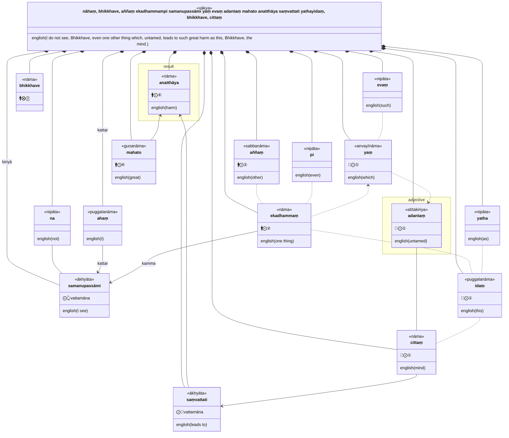
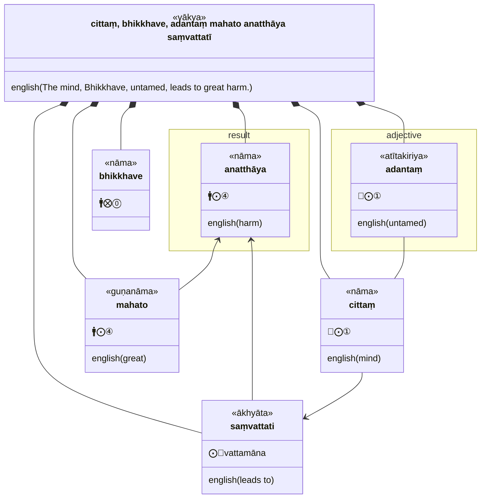
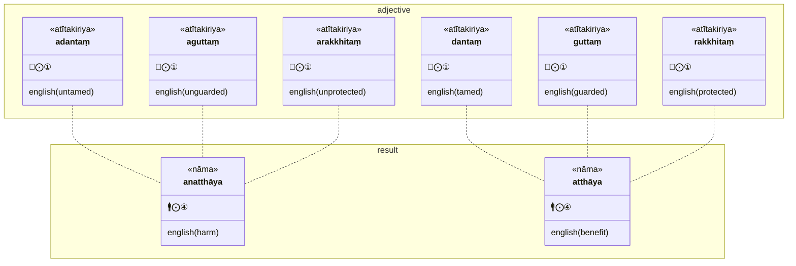
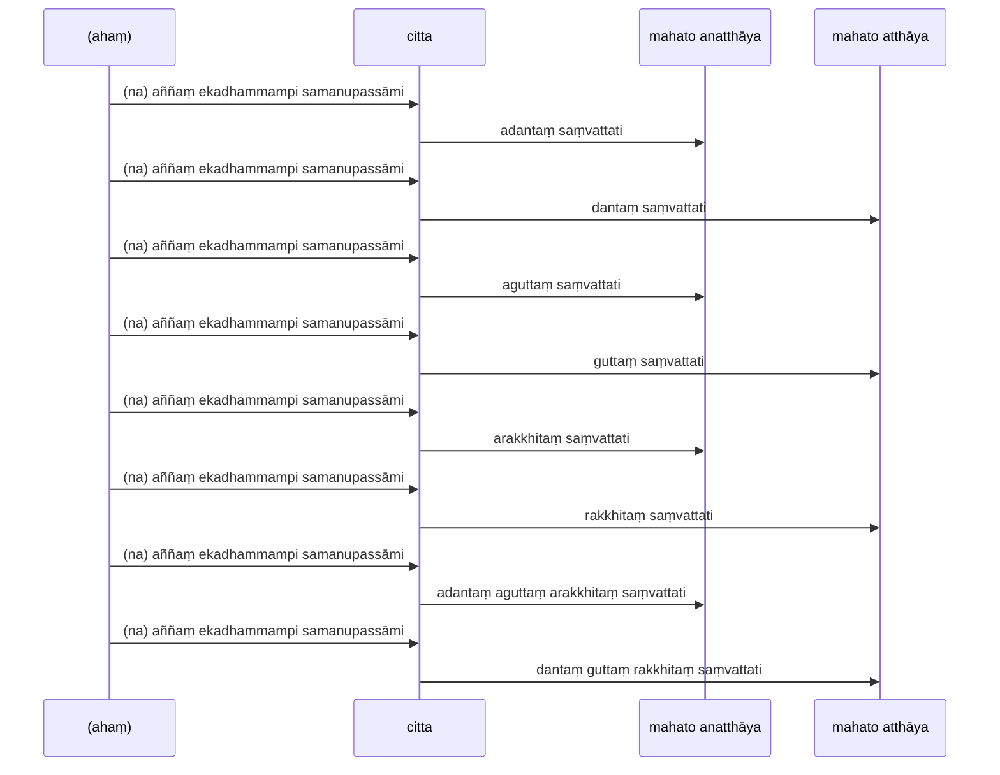
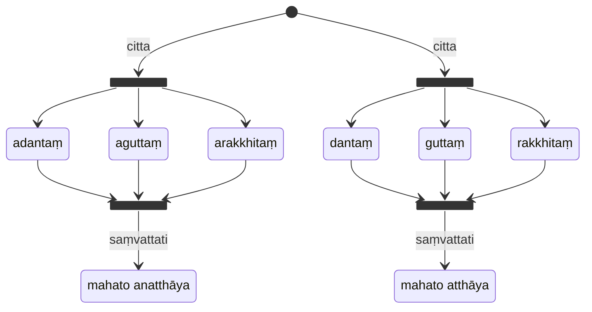

Restraining, Guarding and Protecting the Mind

* [15A1/4 Adantavagga](https://tipitaka2500.github.io/tipitaka/15A1/4.html)

>31. "nāhaṃ, bhikkhave, aññaṃ ekadhammampi samanupassāmi yaṃ evaṃ adantaṃ mahato anatthāya saṃvattati yathayidaṃ, bhikkhave, cittaṃ. cittaṃ, bhikkhave, adantaṃ mahato anatthāya saṃvattatī"ti.
>32. "nāhaṃ, bhikkhave, aññaṃ ekadhammampi samanupassāmi yaṃ evaṃ dantaṃ mahato atthāya saṃvattati yathayidaṃ, bhikkhave, cittaṃ. cittaṃ, bhikkhave, dantaṃ mahato atthāya saṃvattatī"ti.
>33. "nāhaṃ, bhikkhave, aññaṃ ekadhammampi samanupassāmi yaṃ evaṃ aguttaṃ mahato anatthāya saṃvattati yathayidaṃ, bhikkhave, cittaṃ. cittaṃ, bhikkhave, aguttaṃ mahato anatthāya saṃvattatī"ti.
>34. "nāhaṃ, bhikkhave, aññaṃ ekadhammampi samanupassāmi yaṃ evaṃ guttaṃ mahato atthāya saṃvattati yathayidaṃ, bhikkhave, cittaṃ. cittaṃ, bhikkhave, guttaṃ mahato atthāya saṃvattatī"ti.
>35. "nāhaṃ, bhikkhave, aññaṃ ekadhammampi samanupassāmi yaṃ evaṃ arakkhitaṃ mahato anatthāya saṃvattati yathayidaṃ, bhikkhave, cittaṃ. cittaṃ, bhikkhave, arakkhitaṃ mahato anatthāya saṃvattatī"ti.
>36. "nāhaṃ, bhikkhave, aññaṃ ekadhammampi samanupassāmi yaṃ evaṃ rakkhitaṃ mahato atthāya saṃvattati yathayidaṃ, bhikkhave, cittaṃ. cittaṃ, bhikkhave, rakkhitaṃ mahato atthāya saṃvattatī"ti.
>37. "nāhaṃ, bhikkhave, aññaṃ ekadhammampi samanupassāmi yaṃ evaṃ asaṃvutaṃ mahato anatthāya saṃvattati yathayidaṃ, bhikkhave, cittaṃ. cittaṃ, bhikkhave, asaṃvutaṃ mahato anatthāya saṃvattatī"ti.
>38. "nāhaṃ, bhikkhave, aññaṃ ekadhammampi samanupassāmi yaṃ evaṃ saṃvutaṃ mahato atthāya saṃvattati yathayidaṃ, bhikkhave, cittaṃ. cittaṃ, bhikkhave, saṃvutaṃ mahato atthāya saṃvattatī"ti.
>39. "nāhaṃ, bhikkhave, aññaṃ ekadhammampi samanupassāmi yaṃ evaṃ adantaṃ aguttaṃ arakkhitaṃ asaṃvutaṃ mahato anatthāya saṃvattati yathayidaṃ, bhikkhave, cittaṃ. cittaṃ, bhikkhave, adantaṃ aguttaṃ arakkhitaṃ asaṃvutaṃ mahato anatthāya saṃvattatī"ti.
>40. "nāhaṃ, bhikkhave, aññaṃ ekadhammampi samanupassāmi yaṃ evaṃ dantaṃ guttaṃ rakkhitaṃ saṃvutaṃ mahato atthāya saṃvattati yathayidaṃ, bhikkhave, cittaṃ. cittaṃ, bhikkhave, dantaṃ guttaṃ rakkhitaṃ saṃvutaṃ mahato atthāya saṃvattatī"ti.

## Interlinear translation

31.1 "nāhaṃ, bhikkhave, aññaṃ ekadhammampi samanupassāmi yaṃ evaṃ adantaṃ mahato anatthāya saṃvattati yathayidaṃ, bhikkhave, cittaṃ.  
⏏️(na) *️⃣👆⚧⨀①(ahaṃ) 🚹⨂⓪(bhikkhu) *️⃣🤟🚹⨀②(añña) 🚹⨀②🆎(eka+dhamma) ⏏️(api) 🟢⨀👆▶️(samanupassati) *️⃣🤟🚻⨀①(ya) ⏏️(evaṃ) 🚻⨀①🔽(ta)🆎(na+danta) 🚹⨀④(mahanta) 🚹⨀④🆎(na+attha) 🟢⨀🤟▶️(saṃvattati) ⏏️(yathā) *️⃣🤟🚻⨀①(ima) 🚹⨂⓪(bhikkhu) 🚻⨀①(citta)  
not | I | Bhikkhave | other | one thing | even | I see | which | such | untamed | great | harm | leads to | as | this | Bhikkhave | mind  
“I do not see, Bhikkhave, even one other thing which, untamed, leads to such great harm as this, Bhikkhave, the mind.

31.2 cittaṃ, bhikkhave, adantaṃ mahato anatthāya saṃvattatī"ti.  
🚻⨀①(citta) 🚹⨂⓪(bhikkhu) 🚻⨀①🔽(ta)🆎(na+danta) 🚹⨀④(mahanta) 🚹⨀④🆎(na+attha) 🟢⨀🤟▶️(saṃvattati) ⏏️(iti)  
mind | Bhikkhave | untamed | great | harm | leads to | (end quote)  
The mind, Bhikkhave, untamed, leads to great harm.”

32.1 "nāhaṃ, bhikkhave, aññaṃ ekadhammampi samanupassāmi yaṃ evaṃ dantaṃ mahato atthāya saṃvattati yathayidaṃ, bhikkhave, cittaṃ.  
⏏️(na) *️⃣👆⚧⨀①(ahaṃ) 🚹⨂⓪(bhikkhu) *️⃣🤟🚹⨀②(añña) 🚹⨀②🆎(eka+dhamma) ⏏️(api) 🟢⨀👆▶️(samanupassati) *️⃣🤟🚻⨀①(ya) ⏏️(evaṃ) 🚻⨀①🔽(ta)(danta) 🚹⨀④(mahanta) 🚹⨀④(attha) 🟢⨀🤟▶️(saṃvattati) ⏏️(yathā) *️⃣🤟🚻⨀①(ima) 🚹⨂⓪(bhikkhu) 🚻⨀①(citta)  
not | I | Bhikkhave | other | one thing | even | I see | which | such | tamed | great | benefit | leads to | as | this | Bhikkhave | mind  
“I do not see, Bhikkhave, even one other thing which, tamed, leads to such great benefit as this, Bhikkhave, the mind.

32.2 cittaṃ, bhikkhave, dantaṃ mahato atthāya saṃvattatī"ti.  
🚻⨀①(citta) 🚹⨂⓪(bhikkhu) 🚻⨀①🔽(ta)(danta) 🚹⨀④(mahanta) 🚹⨀④(attha) 🟢⨀🤟▶️(saṃvattati) ⏏️(iti)  
mind | Bhikkhave | tamed | great | benefit | leads to | (end quote)  
The mind, Bhikkhave, tamed, leads to great benefit.”

33.1 "nāhaṃ, bhikkhave, aññaṃ ekadhammampi samanupassāmi yaṃ evaṃ aguttaṃ mahato anatthāya saṃvattati yathayidaṃ, bhikkhave, cittaṃ.  
⏏️(na) *️⃣👆⚧⨀①(ahaṃ) 🚹⨂⓪(bhikkhu) *️⃣🤟🚹⨀②(añña) 🚹⨀②🆎(eka+dhamma) ⏏️(api) 🟢⨀👆▶️(samanupassati) *️⃣🤟🚻⨀①(ya) ⏏️(evaṃ) 🚻⨀①🔽(ta)🆎(na+gutta) 🚹⨀④(mahanta) 🚹⨀④🆎(na+attha) 🟢⨀🤟▶️(saṃvattati) ⏏️(yathā) *️⃣🤟🚻⨀①(ima) 🚹⨂⓪(bhikkhu) 🚻⨀①(citta)  
not | I | Bhikkhave | other | one thing | even | I see | which | such | unguarded | great | harm | leads to | as | this | Bhikkhave | mind  
“I do not see, Bhikkhave, even one other thing which, unguarded, leads to such great harm as this, Bhikkhave, the mind.

33.2 cittaṃ, bhikkhave, aguttaṃ mahato anatthāya saṃvattatī"ti.  
🚻⨀①(citta) 🚹⨂⓪(bhikkhu) 🚻⨀①🔽(ta)🆎(na+gutta) 🚹⨀④(mahanta) 🚹⨀④🆎(na+attha) 🟢⨀🤟▶️(saṃvattati) ⏏️(iti)  
mind | Bhikkhave | unguarded | great | harm | leads to | (end quote)  
The mind, Bhikkhave, unguarded, leads to great harm.”

34.1 "nāhaṃ, bhikkhave, aññaṃ ekadhammampi samanupassāmi yaṃ evaṃ guttaṃ mahato atthāya saṃvattati yathayidaṃ, bhikkhave, cittaṃ.  
⏏️(na) *️⃣👆⚧⨀①(ahaṃ) 🚹⨂⓪(bhikkhu) *️⃣🤟🚹⨀②(añña) 🚹⨀②🆎(eka+dhamma) ⏏️(api) 🟢⨀👆▶️(samanupassati) *️⃣🤟🚻⨀①(ya) ⏏️(evaṃ) 🚻⨀①🔽(ta)(gutta) 🚹⨀④(mahanta) 🚹⨀④(attha) 🟢⨀🤟▶️(saṃvattati) ⏏️(yathā) *️⃣🤟🚻⨀①(ima) 🚹⨂⓪(bhikkhu) 🚻⨀①(citta)  
not | I | Bhikkhave | other | one thing | even | I see | which | such | guarded | great | benefit | leads to | as | this | Bhikkhave | mind  
“I do not see, Bhikkhave, even one other thing which, guarded, leads to such great benefit as this, Bhikkhave, the mind.

34.2 cittaṃ, bhikkhave, guttaṃ mahato atthāya saṃvattatī"ti.  
🚻⨀①(citta) 🚹⨂⓪(bhikkhu) 🚻⨀①🔽(ta)(gutta) 🚹⨀④(mahanta) 🚹⨀④(attha) 🟢⨀🤟▶️(saṃvattati) ⏏️(iti)  
mind | Bhikkhave | guarded | great | benefit | leads to | (end quote)  
The mind, Bhikkhave, guarded, leads to great benefit.”

35.1 "nāhaṃ, bhikkhave, aññaṃ ekadhammampi samanupassāmi yaṃ evaṃ arakkhitaṃ mahato anatthāya saṃvattati yathayidaṃ, bhikkhave, cittaṃ.  
⏏️(na) *️⃣👆⚧⨀①(ahaṃ) 🚹⨂⓪(bhikkhu) *️⃣🤟🚹⨀②(añña) 🚹⨀②🆎(eka+dhamma) ⏏️(api) 🟢⨀👆▶️(samanupassati) *️⃣🤟🚻⨀①(ya) ⏏️(evaṃ) 🚻⨀①🔽(ta)🆎(na+rakkhita) 🚹⨀④(mahanta) 🚹⨀④🆎(na+attha) 🟢⨀🤟▶️(saṃvattati) ⏏️(yathā) *️⃣🤟🚻⨀①(ima) 🚹⨂⓪(bhikkhu) 🚻⨀①(citta)  
not | I | Bhikkhave | other | one thing | even | I see | which | such | unprotected | great | harm | leads to | as | this | Bhikkhave | mind  
“I do not see, Bhikkhave, even one other thing which, unprotected, leads to such great harm as this, Bhikkhave, the mind.

35.2 cittaṃ, bhikkhave, arakkhitaṃ mahato anatthāya saṃvattatī"ti.  
🚻⨀①(citta) 🚹⨂⓪(bhikkhu) 🚻⨀①🔽(ta)🆎(na+rakkhita) 🚹⨀④(mahanta) 🚹⨀④🆎(na+attha) 🟢⨀🤟▶️(saṃvattati) ⏏️(iti)  
mind | Bhikkhave | unprotected | great | harm | leads to | (end quote)  
The mind, Bhikkhave, unprotected, leads to great harm.”

36.1 "nāhaṃ, bhikkhave, aññaṃ ekadhammampi samanupassāmi yaṃ evaṃ rakkhitaṃ mahato atthāya saṃvattati yathayidaṃ, bhikkhave, cittaṃ.  
⏏️(na) *️⃣👆⚧⨀①(ahaṃ) 🚹⨂⓪(bhikkhu) *️⃣🤟🚹⨀②(añña) 🚹⨀②🆎(eka+dhamma) ⏏️(api) 🟢⨀👆▶️(samanupassati) *️⃣🤟🚻⨀①(ya) ⏏️(evaṃ) 🚻⨀①🔽(ta)(rakkhita) 🚹⨀④(mahanta) 🚹⨀④(attha) 🟢⨀🤟▶️(saṃvattati) ⏏️(yathā) *️⃣🤟🚻⨀①(ima) 🚹⨂⓪(bhikkhu) 🚻⨀①(citta)  
not | I | Bhikkhave | other | one thing | even | I see | which | such | protected | great | benefit | leads to | as | this | Bhikkhave | mind  
“I do not see, Bhikkhave, even one other thing which, protected, leads to such great benefit as this, Bhikkhave, the mind.

36.2 cittaṃ, bhikkhave, rakkhitaṃ mahato atthāya saṃvattatī"ti.  
🚻⨀①(citta) 🚹⨂⓪(bhikkhu) 🚻⨀①🔽(ta)(rakkhita) 🚹⨀④(mahanta) 🚹⨀④(attha) 🟢⨀🤟▶️(saṃvattati) ⏏️(iti)  
mind | Bhikkhave | protected | great | benefit | leads to | (end quote)  
The mind, Bhikkhave, protected, leads to great benefit.”

37.1 "nāhaṃ, bhikkhave, aññaṃ ekadhammampi samanupassāmi yaṃ evaṃ asaṃvutaṃ mahato anatthāya saṃvattati yathayidaṃ, bhikkhave, cittaṃ.  
⏏️(na) *️⃣👆⚧⨀①(ahaṃ) 🚹⨂⓪(bhikkhu) *️⃣🤟🚹⨀②(añña) 🚹⨀②🆎(eka+dhamma) ⏏️(api) 🟢⨀👆▶️(samanupassati) *️⃣🤟🚻⨀①(ya) ⏏️(evaṃ) 🚻⨀①🔽(ta)🆎(na+saṃvuta) 🚹⨀④(mahanta) 🚹⨀④🆎(na+attha) 🟢⨀🤟▶️(saṃvattati) ⏏️(yathā) *️⃣🤟🚻⨀①(ima) 🚹⨂⓪(bhikkhu) 🚻⨀①(citta)  
not | I | Bhikkhave | other | one thing | even | I see | which | such | unrestrained | great | harm | leads to | as | this | Bhikkhave | mind  
“I do not see, Bhikkhave, even one other thing which, unrestrained, leads to such great harm as this, Bhikkhave, the mind.

37.2 cittaṃ, bhikkhave, asaṃvutaṃ mahato anatthāya saṃvattatī"ti.  
🚻⨀①(citta) 🚹⨂⓪(bhikkhu) 🚻⨀①🔽(ta)🆎(na+saṃvuta) 🚹⨀④(mahanta) 🚹⨀④🆎(na+attha) 🟢⨀🤟▶️(saṃvattati) ⏏️(iti)  
mind | Bhikkhave | unrestrained | great | harm | leads to | (end quote)  
The mind, Bhikkhave, unrestrained, leads to great harm.”

38.1 "nāhaṃ, bhikkhave, aññaṃ ekadhammampi samanupassāmi yaṃ evaṃ saṃvutaṃ mahato atthāya saṃvattati yathayidaṃ, bhikkhave, cittaṃ.  
⏏️(na) *️⃣👆⚧⨀①(ahaṃ) 🚹⨂⓪(bhikkhu) *️⃣🤟🚹⨀②(añña) 🚹⨀②🆎(eka+dhamma) ⏏️(api) 🟢⨀👆▶️(samanupassati) *️⃣🤟🚻⨀①(ya) ⏏️(evaṃ) 🚻⨀①🔽(ta)(saṃvuta) 🚹⨀④(mahanta) 🚹⨀④(attha) 🟢⨀🤟▶️(saṃvattati) ⏏️(yathā) *️⃣🤟🚻⨀①(ima) 🚹⨂⓪(bhikkhu) 🚻⨀①(citta)  
not | I | Bhikkhave | other | one thing | even | I see | which | such | restrained | great | benefit | leads to | as | this | Bhikkhave | mind  
“I do not see, Bhikkhave, even one other thing which, restrained, leads to such great benefit as this, Bhikkhave, the mind.

38.2 cittaṃ, bhikkhave, saṃvutaṃ mahato atthāya saṃvattatī"ti.  
🚻⨀①(citta) 🚹⨂⓪(bhikkhu) 🚻⨀①🔽(ta)(saṃvuta) 🚹⨀④(mahanta) 🚹⨀④(attha) 🟢⨀🤟▶️(saṃvattati) ⏏️(iti)  
mind | Bhikkhave | restrained | great | benefit | leads to | (end quote)  
The mind, Bhikkhave, restrained, leads to great benefit.”

39.1 "nāhaṃ, bhikkhave, aññaṃ ekadhammampi samanupassāmi yaṃ evaṃ adantaṃ aguttaṃ arakkhitaṃ asaṃvutaṃ mahato anatthāya saṃvattati yathayidaṃ, bhikkhave, cittaṃ.  
⏏️(na) *️⃣👆⚧⨀①(ahaṃ) 🚹⨂⓪(bhikkhu) *️⃣🤟🚹⨀②(añña) 🚹⨀②🆎(eka+dhamma) ⏏️(api) 🟢⨀👆▶️(samanupassati) *️⃣🤟🚻⨀①(ya) ⏏️(evaṃ) 🚻⨀①🔽(ta)🆎(na+danta) 🚻⨀①🔽(ta)🆎(na+gutta) 🚻⨀①🔽(ta)🆎(na+rakkhita) 🚻⨀①🔽(ta)🆎(na+saṃvuta) 🚹⨀④(mahanta) 🚹⨀④🆎(na+attha) 🟢⨀🤟▶️(saṃvattati) ⏏️(yathā) *️⃣🤟🚻⨀①(ima) 🚹⨂⓪(bhikkhu) 🚻⨀①(citta)  
not | I | Bhikkhave | other | one thing | even | I see | which | such | untamed | unguarded | unprotected | unrestrained | great | harm | leads to | as | this | Bhikkhave | mind  
“I do not see, Bhikkhave, even one other thing which, untamed, unguarded, unprotected and unrestrained, leads to such great harm as this, Bhikkhave, the mind.

39.2 cittaṃ, bhikkhave, adantaṃ aguttaṃ arakkhitaṃ asaṃvutaṃ mahato anatthāya saṃvattatī"ti.  
🚻⨀①(citta) 🚹⨂⓪(bhikkhu) 🚻⨀①🔽(ta)🆎(na+danta) 🚻⨀①🔽(ta)🆎(na+gutta) 🚻⨀①🔽(ta)🆎(na+rakkhita) 🚻⨀①🔽(ta)🆎(na+saṃvuta) 🚹⨀④(mahanta) 🚹⨀④🆎(na+attha) 🟢⨀🤟▶️(saṃvattati) ⏏️(iti)  
mind | Bhikkhave | untamed | unguarded | unprotected | unrestrained | great | harm | leads to | (end quote)  
The mind, Bhikkhave, untamed, unguarded, unprotected and unrestrained, leads to great harm.”

40.1 "nāhaṃ, bhikkhave, aññaṃ ekadhammampi samanupassāmi yaṃ evaṃ dantaṃ guttaṃ rakkhitaṃ saṃvutaṃ mahato atthāya saṃvattati yathayidaṃ, bhikkhave, cittaṃ.  
⏏️(na) *️⃣👆⚧⨀①(ahaṃ) 🚹⨂⓪(bhikkhu) *️⃣🤟🚹⨀②(añña) 🚹⨀②🆎(eka+dhamma) ⏏️(api) 🟢⨀👆▶️(samanupassati) *️⃣🤟🚻⨀①(ya) ⏏️(evaṃ) 🚻⨀①🔽(ta)(danta) 🚻⨀①🔽(ta)(gutta) 🚻⨀①🔽(ta)(rakkhita) 🚻⨀①🔽(ta)(saṃvuta) 🚹⨀④(mahanta) 🚹⨀④(attha) 🟢⨀🤟▶️(saṃvattati) ⏏️(yathā) *️⃣🤟🚻⨀①(ima) 🚹⨂⓪(bhikkhu) 🚻⨀①(citta)  
not | I | Bhikkhave | other | one thing | even | I see | which | such | tamed | guarded | protected | restrained | great | benefit | leads to | as | this | Bhikkhave | mind  
“I do not see, Bhikkhave, even one other thing which, tamed, guarded, protected and restrained, leads to such great benefit as this, Bhikkhave, the mind.

40.2 cittaṃ, bhikkhave, dantaṃ guttaṃ rakkhitaṃ saṃvutaṃ mahato atthāya saṃvattatī"ti.  
🚻⨀①(citta) 🚹⨂⓪(bhikkhu) 🚻⨀①🔽(ta)(danta) 🚻⨀①🔽(ta)(gutta) 🚻⨀①🔽(ta)(rakkhita) 🚻⨀①🔽(ta)(saṃvuta) 🚹⨀④(mahanta) 🚹⨀④(attha) 🟢⨀🤟▶️(saṃvattati) ⏏️(iti)  
mind | Bhikkhave | tamed | guarded | protected | restrained | great | benefit | leads to | (end quote)  
The mind, Bhikkhave, tamed, guarded, protected and restrained, leads to great benefit.”
